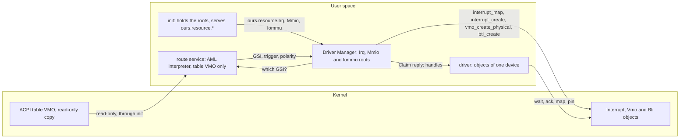
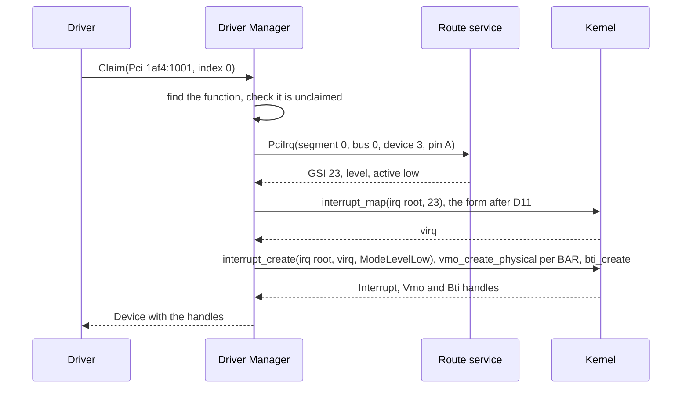

# driver-manager: a resident service that hands drivers capabilities, designed now and built in P3

**Date**: 2026-10-31
**Status**: Proposed

## Problem

Today a driver is handed the roots whole. init holds the interrupt, I/O port, MMIO and IOMMU roots as startup handles and serves each as a built-in `ours.resource.*` protocol that returns a duplicate of the root to any component routed it (`system/service/init/init.cpp:238-277`, `system/service/init/resource_server.cpp`, `system/service/init/builtins.json`). `root.cm` offers `Irq` and `Ioport` to routing_checks and pc-ps2, and `Mmio` and `Iommu` to routing_checks (`kernel/products/image/dev/BUILD.gn`). A driver then names hardware numbers itself: pc-ps2 asked the kernel for ISA 1 (`system/driver/pc-ps2/pc_ps2.cpp`, `take_line`; since the route service it asks that, and gives the kernel the GSI it answers, until a Driver Manager hands it an interrupt), and the virtio-blk driver applies QEMU q35's wiring rule and a hard-coded ECAM base (`.agents/tasks/driver-capabilities/RESULT.md`, sections 1 and 3).

Three things push for a change now. The grant is all or nothing, and the narrowing call does not exist (`docs/repairs/261030/kernel-object.md`, item 2). `interrupt_map` has lost `Isa` and `kind` (interrupt-system D11, `docs/changes/261031/syscall.md`), so some user-space component has to say which GSI the keyboard is on. And nothing in the tree gives user space the ACPI tables: the kernel maps them from the RSDP for its own use (`kernel/platform/pc/acpi.cpp`, the MADT in `kernel/platform/pc/interrupt.cpp:83-89`), no hit for DSDT or SSDT exists under `kernel` or `system`, `kernel/lib/acpi/include/acpi/structures` has no MCFG decoder, and `routing_checks.cpp:683-689` hard-codes the ECAM base.

The user made four decisions on 2026-10-31, recorded as U1 to U4 below. Everything else here is a proposal.

## Goals and non-goals

Goals:
- One place holds the device roots, and a driver holds objects for its own device only.
- The one party that turns untrusted firmware bytes into answers holds no hardware power.
- A version 1 that hands out capabilities and nothing else, with no kernel change beyond the table VMO (U2).
- Narrowing resources (`kernel-object.md`, item 2) is not a prerequisite.

Non-goals (later work, not designed here): matching a driver to a device, starting drivers, hot-plug, lifecycle and restart, MSI and MSI-X, PCI bridges, a hardware IOMMU, power management, and an object form of I/O ports.

## Design

The invariant to defend: **the party that may name hardware numbers holds the roots; the party that parses untrusted firmware bytes (the AML interpreter) holds none.** The route service below is the second party, the Driver Manager the first, and a driver is neither.

### Three roles

| Role | Holds | Reads untrusted bytes | Invariant it protects | Who accesses it concurrently | Worst failure |
|---|---|---|---|---|---|
| Route service | A read-only duplicate of the table VMO, one channel to the Manager | AML, the MADT, the MCFG | An answer depends on the tables and the question only: no hardware, no state kept between questions | The interpreter changes its own namespace while it evaluates, so one question at a time on one Loop thread, as init does (`resource_server.hpp`, D16) | A crafted table or an interpreter bug takes the process: it can lie or hang, and cannot touch hardware. A hang blocks the Manager unless it asks with a deadline |
| Driver Manager | The Irq, Mmio and Iommu roots, the claim table, one Bti per device | Config space of each function: ids, BAR sizing, the capability list. A device controls these bytes | Each device is claimed by at most one live driver, and each handle handed out reaches one device | Claims from several drivers at once; the claim table is the shared state, serialised by one Loop thread. The kernel arbitrates an interrupt line (`AlreadyBound`), but nothing arbitrates two VMOs over one BAR until exclusive ranges exist (`kernel-object.md`, item 6), so the table is the only arbiter for BARs | A bug or compromise hands out a root or the wrong device. It holds everything, so it stays small |
| Driver | The objects of one device | Whatever its device sends back | It touches only what it was handed, and its death returns it: handles close with the process | Its own threads against the device; one thread may wait on an Interrupt, a second gets `BadState` (`syscalls.gni`, `interrupt_wait`) | DMA to any address, since the stub IOMMU isolates nothing (`kernel-object.md`, item 3), and a config-space VMO lets it move its own BARs. Same trust level as today, not worse |

A lying route service can misroute an interrupt, never reach a device. The Manager does not trust its answers more than the kernel lets it: `interrupt_map` answers `NoResource` for a pin that does not exist, and the MMIO deny list refuses RAM and the kernel's devices.

### Protocols (names proposed, not a wire format)

Route service, `ours.acpi.Route`, offered to the Manager only; every answer is `(gsi, trigger, polarity)` or NotFound:
- `IsaIrq(isa)`: the MADT's interrupt source override for that ISA IRQ, or the ISA default (edge, active high) when there is none. A static table, no AML. It is what gives pc-ps2 its GSI now that `Isa` is gone (U4), asked of the service by the driver itself until the Manager exists.
- `PciIrq(segment, bus, device, pin)`: the `_PRT` row.
- `DeviceIrq(hid, uid)`: the `_CRS` interrupt of an ACPI device.
- `EcamBase(segment)`: `(paddr, first_bus, last_bus)` from the MCFG. Not in the user's list: see Decisions D3.

Driver Manager, `ours.driver.Manager`, one connection per driver:
- `Claim(id)` returns a `Device`: a list of kinds with one handle each. `id` is `Pci{vendor, device, index}` or `Isa{irq}`. Kinds: `Config` (a VMO over the function's 4 KiB ECAM page), `Bar(n)` (a VMO from `vmo_create_physical`), `Interrupt` (made with the mode the route service gave, for example `ModeLevelLow`), `Bti` (a duplicate). A VMO and a Bti carry Transfer and Duplicate by default (`kernel/object/include/ours/object/vmo_dispatcher.hpp:23`, `bti_dispatcher.hpp:20`, `system/public/ours/rights.hpp:55`), as does an Interrupt (`syscalls.gni`, `interrupt_create`). Errors: NotFound, AlreadyBound, Unavailable (the route service did not answer in time).
- Release is the claim channel closing. There is no message for it.

The driver names the device it can drive, and the Manager checks that it exists and is free. That is a pull, not matching: the Manager never decides which driver runs.

The route question comes first, so a failed question leaves nothing to undo.

### Version 1 and PCI enumeration

Version 1 is the claim above plus the claim table. Out: matching and binding rules, starting drivers, hot-plug, restart, MSI, bridges (so `PciIrq` only for root-bus functions, the case q35's rule covers today), Acpi ids that need `DeviceIrq`.

The Manager enumerates PCI itself. It already holds `Mmio` and gets the ECAM base from the route service, and a loop over bus, device and function reading ids and sizing BARs needs no power that claiming does not. A separate bus driver would need the MMIO root too, until a narrowing call exists, and adds a protocol and a second failure domain. The price is that the Manager parses bytes a device controls while holding the roots, so the walk of the capability list needs a visit limit. Split it out when bridges, hot-plug or MSI-X make the Manager grow.

### Failure

- A driver dies: its handles close with the process, so the Interrupt object is destroyed, the line detaches and stays masked (`syscalls.gni`, `interrupt_create`; interrupt-system DESIGN, "Life of a line"). The Manager sees `PeerClosed` on the claim channel and frees the claim. It never keeps the only handle to a Bti: it keeps a duplicate and hands out duplicates, which is the rule (a) of `kernel-object.md`, item 4, so a restarted driver can call `bti_release_quarantine`. It keeps no duplicate of the Interrupt, which would hold a line nobody serves.
- The Manager dies: a kernel object lives until its last handle closes, so every Interrupt, BAR and Bti already in a driver keeps working. That answers the open question of interrupt-system DESIGN.md. Lost: the claim table, the Bti duplicates (so item 4's protection), and new claims. A restarted Manager cannot rebuild the table, since `AlreadyBound` for a line looks the same for a live driver and a leak. Policy for later: restarting the Manager restarts its drivers. In version 1 nothing restarts: init never starts an exited component again and routes to it answer NotFound (`system/service/init/realm.cpp:840-850`, `:921`, component-framework D23), so a dead Manager stays dead.
- The route service dies or hangs: `Claim` answers Unavailable after a deadline, running drivers are unaffected.

### What happens to the existing pieces

- init and the built-ins stay as they are. `root.cm` offers `Irq`, `Mmio` and `Iommu` to the Manager instead of to drivers; routing_checks keeps its offers, since it tests the kernel calls.
- pc-ps2 replaces its `ours.resource.Irq` use with `ours.driver.Manager` and takes its Interrupt from `Claim(Isa{1})`, with no `interrupt_map`. It keeps `ours.resource.Ioport`, whole, as today: ports have no object form, so the narrowing call is still needed to take that root away. Its self-check of `AlreadyBound` and of the line coming back (`take_line`) needs the Irq root and moves to routing_checks.
- The virtio-blk driver on `exp/fs-service` is not in this repository (not checked). Until P3 it keeps what `RESULT.md` describes. At P3 its three resource uses become one `Claim(Pci{1af4, 1001, 0})`, and the ECAM base and the q35 rule go away. A transitional device's BAR 0 is I/O ports (`RESULT.md`, section 0), so it needs the modern memory BARs, or `Ioport` as above.
- Phasing: the route service is step 8 of interrupt-system P2 and may start with `IsaIrq` and `EcamBase`, which need no interpreter. The Manager is built in P3 (U3). Until then pc-ps2 and the virtio-blk driver ask the route service themselves and make the kernel calls with the roots they hold.

Counterpart, from memory and not checked here (no Fuchsia checkout in this container): the PCI bus driver serves each function's BARs, interrupt and BTI to its driver as handles, and ACPI is evaluated in the board driver (`pci_irqs.cc:29`, `:206`, as cited in microkernel-interrupts DESIGN D4).

## Alternatives considered

- **One component for everything.** Simplest. Rejected: the AML interpreter and the roots would share an address space, so a crafted table is root power.
- **Narrowed resources, and drivers call `interrupt_map` themselves.** Rejected: `interrupt_map` demands the root, not a range, because a range cannot say which firmware numbers it covers (`kernel/lib/syscall/src/interrupt.cpp:76-85`), so the narrowing call alone does not remove the root from the driver.
- **The kernel evaluates AML.** Rejected in microkernel-interrupts D4.
- **The route service hands the driver a GSI.** That is P1 today: the driver needs the Irq root and a number.
- **The Manager starts each driver and gives it a bootstrap channel.** Identity by construction, but it moves drivers out of `root.cm` and needs startup-handle plumbing. See D5.
- **A separate PCI bus driver now.** See the enumeration paragraph.

## Decisions

| Decision | Options | Recommendation | User's prediction | Decided |
|---|---|---|---|---|
| U1. A resident Driver Manager | None offered | None | None | 2026-10-31, the user: user space gets a resident Driver Manager that provides drivers with a set of capabilities |
| U2. How ACPI tables reach user space | None offered | None | None | 2026-10-31, the user: as a read-only VMO, and no MmIo root is needed to read it. What it holds was settled with step 8a of interrupt-system P2 (see D3) |
| U3. When the Manager is built | None offered | None | None | 2026-10-31, the user: designed now, built in phase P3, and P2 continues without it |
| U4. `interrupt_map` | None offered | None | None | 2026-10-31, the user: it will lose `Isa` and `kind` (interrupt-system D11), so a user-space component must give the keyboard's GSI |
| D1. Roles | (a) one component; (b) route service, Manager, drivers | (b) | None | Open |
| D2. Where the route service lands | (a) with the Manager in P3; (b) alone in P2 as step 8, asked directly by its callers | (b): U3 holds, and D11 is not delayed, since `Isa` goes only once something answers for the keyboard | None | Open |
| D3. What the table VMO holds | (a) DSDT and SSDTs only; (b) every table the RSDT lists, copied whole | (b): `IsaIrq` needs the MADT and `EcamBase` the MCFG, and neither is AML. With (a) the overrides and the ECAM base need another path to user space | None | (b), 2026-10-31, the user: approved at step 8a as a directory of every table (a count, then a signature, offset and length for each, then the bytes) |
| D4. What a driver is handed | (a) objects; (b) narrowed resources | (a), with the I/O port exception above | None | Open |
| D5. How the Manager knows who asks | (a) the request names the device and routing is the gate, as for `ours.resource.*` today; (b) one protocol name per driver, renamed with `as` in `root.cm`; (c) the Manager starts the drivers | (a) now, (b) before a second untrusted driver. With (a) any component routed the protocol can claim any device | None | Open |
| D6. Who enumerates PCI | (a) the Manager; (b) a separate bus driver | (a) | None | Open |
| D7. Failure policy | (a) the Manager keeps Bti duplicates and no Interrupt duplicates, and restart waits for the framework; (b) it also keeps Interrupt duplicates | (a) | None | Open |
| D8. The AML interpreter | (a) a third-party library; (b) written here | Decide when `_PRT` is needed. Any library needs the user's approval and `vendor-import` | None | Open |

## Testing and verification

Nothing here is built. When it is:
- Host: the route service on the `_PRT` the firmware gave a booted q35 guest (`docs/repairs/261031/x86-apic.md`, item 2), on a second machine whose routing differs (QEMU `pc`), on a truncated table and on one that loops. The last two must answer an error at the deadline.
- Boot: `ours-verify` on both images, with `pc-ps2: key a` and `pc-ps2: key A` through the Manager. With `DISK=`, the virtio-blk driver claims its device and receives an interrupt, which is also the first time a device interrupt is observed (`RESULT.md`, Verification).
- Failure: a driver that exits with a pin outstanding, then a second claim releases the quarantine through the Manager's Bti duplicate. A Manager that exits while a driver waits. No kill call exists (`docs/design/261004/component-framework.md:49`), so the test components exit by themselves.
- Not verifiable: real hardware, link devices, bridges, MSI.

## Open questions

- Does the interpreter need OperationRegions (SystemIO, SystemMemory, PCI_Config)? With no roots it cannot. q35's `_PRT` is static; a real board's link devices read chipset registers. Serving those accesses through the Manager keeps the invariant and adds a callback loop. Decide with the first real board.
- Which table VMO reaches init, and as which built-in? Answered at step 8a (2026-10-31, the user): the built-in protocol is `ours.boot.Acpi`. A VMO is not a resource, so `ResourceServer` is a misleading class name for serving it; whether to rename it is left to that step.
- Can `kernel/lib/acpi` build for user space to decode the static tables (it has a `PhysMapper` seam and host tests)? Not checked.
- A BAR smaller than a page shares its page with other registers, since `vmo_create_physical` takes whole pages (`RESULT.md`, section 1).
- How `Claim` carries MSI vectors when P3 of interrupt-system lands.
