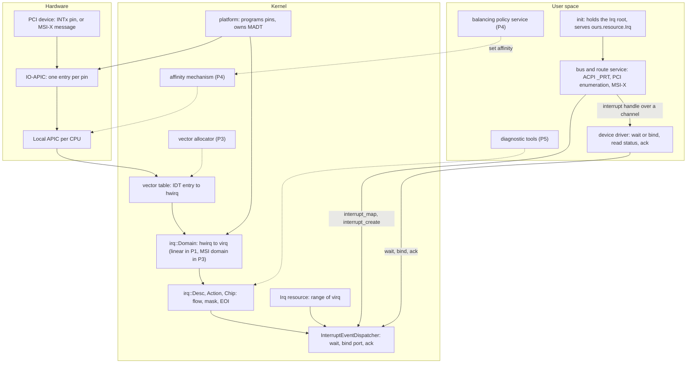
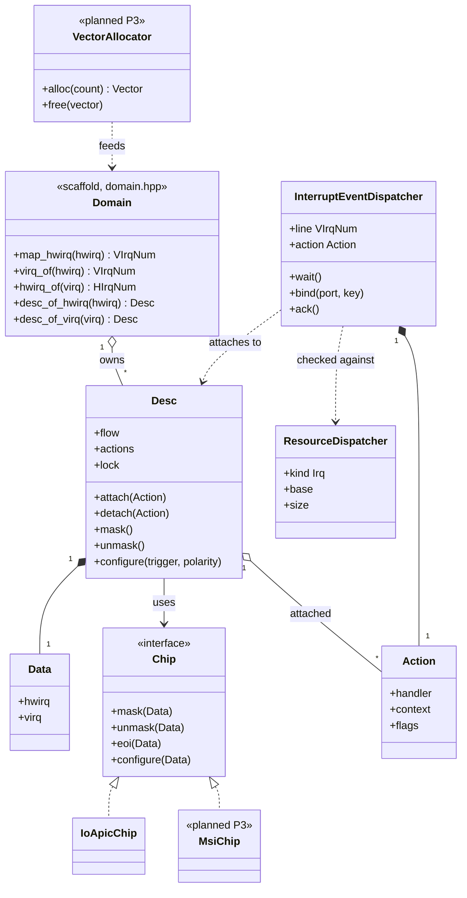
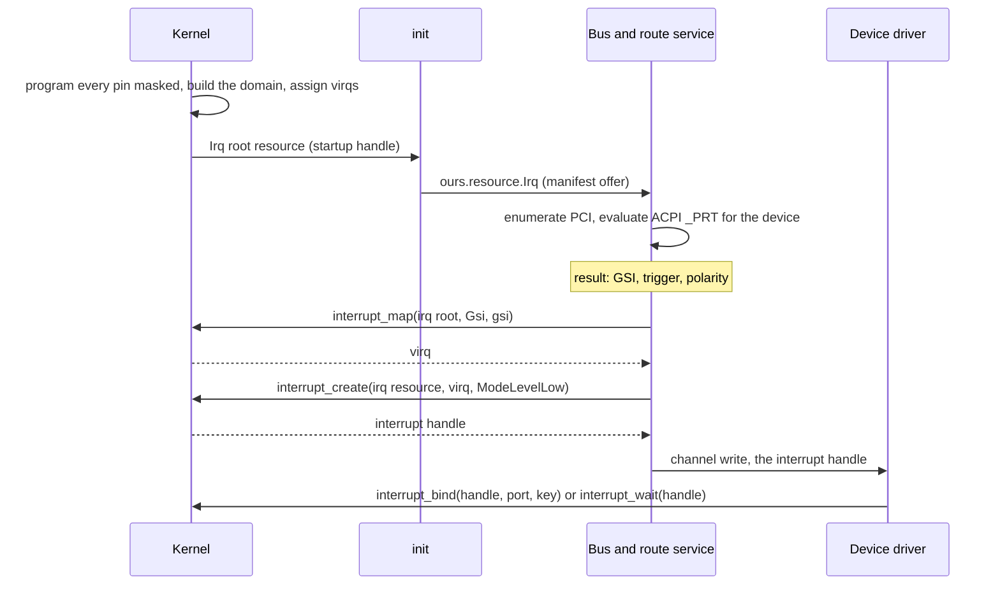
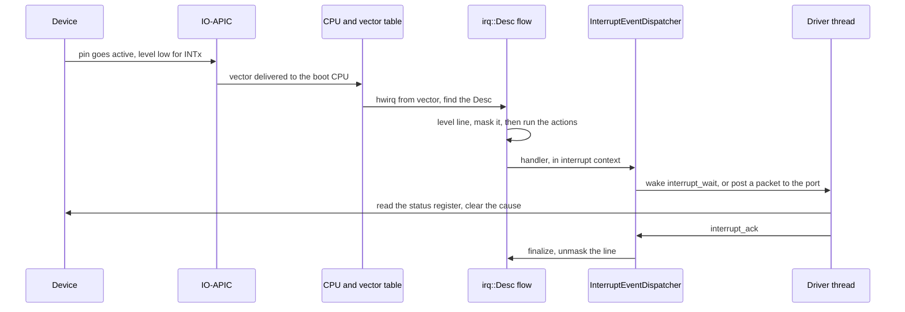
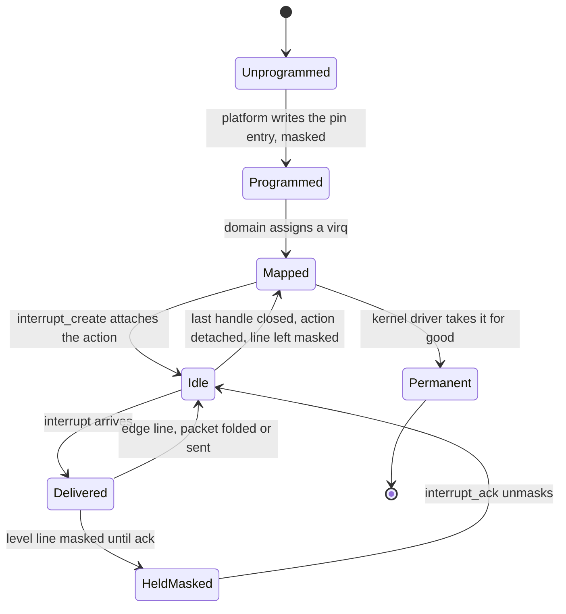

# interrupt-system: the final shape of interrupts, the kernel's virtual interrupt number, and the road there

**Date**: 2026-10-31
**Status**: Proposed

## Problem

A userspace virtio-blk driver (`.agents/tasks/driver-capabilities/`, requirement R4) needs the interrupt of a PCI device. The interrupt layer built so far (`.agents/tasks/microkernel-interrupts/`, `.agents/tasks/irq-genirq/`) serves ISA lines to user space, and names every interrupt by its GSI (microkernel-interrupts D7). Three things forced a wider design than "register the remaining pins":

- On 2026-10-31 the user decided that user programs must not handle GSIs: they use the kernel's own virtual interrupt number. A GSI is an x86 and ACPI concept; ARM has GIC numbers, RISC-V has PLIC sources, and an MSI has no GSI at all.
- The user asked for one map of the final shape, with the kernel side and the user side separated, and a plan that is a compromise for now and an expected design for later (recorded in `.agents/tasks/driver-capabilities/DESIGN.md`, R4).
- The user's weekly budget is short, so the plan has to be complete enough to be picked up at any step without rereading the history.

What exists today (read from the tree on 2026-10-31): `platform_init_apic` programs only the pins ISA lines reach, with vector `PlatformIrqMin + GSI`, and `irq::init_lines` builds a flat table of lines named by GSI (`kernel/platform/pc/interrupt.cpp`). The generic layer has `irq::Desc`, `Action`, `Chip`, `Data` and the flows; `domain.hpp` is an empty scaffold; `VIrqNum` and `HIrqNum` are distinct types that are forced equal. `interrupt_create(resource, line, options)` makes an `InterruptEventDispatcher` on a line, gated by an Irq resource, with `RemapIrq` turning an ISA number into its line.

## Goals and non-goals

Goals:
- One final architecture, with the kernel's duties and the user's duties each named, and a rule for which side a new duty belongs to.
- A user ABI that never exposes a GSI to a device driver, and that does not change when MSI, dynamic vectors and CPU affinity arrive.
- A first phase that makes PCI INTx work for the virtio-blk driver with the least kernel change, whose numbers and calls are already the final ones.
- Every phase landable in small commits, each verified by `ours-verify`, with its triggers written down so nothing is built early.

Non-goals:
- An AML interpreter in the kernel (microkernel-interrupts D4 keeps AML and `_PRT` in a user-space ACPI component).
- In-kernel threaded handlers (irq-genirq D3).
- Interrupt remapping, x2APIC, and any port to ARM or RISC-V: the ABI is kept neutral, the implementations are not planned here.
- Performance work. Any performance item found goes to `docs/repairs/` and is put to the user first.

## Design

### Three number spaces

| Space | What it is | Who sees it | Today |
|---|---|---|---|
| hwirq (GSI on a PC) | The firmware's number for one pin of one controller | The platform code, and the trusted service that reads ACPI | Everyone |
| virq (`VIrqNum`) | The kernel's number for an interrupt source; what `interrupt_create` takes and what the irq layer names a line by | Every user program that holds an interrupt | Forced equal to the GSI |
| vector | The CPU's number for an interrupt entry | The kernel only | `PlatformIrqMin + GSI` |

The rules of the final design:
1. The user ABI speaks virq. A device driver never sees a GSI or a vector.
2. A GSI appears in exactly one call, `interrupt_map`, made by the one trusted service that reads the firmware tables.
3. A virq is whatever the kernel assigns. Programs do not compute with it, do not assume it equals a GSI, and do not assume it is the same on the next boot or the next kernel.
4. Better than a number: a device driver is handed an interrupt handle by whoever set it up, and holds no number at all.

### Component view

The final shape. Solid boxes exist today; the planned ones carry a phase.



In P1 the bus service and the device driver are one component (zcode's driver), which makes the two calls itself.

### Kernel objects



`Data` already carries both `hwirq` and `virq` (`kernel/include/ours/irq/chip.hpp`). `Domain` is the missing piece; irq-genirq D4 deferred it to MSI. The new requirement brings a minimal linear domain forward (decision D3), and leaves the MSI domain and the vector allocator for P3.

### The call that turns hardware into a virq

```text
interrupt_map(resource, kind, hwirq, out virq) -> Status
    resource  an Irq resource that is the root (decision D4)
    kind      InterruptSourceKind: Isa, Gsi; later Msi; other architectures add their own
    hwirq     the number in that kind's space
    out virq  the kernel's number for it
    BadHandle, BadType, AccessDenied (not the root), InvArgs (unknown kind), NoResource (no such source)
```

- The mapping is made at boot for every pin the platform programs, and `interrupt_map` looks it up. A source that does not exist is `NoResource`, as `interrupt_create` already answers for a line that does not exist.
- `Isa` translates through the MADT's overrides, which is what `RemapIrq` does today. `RemapIrq` stays through I3, now yielding a virq, and is retired in I4b once pc-ps2 and the tests use `interrupt_map` (D5).
- `interrupt_create(resource, virq, options)` is unchanged except that `line` is a virq. The resource must cover that virq, so a resource narrowed in P2 limits a driver to its own interrupt.
- Trigger mode and polarity stay in `interrupt_create`'s mode option (`ModeLevelLow` for PCI INTx), not in `interrupt_map`: they are how the line signals, and the driver or bus service already knows them.

### How a device gets its interrupt



In P1: one component does the first half itself, because the `_PRT` service does not exist yet (microkernel-interrupts D4). Where it takes the GSI from is open: the device's Interrupt Line register is not it, since the virtio-blk reads 11 there (see Open questions). Decide before I5.

### One interrupt, from device to driver



The driver must clear the device's cause before `interrupt_ack`; a level line left asserted fires again as soon as it is unmasked.

### Life of a line



A driver that dies closes its handle; the object is destroyed, the action leaves the line, the line stays masked. That is the whole recovery path, and it is already implemented.

### Responsibilities

| Duty | Side | Why (the rule: privilege, interrupt context, or isolation) |
|---|---|---|
| Write IO-APIC and local APIC registers, EOI, mask | Kernel | Privilege |
| Vector table and dispatch from vector to line | Kernel | Privilege, interrupt context |
| Allocate vectors, MSI blocks | Kernel | Isolation: two drivers must not get the same vector |
| Hwirq to virq mapping | Kernel | The namespace is the kernel's |
| One owner per line, the kernel's own lines refused | Kernel | Isolation |
| Flow (edge or level), spurious and storm protection | Kernel | Interrupt context |
| Deliver to the waiting thread or port | Kernel | Interrupt context |
| Decide which GSI a device uses (ACPI `_PRT`) | User | None of the three: policy |
| PCI enumeration, MSI and MSI-X capability setup in the device | User | Policy, and the device's registers are reached through resources |
| Which queue of a device gets which interrupt | User | Policy |
| Balancing across CPUs | User | Policy; the kernel only supplies the mechanism to set a target |
| Handing an interrupt handle to a driver | User | Capability passing over a channel |

### Phases

| Phase | What changes | New or changed ABI | Triggered by |
|---|---|---|---|
| P1 (now) | Every IO-APIC pin is programmed and has a line; a linear domain gives virqs; `interrupt_create` takes a virq; `interrupt_map` is added; pc-ps2 moves to it and `RemapIrq` is retired (I4b, D5); a virtio-blk device exists in the test machine | `interrupt_map`; `line` means virq; `RemapIrq` retired | R4: the virtio-blk driver |
| P2 | A user-space route service evaluates `_PRT`; a narrowing syscall cuts an Irq resource to one virq | A narrowing call (already in `docs/repairs/261030/kernel-object.md`) | A second PCI driver, or the need to isolate drivers |
| P3 | Vector allocator, MSI domain and chip, MSI blocks by syscall, an MSI System slot, MSI-X in the PCI driver, fallback MSI-X, MSI, INTx | `msi_allocate`-like calls and a slot | A device that needs several vectors, or latency |
| P4 | Per-CPU vector tables, a target CPU per source, migration on CPU hot-unplug, balancing service, x2APIC, several IO-APICs | A call to set a source's target | Spreading interrupts across CPUs |
| P5 | Storm protection, per-source counters, `irq` kshell command and a shell tool, interrupt remapping with a real IOMMU | None | A real stuck line, or the IOMMU work |

## Alternatives considered

- **Keep the GSI as the user-visible number (microkernel-interrupts D7, as built).** Smallest change, matches Zircon's `interrupt_create(src_num)`. Rejected by the user on 2026-10-31: it ties every driver to the x86 numbering and has no place for an MSI.
- **No number at all: `interrupt_create` takes a hardware description and returns a handle.** The cleanest in capability terms, and it removes the map call. Not chosen because the user asked for a virtual interrupt number, and because MSI blocks and kernel-side bookkeeping want a stable name for a source anyway. It remains available later as an additional form.
- **A full Linux `irq_domain` now, with a sparse descriptor tree.** Linux has two separate lookups, and this plan treats them separately. virq to descriptor: a static array (a kernel without SPARSE_IRQ) or a tree of descriptors made on demand (SPARSE_IRQ). hwirq to virq inside a domain: a linear array indexed by hwirq, or a radix tree for a hwirq space that is large, sparse or unbounded. P1 needs neither tree. Every IO-APIC pin is known at boot from the MADT, so nothing is created at run time. The interrupt path (vector to hwirq to descriptor) is read in interrupt context without a lock, which a table written once before any line is unmasked allows and a tree that changes would not: it needs RCU or a lock, and whether the kernel has RCU was not checked. The first lookup to become dynamic is virq to descriptor, at P3, when MSI blocks make descriptors at run time; `DescTable::irqnum_to_desc()` and `find_line()` are its only readers, so the change stays inside them. Rejected for P1: the cost is paid and nothing uses it (irq-genirq D4 said the same). A linear domain is the smallest honest form and grows into the rest. The Linux details here are from memory and from the citations in irq-genirq, not checked against the source.
- **Identity virq for good, until MSI.** Cheapest, and it keeps `domain.hpp` as scaffolding as irq-genirq D4 recommended. Rejected as a recommendation here because nothing then proves that a program does not depend on virq equalling the GSI: the mapping is never exercised (D3).
- **The kernel evaluates ACPI and tells drivers their interrupt.** Rejected: AML is policy and a large trusted interpreter in ring 0 (microkernel-interrupts D4).
- **A Zircon-style split without a virq (kernel table `dev_pin_to_global_irq` handed in from user space).** Worth keeping in mind for P2: it lets the route service tell the kernel the `_PRT` instead of each driver deriving a GSI. Not needed for P1.

## Decisions

| Decision | Options | Recommendation | User's prediction | Decided |
|---|---|---|---|---|
| D1. What a user program names an interrupt by | (a) the GSI; (b) a kernel virq | (b) | None | (b), 2026-10-31: "I do not want user programs to handle GSIs directly; they use our virtual interrupt number" |
| D2. How a program learns its virq | (A) the bus service holds numbers and hands drivers interrupt handles; (B) a call `interrupt_map` for the trusted service; (C) the kernel enumerates devices | A and B together | None | A and B together, 2026-10-31, as recommended ("可以"). In P1 zcode's driver is both the bus service and the driver, so it holds the whole Irq root: isolation between drivers starts with the narrowing call of P2 |
| D3. How virqs are assigned in P1 | (a) identity with the GSI until MSI; (b) a linear domain now, virqs deliberately not equal to GSIs (for example `0x100 + index`) | (b), so that a dependence on equality fails in the first test | Asked on 2026-10-31 which of the two lookups fails first when MSI arrives; not answered | (b), 2026-10-31, as recommended, in two parts after the user asked why not Linux's sparse irq and tree domains: (i) the rule, a virq is assigned by the kernel and is not the GSI, whatever the structure; (ii) the structure, a linear domain with a flat virq-indexed `DescTable`, changing at P3 (see Alternatives). It brings forward what irq-genirq D4 left for MSI; the user approved that departure with this decision |
| D4. What `interrupt_map` requires | (a) the Irq root; (b) a resource covering the hwirq; (c) a new System slot | (a): an Irq resource's range is in virq space after D1, so a resource "covering the hwirq" would compare numbers from two spaces | None | (a), 2026-10-31, as recommended |
| D5. `RemapIrq` | (a) keep until pc-ps2 uses `interrupt_map`, then remove; (b) remove now; (c) keep for good | (a) | None | (b), 2026-10-31, the user's choice over the recommendation, after being shown that it is the one place `interrupt_create` takes an ISA number and not a virq. Read as: not in I3, because pc-ps2 has no other way to name its line until `interrupt_map` exists, but in a step of its own after I4 (I4b). The option bit `0x1` is retired and not reused, since option values are ABI: a create that sets it answers InvArgs. The user confirmed this reading on 2026-10-31 |
| D6. Test device | (a) a virtio-blk behind a `DISK=` variable of `scripts/qemu_boot.py`, off by default; (b) always present; (c) none | (a) | None | (a), 2026-10-31, as recommended |
| D7. Where `_PRT` is evaluated | (a) a user-space ACPI component; (b) the kernel | (a) | None | (a), 2026-10-04, microkernel-interrupts D4 |
| D8. Vectors and MSI | (a) static `PlatformIrqMin + GSI` now, a bitmap and a syscall with P3; (b) dynamic now | (a) | None | (a) for now, 2026-10-31, the compromise; P3 is the expected plan |

## Testing and verification

- P1 kernel: a kshell test that `interrupt_create` on each programmed pin (virq from the domain) succeeds, that a second one is `AlreadyBound`, that a pin past the vector range has no line, and that the domain's two directions are inverse. A mutation of the mapping must fail it.
- P1 user: `routing_checks` asks `interrupt_map` for an ISA number, a GSI, an unknown kind (`InvArgs`), a source that does not exist (`NoResource`) and a narrowed resource (`AccessDenied` once P2 exists), then `interrupt_create` on the result.
- P1 device: with `DISK=` set, a driver sees a virtio-blk, raises its interrupt, and receives it through `interrupt_wait`. Not verifiable in the images `boot_check` boots by default, which have no device.
- Every phase: `ours-verify` on both images; clang-tidy and clang-format on changed lines.
- Not verifiable here: real hardware, MSI before P3, other architectures.

## Open questions

- Where does the P1 driver get the GSI of its device? The Interrupt Line register does not hold it: with `DISK=` set, QEMU 8.2.2 and Ubuntu's OVMF 2024.02 (not the QEMU 11.1.1 and edk2 the project normally boots, so repeat it there), `info pci` shows the virtio-blk at bus 0, device 3, function 0 as `1af4:1001`, `IRQ 11, pin A`, after the guest has booted. 11 is below 16, which is where q35 puts its PCI interrupt pins as far as is known (not checked here). The options are a q35 routing rule from the slot and the pin, reading the ACPI `_PRT`, or looking for which pin fires; a choice between approaches, so the user's. Decide before I5.
- Should `interrupt_map` also carry trigger mode and polarity, so that a source is fully described in one place? It would make `ModeDefault` readable from the mapping instead of the pin entry.
- Are virqs stable across boots? If drivers may cache one, they must; the recommendation above says no.
- Where do virqs start? Answered in I3 (2026-10-31, the user's choice of a start at 32 on this machine): the first multiple of 32 past the highest hardware number (`Domain::VIRQ_ALIGN`), so every virq is above every GSI of the machine and a GSI used as a virq answers NoResource instead of silently naming another pin. The line table is indexed by hardware number, so the start costs no empty slots.
- What number range does the virq space keep for MSI blocks, and does an Irq resource's range span both?
- How do ARM and RISC-V name a source (device-tree cells, PLIC ids)? The `kind` field must be able to hold them without a new call.
- Where the interrupt handle goes when a bus service restarts: does the device driver keep working, or must it be restarted too?
