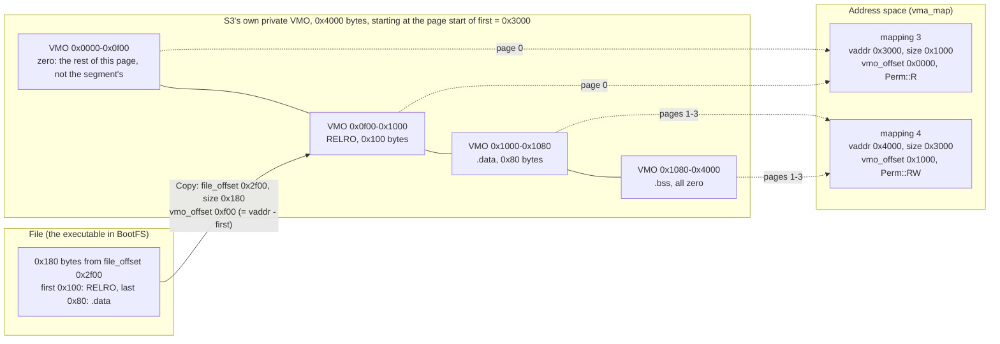

# launch-plan-exercise: how a writable segment becomes a private VMO and its mappings

**Date**: 2026-09-29

The writable segment S3 of the `TypicalLayout` test in `system/lib/launch/test/plan_test.cpp`: `vaddr` 0x3f00, `file_offset` 0x2f00, `file_size` 0x180, `mem_size` 0x2180, RELRO `{0x3f00, 0x100}`. Its `first` is 0x3000 and its `end` is 0x7000, so its private VMO is 0x4000 bytes. The numbers are the ones the test expects.

## Reading it
- Every writable segment has a private VMO of its own, and offsets in it count from 0 at that segment's `first`. Nothing accumulates from one segment to the next.
- `Copy.vmo_offset` (0xf00) is where the segment's first byte sits in its VMO: a VMO is whole pages, and the segment starts partway into its first page. The bytes before it stay zero.
- `Mapping.vmo_offset` says where in that one VMO a mapping starts. RELRO cuts S3's VMO into two mappings of different protection: page 0 is wholly RELRO, so it is `R` at offset 0; pages 1 to 3 are `.data` and `.bss`, `RW` at offset 0x1000 (`page - first`). With no RELRO the segment is one mapping at offset 0.
- `Mapping.segment` is the index of the segment, 3 for both mappings, not the number of the private VMO among the private VMOs.
