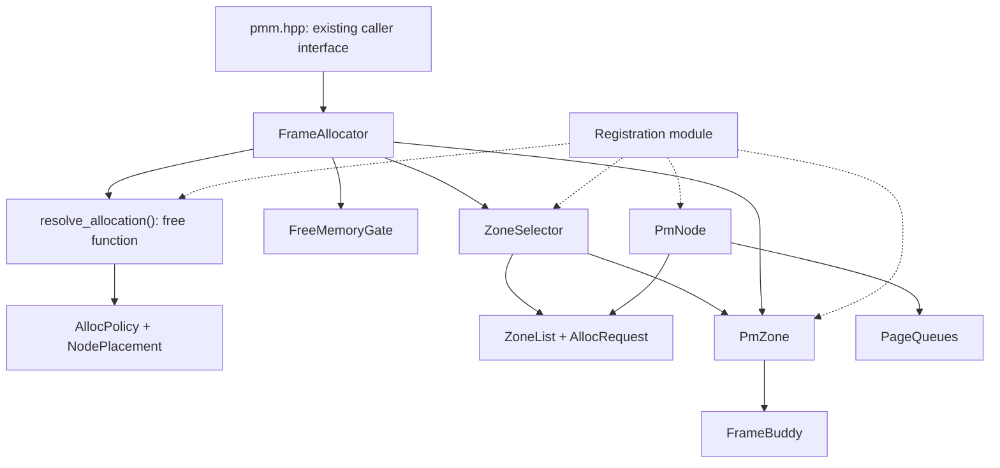

# pmm-responsibilities: organize physical allocation around ownership and decisions

**Date**: 2026-11-04
**Status**: Proposed

## Problem

The user asked for a PMM object design in which names express responsibility: registration, sourcing, creation, selection, conversion, policy, and execution. The current tree at `f7b22de4` mixes registration, CPU placement, allocation orchestration, and per-node resources in `PmNode`; `PmZone` also owns the global zone registry. Allocation policy, admission, and public adapters are spread between these classes and `pmm.cpp`.

This is a design proposal, not a kernel implementation. The preceding review is `.agents/tasks/pmm-design-review/REVIEW.md`. The naming table below supersedes the longer class names in the first proposal. Its corrected premise is retained: `get_frames_n()` and `alloc_frame_n()` already convert a minimum page count to a buddy order. Rounding to a power-of-two block is a valid allocation contract. That conversion is not a reason to replace the allocation interface.

Reference: the local Zircon `pmm_alloc_page`, `pmm_alloc_pages`, and `pmm_alloc_contiguous` declarations in `/Users/smallhuazi/Workspaces/projects/fuchsia/zircon/kernel/vm/include/vm/pmm.h`, `PmmNode::AllocPage/AllocPages/AllocContiguous` in `include/vm/pmm_node.h`, and the delegation in `kernel/vm/pmm.cc`. This design preserves this project's NUMA/zone model, rather than copying Zircon's single global node.

## Goals and non-goals

- Give each shared fact, invariant, and decision one owner, with names that describe the role.
- Centralize one complete allocation or release operation, including resolution, admission, fallback, zeroing, rollback, and pressure notification.
- Preserve the order-based block contract, count helpers, direct-map helpers, separate single-page wait protocol, strong address types, and upper-layer reclaim.
- Keep fixed boot-time storage, early allocation, descriptor layout, initialization stages, and the existing CPU-local model usable before the heap or per-CPU caches exist.
- Separate structural migration from behavior changes such as zone ordering and watermark admission.
- Do not add a Source, Provider, Factory, Builder, Resolver, Router, or Coordinator class merely to cover every suffix. No new virtual allocation backend, public Pmm singleton, per-request heap allocation, arbitrary contiguous wait promise, hotplug implementation, or working per-CPU page cache is proposed.

## Design

### Naming vocabulary

The flags, policy/state, and count-helper naming slice is now implemented; see `.agents/tasks/pmm-naming/RESULT.md`. The remaining object decomposition in this document is still Proposed.

The user clarified on 2026-11-04 that Pm/Vm prefixes identify principal memory models, not every helper in those subsystems. Follow existing usage: PmNode, PmZone, VmObject, and VmArea identify major models; PageQueues, ProtectionRanges, ZoneList, and ZoneSelector express concrete supporting responsibilities. Nested Cursor, Builder, Attachment, and Enumerator names use their containing object's context.

Convergence means one term for one concept and enough context to identify it. Keep familiar names when their contract is clear. Do not encode every property or processing stage in a name, require a role suffix for each class, or apply a subsystem prefix mechanically.

| Earlier proposal/current spelling | Proposed spelling | Reason |
|---|---|---|
| FrameAllocationPlan | AllocRequest | Retain the existing immutable resolved request; resolution does not introduce a second concept. |
| ZoneFallbackOrder | ZoneList | Retain the existing name; ordering and fallback are part of its contract. |
| FrameAllocationGate | FreeMemoryGate | Retain the existing name for the global free-memory pressure protocol. |
| PlacementPolicy / MemoryAllocationPolicy | AllocPolicy | One concise term for the allocation policy. |
| MemoryAllocationState | AllocState | The thread member provides ownership context; retain the Alloc vocabulary. |
| Gaf | AllocFlags | Express the flags' role directly. |
| PmRegistry | Private registration module | Preserve the accepted file-scope registry design; no additional principal-model class. |
| PmNode / PmZone / NodePlacement / ZoneSelector / FrameBuddy / FrameAllocator | Retain | Coherent existing names or names that state the concrete responsibility already. |

The existing PageFrame/PmFrame double spelling is recorded as a separate consolidation candidate. This design does not infer a blanket prefix migration from the user's clarification. All specific renames remain proposals.

### Objects and state ownership

One concrete internal class is added: `FrameAllocator`. Registration moves into a private module. The other objects retain established names or use the shorter vocabulary above. These are design proposals, not implemented C++ changes.

| Object/module | Role and state | Principal operations |
|---|---|---|
| Registration module | One registration index for node identities, zone identities, and node state masks. Owns index storage and publication rules, not physical memory allocation. | Find a node; get a node's zone row; enumerate zones once; declare/publish boot registrations. |
| `PmNode` | A physical memory domain: identity, bounds, its page queues, and its fallback order. Borrows its zone row from the registry. | Inspect this domain's resources, queues, and fallback order. |
| `NodePlacement` | Runtime CPU-to-node relation, per-node CPU/affinity masks, and the existing per-CPU node-pointer cache. | Capture the current origin; claim/publish CPUs; maintain all sides of a CPU move. |
| `AllocPolicy` | The current `MemoryAllocationPolicy`, made an immutable rule object for Default/Preferred/Bind/Interleave. | Resolve placement restrictions/preferences from explicit inputs. |
| `AllocRequest` | The existing immutable `AllocRequest`, preserving its resolved contract. Holds order, effective node/zone limits, home node, origin, zeroing flags, admission mark, and pressure mode. | Read the resolved values; produce validated derived plans when needed. |
| `ZoneList` | The existing `ZoneList`: a boot-built sequence of borrowed zone references, distinct from the registry's by-identity index. | Expose a stable candidate order. |
| `ZoneSelector` | A short-lived range over one fallback order and one immutable plan. Its iterator owns traversal position. | Yield zones meeting node, zone, and watermark criteria. |
| `FreeMemoryGate` | The existing `FreeMemoryGate`: global pressure admission, watcher registration, and waiter/event state. | Admit, arm the watcher, notify on free-count changes, wait for an opening. |
| `FrameAllocator` | Organizes the full allocation/release operation. Uses registry queries and owns its pressure gate. | Allocate a block or batch; release; roll back; split an owned block into pages; wait for one page. |
| `PmZone` | One zone's allocation invariant: buddy state, zone lock, free/reserved accounting, watermark values, and the existing cache scaffold. | Try an allocation; return a block; report availability; maintain zone-local accounting. |
| `FrameBuddy` | The existing split/merge mechanism. Owns order lists; has no lock, placement policy, or global MemMap dependency. | Allocate/release power-of-two blocks. |

Registration remains a private module with file-scope tables/functions behind the existing query interface, preserving accepted D2 in `.agents/tasks/pmm-layering/DESIGN.md`. Its private publication functions enforce unique node/zone registration, constructed-before-publication order, and consistent masks/indexes. Nodes and zones no longer own machine-wide registration state. This responsibility does not require another public or principal-model class.

### Dependencies and composition

Solid arrows show calls or composition; dotted arrows show lookup/reference relationships. The allocator iterates the selector and calls `PmZone`; the selector itself never allocates. A fallback list may include other nodes' zones, so releasing a frame uses its own node/zone identity, never the request's home node.

No base class is added. Existing reference-counting and CPU-local mechanisms keep their specialized forms. The registry and fallback order do not duplicate ownership of zones: registrations are authoritative, fallback entries are immutable borrowed references.

### Registration, placement, and per-node resources

Move `PmNode::NODES`, state masks, and `PmZone::TABLE` into the registration module. Counts are derived from their authoritative registrations/masks rather than a second independently maintained count. Registry operations that publish nodes/zones are boot-only in this design. Storage remains bounded and allocated without the heap; node/zone objects retain their EarlyMem-backed lifetime. A registry entry cannot expose an unconstructed object.

Move CPU masks and the operations now called `PmNode::publish_cpu`, `publish_cpus`, `claim_possible_cpus`, and `set_cpu_node` into `NodePlacement`. This object then owns the table, reverse membership, and cached pointer as one relationship. The pointer remains a cache of the table, including the early miss fallback; the private CpuLocal storage model is preserved. Firmware placement and the distance matrix stay in `kernel/lib/numa`.

`PmNode` consequently has no allocation methods, global registry, or CPU publication protocol. It remains useful because a memory domain groups local zones, fallback order, and PageQueues. Existing unimplemented node-policy/cache scaffolding is retained, not removed as incidental cleanup.

Runtime rehoming requires a serialized, quiescent target CPU before updating its table/cache. No new concurrent hotplug semantics are implied. Preserve stable addresses for affinity-mask references used by caches. Before AP startup, firmware masks may still be completed; after publication they retain their current immutability contract.

### Policy and request resolution

`resolve_allocation()` is an ordinary function. It combines the caller's flags/order/node mask, optional explicit home node, a coherent origin snapshot, and placement policy into one immutable `AllocRequest`. It needs no identity or mutable state, so an `AllocationResolver` class would add no useful ownership.

`AllocPolicy` owns policy meaning and evaluates its restrictions/preferences. Its shared object is immutable after publication. The mutable Interleave cursor belongs to the requesting thread's `AllocState`, not in a policy shared by several threads. A single request must not advance the cursor again for every candidate zone or retry. Per-page Interleave semantics for batches need their own implementation tests before that policy kind is enabled.

Use the real `MM_ALLOCATION_POLICY` build setting. When disabled, allocation must not acquire the thread resource lock solely to copy a policy it cannot apply. When enabled, hold that lock only for the required state/policy snapshot, then release it before traversing zones, zeroing, or waiting. Allocation-disable checks still apply to both implicit-node and explicit-node entry points. Unsupported installed policies return an error until implemented; they do not silently act as Default.

Explicit node selection keeps the current entry-point precedence over thread-default placement; caller-supplied hard limits still apply. The accepted conditional `ThisNode` narrowing behavior is preserved during structural migration: if the caller excludes the home node, its mask is kept. Making that flag a strict locality constraint would be a separate behavior change.

The plan contains neither an iterator nor a wait event, live thread reference, resource lock, or mutable policy cursor. This keeps one resolved request representation rather than recreating the previous overlapping request/context/options objects.

### Selection and admission

`ZoneList` records order; `ZoneSelector` applies eligibility. Build each node's fallback order from the node sequence already calculated by `numa::build_fallback_orders()`, with ordinary eligible zone types before scarce low-address types inside each node. Keep the distance calculation out of allocation-time code. The change from Dma-first to Normal-first is a separate policy fix for `docs/repairs/261028/mm.md`, item 1.

Following the accepted D1, the selector applies the plan's resolved admission mark and the zone's availability predicate before yielding a candidate. `PmZone` retains the watermark values and the factual `watermark_ok()` query; it does not infer caller policy from thread state or raw flags. `High` is not an allocation refusal line. The request's resolved mark selects the applicable Min/Low admission criterion.

Approximate watermarks are a best-effort avoidance policy, not a strict reserve guarantee: concurrent selectors may pass the same precheck. The buddy still decides whether a block exists under the zone lock. A future strict reserve requirement would need a distinct design and atomic commit-time enforcement; this proposal does not silently relocate admission into the zone or claim such a guarantee.

Rename `Gaf` to `AllocFlags`. Replace the misleading DirectReclaim name with `CanBlock` only in the documented sense that the caller's context permits blocking; resolution may use that fact to select an admission mark, but PMM performs no direct reclaim or implicit sleeping. Represent pressure eligibility separately as `PressureMode::Immediate` or `MayDefer`; this is the present CanWait protocol, not a second meaning of CanBlock. Immediate pointer adapters do not accept the defer mode. Compatibility adapters for old flags reject invalid combinations in every build.

No general physical-address-ceiling or independently aligned allocation interface is added merely for a future device. A real constrained caller can extend the resolved plan and selector with those guarantees without changing the buddy's responsibility.

### Allocation, release, and ownership transitions

`FrameAllocator` has concrete work: context capture, request resolution, pressure gating, zone traversal, failure translation, batch rollback, zeroing, accounting notification, and release routing. It owns the private primitives that adapters would otherwise duplicate or bypass. It has no machine-wide allocation lock and is not replicated per node: node traversal can serve remote zones.

Representative operations are `allocate_block(order, ...)`, `allocate_pages(count, ...)`, `allocate_fragments(count, ...)`, `release_block(frame, order)`, `release_list(list)`, `split_block(frame, order)`, and `wait_for_page(...)`. Detailed parameter spelling follows the existing flags/order/node/mask interface; no public options class is introduced in this proposal. The pressure mode is explicit on the Result-returning path.

One allocation proceeds as follows:

1. Validate the order and entry-specific arguments; verify the thread may allocate. Capture CPU and local node as one origin snapshot under a short migration/preemption guard where required.
2. For MayDefer, consult `FreeMemoryGate`. A closed gate returns ShouldWait before any page is transferred. Resolve policy once for the actual attempt, without holding the thread lock across allocation.
3. Create the selector from the home node's fallback order and the plan. Ask each yielded zone for a block until one succeeds.
4. Within one zone lock, detach the block from the buddy and update authoritative free accounting together. The zone returns an Option; exhaustion here is an ordinary candidate failure. No zone lock is held on return.
5. The allocator zeroes the block if requested, records locality using the returned frame's node rather than merely the starting node, checks pressure notification, and returns a non-null successful Result.

A failure after acquiring a partial batch returns every acquired block to its owning zone before returning the error. This provides rollback, not atomic isolation from observers during the batch. Bulk allocation remains an exact count of order-zero pages; fragmented allocation retains its documented set-bit block decomposition. Neither silently turns into an arbitrary contiguous request.

Release routes through registry lookup using the frame's identity. The zone performs buddy return and free accounting in the same critical section; the allocator checks pressure notification after dropping the zone lock. Reserved boot frames continue to require the explicit unwire transition before ordinary release/adoption; its role and reservation-accounting rules remain intact.

`split_block` is an explicit ownership operation on an exclusively owned, unlisted, unadopted allocation with no live mappings/pins. It validates the block geometry and transitions all descriptors to independent order-zero allocations. It neither frees memory nor changes the zone's free count. The caller can then return surplus pages or transfer them into VMO ownership. The operation never reaches outside one maximum-order descriptor block. After the transition, releasing the original large block is invalid. This encapsulates the current manual `set_order(0)` loop without introducing a general RAII page owner or putting VMO lifecycle management in PMM.

### Pressure, waiting, and reclaim

`FreeMemoryGate` retains the existing Open/Shut/Refusing state protocol, watcher synchronization, one-shot event registration, and chained waiter wakeup. Extraction and renaming initially preserve its synchronization rather than rewriting the atomics at the same time. Its free-memory sample is machine-wide and answers pressure admission, not constrained local availability.

`wait_for_page()` is called with no caller lock held and returns one order-zero page after an eligible retry; it does not promise an arbitrary block size. Watchdog decisions and reclaim stay above PMM. Keep `MemoryWatchdog`, `MemoryReclaimer`, PageQueues, PageSource, and VMO ownership outside the allocation mechanism. There is no call from a zone lock to those upper layers.

### Initialization and lifetime

Keep the actual order in `kernel/mm/init_pmm.cpp`: build descriptor storage, bootstrap node/zone objects and fallback orders, stamp descriptors/reservations with `init_memmap()`, hand free ranges to PMM, publish `InitStage::Pmm` immediately at handoff, then set watermarks. Per-CPU publication still occurs only after CpuLocal storage exists; later MADT CPU discovery is claimed before AP startup. The object split changes where these steps are implemented, not their dependency order.

Registration/allocator storage and the gate's events follow the current early global-object initialization discipline. Allocator/gate constructors allocate nothing; registration storage requires no heap allocation. Explicit bootstrap functions create zone/node objects using EarlyMem and publish them in sequence. No BootstrapFactory or MemoryBuilder class is needed because there is one concrete construction path.

Before handoff, `alloc_page_table()` still uses EarlyMem; afterwards it uses the allocator. Its early pages remain reserved and not normally reclaimable. Keep this existing function as the adapter: a polymorphic FrameSource would hide the lifetime and release difference between its two paths. `PhysMap` and MemMap remain the existing address/descriptor mapping abstractions.

### Locking summary

| State/invariant | Owner and synchronization |
|---|---|
| Registration identity and masks | Registration module, boot-only writes before general readers; fixed object lifetime. |
| CPU placement, memberships, cached pointer | `NodePlacement`; boot/quiescent publication, preserving target-CPU cache safety. |
| Shared policy lifetime and thread cursor | Immutable `AllocPolicy`; thread state snapshot/cursor under its existing protection. |
| Request eligibility and traversal position | Stack-owned plan and selector iterator; no shared mutable request state. |
| Free-list membership and committed free accounting | One `PmZone` IrqSave lock; no second FrameBuddy lock. |
| Pressure/watcher/waiter state | `FreeMemoryGate`'s existing atomics, watcher lock, and events. |
| Zeroing and VMO transfer | Exclusive allocation owner, after leaving the zone lock. |

A typical interleaving has two selectors admitting the same zone, then serial allocation under its lock. They may cross an approximate watermark, but cannot detach the same block twice. A free commits accounting before checking the gate; notification and upper-layer reclaim never run under that zone lock. Waiting holds none of the zone, thread-resource, or registry publication locks.

### Migration slices

1. Clarify names and fix the uninstantiated node-specific get-frame helper. Preserve power-of-two/count and get/alloc conventions.
2. Extract the registry module and its publication interface. Keep public queries and boot order stable; remove node/zone global registration duties.
3. Add FrameAllocator and move allocation/release/batch rollback from PmNode and duplicated pmm entry bodies. Move zeroing to its post-allocation phase; encapsulate the split operation and migrate the VMO caller.
4. Move CPU relationship maintenance into NodePlacement without changing hook levels, early misses, affinity lifetimes, or AP claiming.
5. Extract/rename the existing gate and resolve immutable placement plans. Fix build-setting handling. Keep unimplemented policy kinds inactive or explicitly rejected.
6. Land Dma/Normal ordering and selector watermark admission as separate behavior changes with dedicated tests; do not combine them with the class moves.

## Alternatives considered

- Rename PmNode to a Manager and keep all its duties: the hidden relationships and unrelated lock/state ownership remain.
- Make every name in the user's guide a new object: adds forwarding layers without new invariants. Resolution, bootstrap, and address conversion already have suitable functions/abstractions.
- Introduce a polymorphic FrameSource for EarlyMem, buddy, or pager: these have different ownership/release/content contracts. The existing page-table adapter and VMO PageSource keep those differences visible.
- Add an AllocationCoordinator over FrameAllocator: both would organize the same operation. FrameAllocator is the concrete execution owner.
- Put policy in the registry or node: registration is not selection; a fallback request may allocate remotely. Keep eligibility in a resolved plan and selector.
- Rewrite buddy, introduce per-request allocation, or make the per-CPU cache work during the split: unrelated mechanism/performance changes would obscure verification of the responsibility moves.
- Enforce a strict watermark floor inside the zone in this pass: changes accepted admission semantics and requires different counter/cache guarantees. Keep the current best-effort selector design explicit.

## Decisions

| Decision | Options | Recommendation | User's prediction | Decided |
|---|---|---|---|---|
| Registration representation | Private file tables/functions; concrete registry class | Preserve accepted file-scope tables/functions and enforce publication invariants | Not requested | Preserve accepted D2 |
| Allocation execution owner | Continue splitting it between pmm.cpp and PmNode; concrete FrameAllocator | FrameAllocator with private resolved primitives and owned pressure gate | Not requested | |
| Resolved request name | AllocRequest; FrameAllocationPlan | Retain AllocRequest and one immutable resolved representation | Not requested | |
| CPU relationship owner | PmNode plus NodePlacement; all in NodePlacement | NodePlacement, with runtime moves limited to serialized/quiescent targets | Not requested | |
| Watermark strength | Approximate selector admission; strict commit-time floor | Preserve accepted selector admission and document its approximate guarantee | Not requested | |
| Public count helper semantics | Existing minimum-size buddy block; new exact-count meaning | Preserve existing meaning; separately name bulk independent-page allocation | Not requested | |

These are recommendations for review, not approvals already received. No teaching predictions or exercises are required.

## Testing and verification

No C++ source was changed for this proposal. The design document is checked with `scripts/lint_docs.py`; design quality and performance improvement are not established by a build.

During implementation, use the repository's C++ format/tidy and verify workflows after each meaningful slice and before commits. Build and boot both development images, including the disked image path used by the current tests. Do not use the old 2026-10-28 suite counts as today's acceptance baseline; compare each slice with its immediate parent.

- Pure host checks: request resolution, conditional ThisNode narrowing, node-mask/zone filtering, one cursor advance per resolved operation, fallback order, and existing FrameBuddy split/merge invariants.
- Registry checks: duplicate identities, missing zone cells, publication order, unique iteration, and derived counts.
- Kernel allocation checks: existing pmnode tests exercise production routes; exact bulk count, documented fragmented shapes, exhaustion rollback, non-null success, correct remote release, and free-count recovery.
- Ownership checks: allocate order 2, split into four order-zero pages, return three, adopt/release one, and recover the original free-count and block profile. Invalid double release/original-block release are invariant violations, not supported operations.
- Policy/configuration checks: disabled allocation policy has no policy lookup path; enabled unsupported modes are rejected; explicit-node precedence and memory-allocation-disable enforcement are preserved.
- Admission checks: Normal precedes Dma within each node; permitted zone/node bounds hold; the selector uses the requested watermark; tests permit concurrent overshoot of an approximate threshold but never duplicate allocation or counter drift.
- Pressure checks: delay/wake/refuse transitions, timeout and interrupt handling, event-arm races, one-page retry, and existing memory-pressure/reclaim suites.
- Bring-up checks: zero-page and page-table allocation during CpuLocal setup, pre-heap allocation, no-SRAT boot, AP allocations after MADT claiming, sparse/vflat descriptor configurations, and NUMA configuration where supported.

## Open questions

- No missing user answer blocks this object proposal. The decision table records the proposed changes for review; they have not been treated as accepted implementation decisions.
- Full Interleave/Bind implementation, runtime CPU rehoming/hotplug, strict reserve semantics, watermark retuning, and device-specific physical constraints require their own concrete behavior work and tests; this design does not claim those features are implemented.
