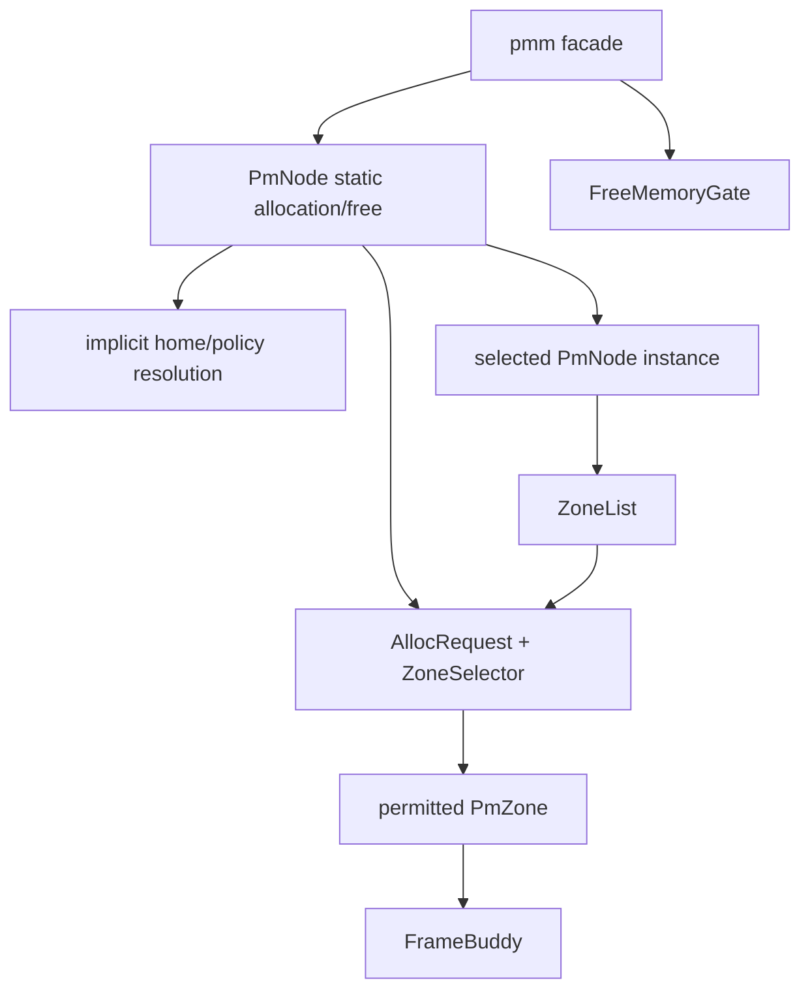

# pmm-responsibilities: resource models with static operations across nodes

**Date**: 2026-11-04
**Status**: Proposed

## Problem

The user requested clearer PMM responsibilities and convergent names, then identified the principal resource models as PmFrame, PmZone, and PmNode. The user subsequently selected PmNode::alloc_frames/free_frames as static operations across nodes. This replaces the earlier proposed separate FrameAllocator class.

The naming slice is delivered in `.agents/tasks/pmm-naming/RESULT.md`. The static-interface slice is recorded in `.agents/tasks/pmm-static/RESULT.md`. Those concrete decisions are implemented; the additional decomposition ideas marked as follow-ups below remain Proposed.

The local Zircon references are `pmm_alloc_page/pages/contiguous` in `zircon/kernel/vm/include/vm/pmm.h`, PmmNode's allocation methods in `include/vm/pmm_node.h`, and their delegation in `kernel/vm/pmm.cc`. This project retains its own multi-node/zone model and the user's chosen static interface.

## Goals and non-goals

- Keep PmFrame/PmZone/PmNode as the principal physical-memory models.
- Provide class-qualified allocation and release across all permitted nodes, without a caller holding a node instance.
- Preserve local-first placement, explicit-home preference, allowed-node restrictions, ThisNode behavior, allocation-disable checks, rollback, and error contracts.
- Retain the existing pressure/wait facade, buddy locking, descriptor layout, strong addresses, and boot handoff.
- Use helper names that state a concrete role and use their containing object's context. No mechanical Pm/Vm prefix rule or class for every role suffix.
- No new allocator singleton, virtual backend, per-request allocation, reclaim implementation, strict reserve, hotplug, or working per-CPU page cache is part of this slice.

## Design

### Principal models and supporting roles

| Model/helper | Responsibility |
|---|---|
| PmFrame | A physical page's descriptor: identity, ownership, use, and state. The existing PageFrame alias relationship is a separate spelling-consolidation candidate. |
| PmZone | A zone's buddy, lock, accounting, watermark values, and existing cache scaffold. |
| PmNode instance | One memory domain's state, including its zones/fallback order, queues, and current CPU relationship fields. |
| PmNode static interface | Select a starting node and allocate across permitted zones/nodes; release to the frame's owner. |
| AllocRequest | The existing immutable resolved allocation request, including home, origin, order, allowed nodes, and zone limits. |
| AllocPolicy / AllocState | Thread-default placement rules and requesting-thread state, respectively. Existing unfinished policy behavior is not implemented by this refactor. |
| NodePlacement | The runtime CPU-to-node table and its cached node pointer. |
| ZoneList / ZoneSelector | Stable candidate order and request-specific eligibility/traversal. |
| FrameBuddy | Split/merge mechanism with no lock or global MemMap dependency. |
| FreeMemoryGate | Existing machine-wide pressure admission, watcher notification, and waiting state in the pmm facade. |

Naming convergence retains AllocRequest, ZoneList, FreeMemoryGate, NodePlacement, ZoneSelector, and FrameBuddy. The longer FrameAllocationPlan, ZoneFallbackOrder, and FrameAllocationGate names are withdrawn. Gaf/MemoryAllocationPolicy/MemoryAllocationState became AllocFlags/AllocPolicy/AllocState in the delivered naming slice.

### Static allocation contract

```cpp
PmNode::alloc_frames(alloc_flags, order, allowed_nodes);
PmNode::alloc_frames(home, alloc_flags, order, allowed_nodes);
PmNode::free_frames(frame, order);
PmNode::free_frames(&frames);
```

Both allocation forms return Result<PmFrame *> and are static. Order defaults to zero and the allowed-node mask defaults to the online set. The implicit form applies the existing thread-default policy resolution and starts at the local node. The explicit form starts at the requested home, without applying thread-default placement again. A home id outside the table selects the implicit form, matching the established public pmm convention; an absent in-range node returns InvArgs.

The home node is a preference, not the entire permitted set. Its fallback ZoneList may contain remote nodes, and ZoneSelector applies the allowed mask. ThisNode retains the previously accepted rule: narrow to home when the caller already permits it; otherwise preserve the caller's mask. Invalid order, exhaustion, and disabled allocation still produce InvArgs, OutOfMem, and AccessDenied respectively.

Call these operations as PmNode::alloc_frames. C++ permits static methods to be called through an object, but that syntax does not bind the home to that object; pass its nid() explicitly when that is the intended preference. All active allocation callers have been migrated to the class-qualified interface.

The bulk and fragment operations are also static, with implicit/explicit-home forms. Bulk allocation remains an exact count of order-zero pages. Fragment allocation retains its set-bit block decomposition. Partial failure rolls the acquired list back through static release. Existing minimum-count helpers continue to round to a power-of-two block.

### Execution and resource state



The static entry selects and validates a real home node, verifies its canary, checks the requesting thread's allocation state and order, and resolves one request for the zone walk. Private instance helpers may read that chosen node's ZoneList and existing accounting; they are not public per-instance allocation operations.

Implicit-home policy resolution moved from pmm.cpp into the node-allocation implementation. Its thread resource lock still covers only the policy Arc snapshot and is released before the zone walk. A direct static caller therefore cannot bypass allocation-disable enforcement or default placement resolution. The unfinished policy switch and its existing enablement behavior are unchanged.

A returned frame goes back to the zone identified by its own node/type fields. The caller's CPU, selected home, and any node object used earlier do not choose the release destination. Existing ownership preconditions remain: a reserved frame must be unwired first, and an adopted/queued page must be detached by its owner before ordinary release.

### Pressure, locking, and lifecycle

The static node methods are the immediate physical-allocation backend. The existing pmm facade retains pressure admission, CanWait handling, the one-page retry/wait protocol, and notification after allocation/free. try_alloc_frames clears CanWait before entering the backend. This refactor does not move the gate or introduce sleeping/reclaim into node or zone code.

One PmZone IrqSave lock protects buddy operations; FrameBuddy gains no second lock. Zeroing remains outside that lock. Existing zone accounting, locality counters, and approximate watermarks retain their behavior. There is no new global allocation lock.

Nodes, zone tables, and fallback references have their existing boot-time publication and lifetime. The move to static methods changes neither initialization order nor the immediate InitStage::Pmm transition at EarlyMem handoff. Early page tables still use EarlyMem, then the same post-handoff allocator.

### Independent follow-ups

The following remain separate proposals and are not delivered by the static-interface slice:

- Extract private registration tables/functions while preserving the accepted file-scope representation, rather than adding a PmRegistry principal class.
- Consolidate CPU relationship maintenance into NodePlacement, preserving its early miss path, cache invariant, affinity lifetime, and AP claim/publication hooks.
- Finish the real placement policies and align their enablement with the build setting.
- Implement selector watermark admission and repair Dma-first ordering in their own behavior changes. Approximate admission must not be described as a strict reserve guarantee.
- Encapsulate allocated-block-to-page ownership transitions where real clients need them; do not silently change the existing rounded-block helpers.

## Alternatives considered

- Separate FrameAllocator: superseded by the user's explicit choice of static PmNode allocation/release methods.
- Keep public per-instance allocation and add a static wrapper with a new name: leaves two competing entry models and weakens the requested naming convergence.
- Turn PmNode instances into global managers: loses the useful per-node resource identity. Static operations can choose those resource instances without changing their meaning.
- Move pressure/reclaim, policy enablement, or zone ordering at the same time: independent behavior changes would obscure verification of the interface move.
- Add Source/Provider/Factory/Resolver/Coordinator classes for every stage: request resolution and boot construction already have functions and state owners; new suffixes alone add no responsibility.

## Decisions

| Decision | Options | Recommendation | User's prediction | Decided |
|---|---|---|---|---|
| Principal resource names | Invent a new family; PmFrame/PmZone/PmNode | Use the existing three principal models | Not requested | User specified, 2026-11-04 |
| Allocation/release interface | Per-instance; separate allocator; static PmNode | Static operations across nodes | Not requested | User selected, 2026-11-04 |
| Implicit/explicit home | Only one form; both | Both, preserving local-first and explicit-home behavior | Not requested | Implemented with compatibility semantics |
| Helper naming | Long processing-stage names; existing concise vocabulary | AllocRequest, ZoneList, FreeMemoryGate, AllocPolicy, AllocState, AllocFlags | Not requested | Naming slice delivered |
| Remaining resource decomposition | Bundle with the static move; independent slices | Independent behavior-preserving slices | Not requested | |

## Testing and verification

The static slice runs real format/tidy on pm_node.hpp, pm_node.cpp, pmm.cpp, and pm_node_test.cpp using the active compile database. Build and boot both disked development images under the default and four-node NUMA configurations, including all host tests.

Production-path kernel tests cover class-qualified implicit and explicit calls, ThisNode, empty allowed masks, invalid orders, remote permitted allocation, static release, and direct allocation-disable enforcement. Existing bulk/fragment, contiguous-page, pressure, pager, and reclaim tests remain relevant. Results and logs are recorded in `.agents/tasks/pmm-static/RESULT.md`.

The already reproduced NUMA33 vmalloc failure remains tracked in docs/repairs/261104/mm.md and is not claimed fixed by this change. No performance improvement is claimed.

## Open questions

None block the chosen static interface. Independent follow-ups above require their own scoped implementation and verification.
