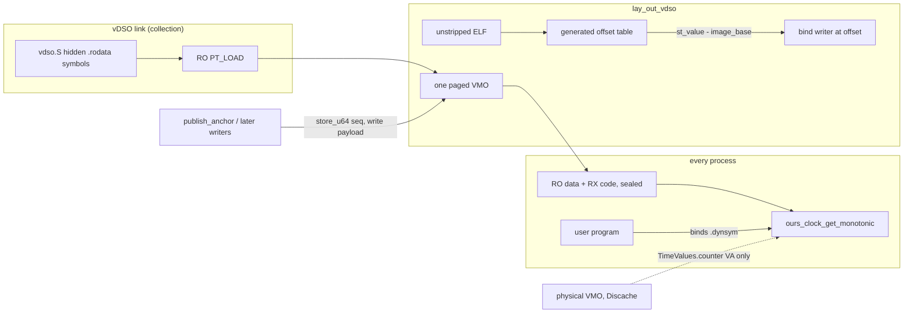
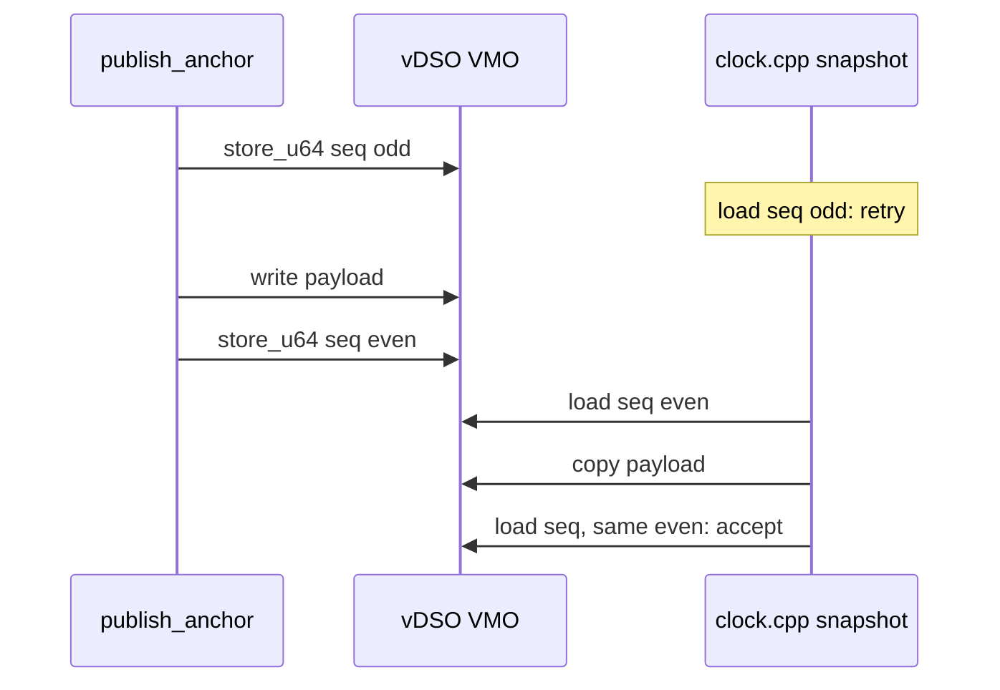

# vdso-published-data: kernel-written, userspace-readable records collected by the vDSO link into its read-only pages

**Date**: 2026-11-02
**Status**: Proposed

## Problem
The kernel already publishes one record of this class: `ours::TimeValues` (`system/public/ours/time_values.hpp`), the monotonic anchor a vDSO read scales a counter sample with. The kernel is the only writer. A user program reads it without a trap, by calling `ours_clock_get_monotonic` (`kernel/lib/userabi/vdso/clock.cpp`), which loads the record from the same pages every process already maps as the vDSO. The bytes live in the vDSO's `.rodata` as the hidden symbol `ours_time_values` (`kernel/lib/userabi/vdso/vdso.S`). `lay_out_vdso()` finds them by scanning the laid-out VMO for `TIME_VALUES_MAGIC` (`kernel/lib/userabi/src/userboot.cpp`, `find_time_values()`), because the packaged image is stripped (`kernel/phys/strip-kernel-elf.py`, `llvm-objcopy --strip-sections`) and a hidden symbol is not in `.dynsym`.

That is a one-off. The next record that belongs in the same class — a ticks-per-second, a boot-time offset, anything the kernel has already computed and a program wants to load without trapping — would copy the magic, the scan, and a private bind function. A scan is O(vDSO size), matches any 8-byte-aligned occurrence of the constant, and does not fail the build when the symbol is missing: it fails at boot, after the image is packaged. Magics are a growing private ABI between assembly and `lay_out_vdso()`, independent of the link that actually placed the bytes.

The class is not the HPET MMIO page. That page is a device register, a physical VMO mapped uncached at `CLOCK_PAGE_BASE` (`system/public/ours/clock_page.hpp`, `map_clock_page()`, `HandleType::VmoClockPage`). `TimeValues::counter` is a user virtual address of that register. Device memory stays a separate object.

What is missing is the mechanism TimeValues already is an instance of: records collected by the vDSO link, found by the kernel without a scan, written through the existing VMO with the existing odd/even protocol, and read by code that already links the vDSO.

## Goals and non-goals
Goals:
- Name the class and make `TimeValues` its first published object, not a special case.
- Collect records by linking the vDSO: each record is a hidden symbol in `.rodata`, defined in assembly so the compiler cannot constant-fold a field the kernel will overwrite.
- Give the kernel a way to obtain each record's VMO offset that does not grow a set of magics. Prefer a build-time table generated from the unstripped vDSO (the same ELF `:vdso.ifs` already reads). Keep the magic as a pairing check at that offset, not as a search key.
- Reuse the odd/even protocol and `VmObjectPaged::store_u64()` for every mutable record. Do not invent a second store path.
- Keep the vDSO ELF without a writable `PT_LOAD`. Userspace maps data RO and code RX. The kernel writes the VMO, which is the same pages (`layering.md`, Syscalls only through the vDSO).
- Leave a later record as a new symbol, a new writer, and the same page.

Non-goals:
- A second dedicated VMO in the shape of Linux's vvar page, or a slice VMO of one record in the shape of Zircon's `VDso::CreateTimeValuesVmo()`. One page of `.rodata` holds the present record with room for several more (`TimeValues` is 56 bytes, 64-byte aligned).
- A runtime registry of publishers, a constructor that registers, or a walk of a list at `lay_out_vdso()`. The link is the collection.
- Pulling HPET MMIO, or any other device memory, into the published page. Uncached physical VMOs stay separate.
- Changing `TimeValues`'s layout, the monotonic scale, or `ours_clock_get_monotonic`.
- Changing `publish_anchor()` or `store_anchor()`. PR1 is the finder only. Two pre-existing defects of that writer are recorded in `docs/repairs/261102/kernel-time.md`, not in this cut.
- Exporting data symbols in `.dynsym`. A program reads a record by calling a vDSO function (`ours_clock_get_monotonic` today). Layout is not a public dynamic-symbol ABI.
- Mapping the vDSO VMO into the kernel aspace so a writer can store through a pointer. `VmoDispatcher::write` / `store_u64` is enough while publishes are rare (source switches, bind). A high-frequency writer is a later decision.
- Build-id pairing of the kernel and the packaged vDSO. Recorded as a deferral in `.agents/tasks/system-abi-surface/DESIGN.md`; the magic at the generated offset is the check until that exists.
- Additional records in the first cut.

## Design
### Objects
- **A published record.** Kernel-only writer, userspace reader, no trap. Bytes in the vDSO's read-only `PT_LOAD`. One hidden ELF symbol names it. One public C++ layout describes it (`TimeValues` for the first). A mutable record carries its own sequence word; an immutable record is written once in `lay_out_vdso()`, before any user thread exists, and never again.
- **The vDSO VMO.** One paged VMO, laid out once by `kelfload::Loader::load()` (`kernel/lib/kelfload/src/loader.cpp`), marked with `VmoDispatcher::mark_vdso()`, kept as `SHARED_VDSO` (`userboot.cpp`). Every process maps it by segment: data RO, code RX, both sealed (`map_vdso()`, `launch::start()` in `system/lib/launch/src/launch.cpp`). The kernel's `write` and `store_u64` hit the same pages the mappings display. Handles to it have no Write (`RIGHTS_DEFAULT_VMO & ~Rights::Write | Rights::Execute`).
- **The offset table.** A generated header, consumed only by the kernel, giving each published symbol's link address (`st_value`) and size. `lay_out_vdso()` subtracts `ImageVmo::image_base` (the lowest page-aligned `p_vaddr`, which `load()` already computed) to obtain the VMO offset. File offset is the wrong number: `load()` places each segment at `p_vaddr - lowest`, not at `p_offset`.
- **A writer.** One per record. For the anchor, `time::publish_anchor()` (`kernel/kernel/time/anchor_page.cpp`), bound at layout with `bind_anchor_page(store_anchor, &vmo, offset)`. The store callback is `store_anchor()` in `userboot.cpp`: eight bytes go through `VmoDispatcher::store_u64()`, anything else through `write()`. Later writers bind the same way, at their own offset, with their own sequence word.
- **A reader.** vDSO code that names the assembly symbol (`extern TimeValues ours_time_values` in `clock.cpp`) and loads it with acquire on the sequence. A user program does not bind the data symbol; it calls the vDSO function the loader already binds from `.dynsym`.
- **Not an object of this class: the clock page.** `CLOCK_PAGE_VMO`, `VmoDispatcher::create_physical(hpet_mmio_phys(), PAGE_SIZE)`, mapped at `CLOCK_PAGE_BASE` with `MmuFlags::Discache`. `TimeValues::counter` points into it. It is a device register, not computed RAM.

Zircon counterparts, down to the function: `fasttime::internal::TimeValues` in `zircon/kernel/lib/fasttime/include/lib/fasttime/internal/abi.h`; the assembly object `DATA_TIME_VALUES` in `zircon/kernel/lib/userabi/vdso/data.S`; `VDso::SetTimeValues()` writing the struct through the VMO at the generated `VDSO_DATA_TIME_VALUES` (`zircon/kernel/lib/userabi/vdso.cc`); `VDso::SetMonotonicTicksOffset()` storing into a kernel mapping of that range; `gen-rodso-code.sh` producing those macros from `nm` of the unstripped vDSO (`zircon/kernel/lib/userabi/BUILD.gn`, `gen-vdso-code.h`). Linux counterparts: `struct vdso_clock` / `struct vdso_time_data` in `include/vdso/datapage.h`; `vdso_calc_ns()` in `lib/vdso/gettimeofday.c`; `update_vsyscall()` in `kernel/time/vsyscall.c` taking the write side of the seqlock; the vvar page as a dedicated mapping, which this design does not take.



### Collection: the vDSO link
A record is collected when the vDSO links, not when the kernel boots. The first one is already this:

```text
.section .rodata, "a", @progbits
.balign 64
.global ours_time_values
.hidden ours_time_values
.type ours_time_values, @object
ours_time_values:
    .quad 0x0C10C1A11E000001
    ...
.size ours_time_values, . - ours_time_values
```

Rules every later record follows:
- Defined in assembly, in `.rodata`. A C++ object with an initializer lets LTO treat `accessible` (or the equivalent) as the constant it was compiled with; `clock.cpp` is an `extern` declaration on purpose, and `vdso.S` is the definition. Zircon's `data.S` states the same reason.
- `.hidden`. The symbol is this image's. It does not enter `.dynsym`, so it does not enter `libours.ifs` and `vdso.abi_check` does not have to describe a data layout. A program that needs the value calls a vDSO function, which is the existing user-facing ABI (`<ours/vdso.hpp>`).
- Aligned at least 8 bytes, because the sequence word is one aligned `u64` store. `ours_time_values` is 64-byte aligned; new records may be 8-byte aligned until two of them are written independently on the same cache line, which is not the first cut.
- Packed into the existing RO segment. Do not page-align each record the way Zircon page-aligns `DATA_TIME_VALUES` and `DATA_CONSTANTS` (`VDSO_MAX_PAGE_SIZE`). Those alignments exist so Zircon can slice a child VMO. We do not slice.

The allow-list of names the kernel will bind is the generator's input, written down in GN next to the vDSO, not discovered by walking `.rodata`. A symbol in `vdso.S` that is not on the list is never written. A name on the list that the ELF does not define fails the build.

The generator also refuses a listed symbol whose section is not a safe place for the kernel to store. It reads `--sections` with the symbols (the same JSON as `build/toolchain/verify-undefined-symbols.py`) and requires the section to be allocated (`SHF_ALLOC` / flag `A`), not writable (`SHF_WRITE`), and not executable (`SHF_EXECINSTR`). A typo that leaves the object in `.text` would otherwise make `lay_out_vdso()` `write`/`store_u64` the executable segment, which every process maps RX as the syscall range (`mark_vdso` / `VmaDispatcher::map()`), and the magic check would still pass if the bytes start with the constant. It also requires `st_value` 8-byte aligned, so `store_u64` cannot return `InvArgs` at bind. The real `.rodata` on today's vDSO is `PROGBITS`, address `0xf80`, flags `A`, align 64.

### Finding a record: generated offsets
The packaged vDSO has no section headers (`llvm-objcopy --strip-sections` in `kernel/phys/strip-kernel-elf.py`). `.dynsym` survives because it is loadable; hidden symbols do not. The unstripped linker output does still have them, and the tree already reads that file: `:vdso.ifs` runs `llvm-ifs` on `$target_out_dir/vdso` from `:vdso.binary` (`kernel/lib/userabi/vdso/BUILD.gn`).

A Python action, not a shell script (Zircon's `gen-rodso-code.sh` is the counterpart we do not copy the language of), reads that ELF with `llvm-readelf --elf-output-style=JSON --symbols --sections`. That is the same *tool* as `kernel/phys/gen-phys-exports.py` and `build/toolchain/verify-undefined-symbols.py`, not the same *filter*. `gen-phys-exports.py` keeps only `Binding.Name == "Global"` and skips any symbol whose `Other.Flags` is non-empty, because a physload module must not bind a hidden symbol. `ours_time_values` is the opposite of that filter: after linking it is `Binding.Name == "Local"` with `Other.Flags == [{"Name": "STV_HIDDEN", "Value": 2}]`, even though `vdso.S` writes `.global`. `.hidden` in a shared object is what makes it `STB_LOCAL`. A copy of that filter fails the build on the only record this cut publishes.

The generator looks up each allow-list name in `.symtab` by `Symbol.Name.Name`, with no Global or default-visibility filter. The fields it uses:
- `Symbol.Name.Name` — the string, not `Symbol.Name.Value` (that is the string-table index).
- `Symbol.Value` — `st_value`, an integer. On today's linked vDSO this is `3968` (`0xf80`).
- `Symbol.Size` — `st_size`; `56` for `ours_time_values`.
- `Symbol.Section.Name` — must be `.rodata` today; the section flags are the check above (`STV_HIDDEN` is the visibility flag name in this JSON, not `Hidden`).

If two symbol-table entries share a name (`.dynsym` and `.symtab` for an exported function), they must agree on `Value` and `Size` or the action fails. A hidden data symbol has one entry, in `.symtab` only.

It emits a header the kernel compiles. The numbers are not an example of the real vDSO; zeros here are a sentinel so a copied sketch cannot be mistaken for `0xf80`:

```cpp
// Generated by gen_published_offsets.py. Do not edit.
#pragma once
#include <ours/types.hpp>
namespace userabi {
inline constexpr auto kPublishedOursTimeValuesVaddr = u64{0};
inline constexpr auto kPublishedOursTimeValuesSize = u64{0};
}
```

The include name is `published_offsets.hpp` under the producing target's `target_gen_dir`. Constants live in `namespace userabi`, matching `userboot.cpp` (`namespace userabi { using namespace ours; ... }`). There is no `ours::userabi` in the tree.

`lay_out_vdso()` then binds without a scan. Fully qualified so the snippet is valid both inside and outside that namespace:

```cpp
static_assert(::userabi::kPublishedOursTimeValuesSize == sizeof(TimeValues));
auto const offset = ::userabi::kPublishedOursTimeValuesVaddr - image.image_base;
if (offset + ::userabi::kPublishedOursTimeValuesSize > image.span) {
    return Status::InvArgs;
}
u64 magic = 0;
if (vmo.read(&magic, offset, sizeof(magic)) != Status::Ok || magic != TIME_VALUES_MAGIC) {
    log::error("userabi: the vDSO's monotonic anchor is not at the generated offset ({:#x}, word {:#x})",
               offset, magic);
    return Status::InvArgs;
}
time::bind_anchor_page(store_anchor, &vmo, offset);
```

`find_time_values()` goes away. `TIME_VALUES_MAGIC` stays as the word at offset 0 of the record, checked once at bind. Within one ninja graph the generator and the packaged file share `:vdso.binary`, so they cannot disagree. A kernel and a vDSO from different builds still can; the magic check is what refuses to boot then, until build-id pairing exists.

This is not the "build-time constants for the code segment" `layering.md` forbids. Those were independent numbers that could disagree with the packaged ELF, which is why `lay_out_vdso()` reads the code segment from the file itself. Offsets generated from that same ELF are a fact of the file, recovered at compile time so the stripped copy does not have to carry `.symtab`.

GN wiring, in this tree's labels, not Zircon's. `default_toolchain` here is the host/meta toolchain (`build/toolchain/toolchain_environment.gni`: `in_default_toolchain` sets `toolchain_environment = "host"`). The vDSO is built at `//build/toolchain/ours:user-${target_cpu}`, and `kernel/lib/userabi/vdso/BUILD.gn` asserts `toolchain_environment == "user"`, so that file cannot be loaded in the kernel or host toolchain. `system/public/BUILD.gn`'s `syscalls.private` runs its generator in `$default_toolchain` because those outputs do not depend on a target ELF; this generator must read `:vdso.binary` from the user toolchain, so it cannot.

Chosen shape (option A):
- The action stays in `kernel/lib/userabi/vdso/BUILD.gn`, next to `:vdso.binary` and `:vdso.ifs`.
- It is a `toolchain_utils_action("published_offsets")` with `utils = ["llvm-readelf"]` and `script = "gen_published_offsets.py"`. That template resolves `llvm-readelf` from `clang_tool_dir` in `prebuilt/` and prepends each `utils` path as a positional argument (`build/toolchain/c_utils.gni`: `args += utils_paths + util_extra_args + invoker.args`). Do not look the binary up on `PATH`. Do not copy `gen-phys-exports.py`'s `--readelf` flag: that script is a plain `action()` (`phys_executable.gni`), so a `--readelf` convention here would not see the tool the wrapper actually passes.
- CLI of `gen_published_offsets.py`, the shape both the user-toolchain action and the host test must use:
  - `argv[1]` is the `llvm-readelf` binary (prebuilt, never PATH).
  - `argv[2]` is the allow-list, comma-separated names; first cut is `ours_time_values`.
  - `argv[3]` is the input unstripped ELF.
  - `argv[4]` is the output `published_offsets.hpp`.
  - `argv[5]`, if present, is the depfile.
  - `invoker.args` of the `toolchain_utils_action` is therefore `ours_time_values`, then the rebased ELF, header, and depfile.
- The producing target carries `public_configs` whose `include_dirs` is *that* toolchain's `target_gen_dir`, and `visibility` that includes `//kernel/lib/userabi:*`.
- `kernel/lib/userabi/BUILD.gn` (kernel toolchain) depends on the explicit label `//kernel/lib/userabi/vdso:published_offsets(//build/toolchain/ours:user-${target_cpu})`, the same suffix `kernel/products/image/BUILD.gn` already uses for `//kernel/lib/userabi/vdso`. The `public_configs` on that user-toolchain target are how the kernel compile sees `published_offsets.hpp`. `get_label_info` of that label is the way to name the gen dir if a config ever has to be written on the kernel side instead.
- The vDSO does not depend on userabi, so there is no cycle.

A host test of the generator must not live in `vdso/BUILD.gn`: that file's environment assert would fail when loaded from the host. It must also not be reached through `kernel/lib/userabi/BUILD.gn`. That file's `source_set("userabi")` depends on `//kernel/mm` and `//kernel/object` with no toolchain suffix; those targets exist only under `if (toolchain_environment == "kernel")`. GN executes the whole BUILD.gn that contains a reached target, so a default- or host-toolchain dep on `//kernel/lib/userabi:tests` instantiates `:userabi` there and `gn gen` fails. `$host_toolchain` on such a group does not help: host is not kernel. `//kernel/lib/obi:tests` is the wrong analog: `source_set("obi")` depends only on `:headers`. `gktl:tests($host_toolchain)` works because *its* deps exist on the host (`//kernel/lib/ktl`, `//kernel/mm:headers`); userabi's do not.

The test lives in `kernel/lib/userabi/vdso/test/BUILD.gn` as `action("gen_published_offsets_test")`, with no `deps` on `//kernel/lib/userabi/vdso:*` and no `deps` on `//kernel/lib/userabi:*`: a different file, no kernel `source_set`. The root `BUILD.gn` `group("default")` names `//kernel/lib/userabi/vdso/test:gen_published_offsets_test($host_toolchain)` directly, the way it already names `//kernel/lib/numa/test:tests($host_toolchain)` and `//kernel/arch/x86/lib/page_tables/test:page_tables($host_toolchain)`. If a `group("tests")` is wanted, it goes in `vdso/test/BUILD.gn`, not in `kernel/lib/userabi/BUILD.gn`. Do not add `group("tests")` to `kernel/lib/userabi/BUILD.gn`. `scripts/host_tests.py` finds only host-toolchain executables, so this Python action is exercised solely as a ninja dep of `//:default`, as `pack-smoke` is (`BUILD.gn` comment on that failure mode; `docs/repairs/261029/tools-templates.md`). A test that is not named from `//:default` is built by nothing. The test action is handed `$clang_tool_dir/llvm-readelf`, the prebuilt assembler, and the prebuilt linker as arguments, the way `pack-smoke` is handed `obit`; it then invokes `gen_published_offsets.py` with the CLI above (`argv[1]` = that `llvm-readelf`), never PATH.

### Writing a record: odd/even through the VMO
Readers never take a lock. The protocol is the one `publish_anchor()` already implements, and the one `sync::SeqCount` documents for in-kernel use (`kernel/include/ours/sync/seqlock.hpp`): the sequence is odd while the payload is being written; even means the words agree. A reader that sees odd, or that sees the sequence change across the copy, retries.

The sequence word must be one aligned 8-byte store. `VmObjectPaged::write()` copies a byte at a time (`kernel/mm/vm_object_paged.cpp`, `memcpy` per page chunk). A torn sequence can look even while the payload does not agree, and no retry catches that. `VmObjectPaged::store_u64()` exists for this: it refuses a misaligned offset, demands the store not split across a page, and does `__atomic_store_n(..., __ATOMIC_RELEASE)`. `store_anchor()` already routes `sizeof(u64)` through it.

```text
writer (must be a single writer; the sequence does not serialise two of them):
  seq += 1                          # now odd
  store_u64(record + seq, odd)      # RELEASE; on failure seq -= 1 and return
  write(record + payload, bytes)    # byte copy is fine: readers see odd and retry
  seq += 1                          # now even
  store_u64(record + seq, even)

reader (vDSO, no lock, no store):
  seq1 = load_acquire(seq)
  if seq1 is odd: retry
  copy the payload with acquire on the u64s
  seq2 = load_acquire(seq)
  if seq1 != seq2: retry
  use the copy
```



Writers of one record must be serialised against each other. The sequence does not do it: two overlapping writes leave it even on a torn payload (`SeqCount` rule 2). That is a requirement on each producer, not a property `Clock::m_seqlock` already provides.

What actually serialises today's publishes:
- `bind_anchor_page()` and `bind_counter_va()` run from `lay_out_vdso()` / `map_clock_page()` on the laborer, before any user thread exists. Those two are single-threaded boot and do not overlap with each other.
- Runtime source switches are not serialised around the VMO write. `Clock::m_seqlock` covers the in-kernel `Anchor` only. `SteadyClock::notify()` (`kernel/kernel/time/clock.cpp`) drops that lock, then calls `publish_anchor(CLOCK.reading())`. `ClockSource::enroll()` (`kernel/kernel/time/clock_source.cpp`) drops `REGISTERED_SOURCES_MUTEX` before `SteadyClock::notify(best)` and assigns `CURRENT_CLKSRC` only after. Two overlapping `publish_anchor` calls race on the globals `SEQ` / `STORE` and can leave the VMO sequence even on a torn payload. First cut does not add a lock. The overlap is `docs/repairs/261102/kernel-time.md` item 1.

The kernel `Clock::m_seqlock` and the published sequence are different objects. The first protects the in-kernel `Anchor`. The second protects the VMO copy. `notify()` updates the kernel clock, then publishes `CLOCK.reading()`. A vDSO reader that lands in the window still has a coherent old anchor and the old counter VA; after the publish it has the new pair. `change_source()` pins the new source's counter to the time the old source showed, so the two readings agree at the switch. That window is not the enroll/notify writer race above.

A later record names its own producer and the lock that producer takes across the whole odd/even store; it does not share `TimeValues::seq`, and it does not assume `m_seqlock` covers the VMO.

An immutable record skips the sequence: `lay_out_vdso()` writes it once, then `map_vdso()` runs. No user mapping exists until then, so there is no concurrent reader. A field that might be written again after the first map is mutable from the start and carries a sequence.

Do not map the VMO into the kernel aspace in the first cut. Zircon does (`VDso::MapTimeValuesVmo()`, then `SetMonotonicTicksOffset()` stores through the pointer) because `mono_ticks_offset` is updated at run time without going through `VmObject::Write`. Linux maps vvar because `update_vsyscall()` runs from timekeeping. Our publishes are a source switch and a bind. Each takes the VMO lock for a few stores; that is the cost of not having a kernel VA, and it is the existing path.

### Reading a record
`clock.cpp` is the pattern. The vDSO function is the user-facing call (`visibility("default")`, in `.dynsym`, in `libours.ifs`). The data symbol is hidden. The snapshot uses acquire loads, retries on odd or changed sequence, and traps through `ours_clock_get_monotonic_via_kernel()` when `accessible == 0` or `counter == 0`. `monotonic_from()` is the same scale `ClockSource::ticks_to_time` uses.

A later record that a program should be able to load without trapping gets a vDSO function, generated from `syscalls.gni` with `attrs = ["vdso"]` if it also has a kernel fallback, or written by hand in the vDSO if it is pure userspace (Zircon's `zx_ticks_per_second` returns `DATA_TIME_VALUES.ticks_per_second` and never traps). It does not get a `.dynsym` data symbol, and it does not get a new mapping.

Programs already link the vDSO: `//system/user_executable.gni` records the imports, `elfload::Binder` resolves them against the mapped image. That is what "userspace already links the vDSO; it reads the symbols" means for this kernel. The symbols a program binds are the functions. The data symbols are read inside those functions, by the same image, at a PC-relative address that does not care what the kernel used as a VMO offset.

### What this is not: the HPET MMIO page
`CLOCK_PAGE_BASE` is one page below `VDSO_BASE` (`USER_ASPACE_BASE + 8 MiB`). The VMO is physical, the mapping is `PermRead | Specific | Sealed | MapRange`, and `VmaDispatcher::map()` adds `Discache` for a physical VMO. A cached mapping of the same page the kernel uses for HPET MMIO would return a stale counter. Write is refused: a writable user mapping of a running counter could stop it. `bind_counter_va(CLOCK_PAGE_BASE + CLOCK_COUNTER_OFFSET)` republishes `TimeValues` with `accessible == 1` and `counter` equal to that VA. None of that moves onto the published page. A future TSC source would put a different value in `counter` (or 0, and sample `rdtsc` in the vDSO); it still would not put device memory in `.rodata`.

### First cut
One change. Generate the offset table for `ours_time_values`. `lay_out_vdso()` binds at `st_value - image_base`, checks the magic there, and drops `find_time_values()`. Update the comment in `vdso.S` that still says the kernel finds the symbol by the magic. `TimeValues`, `publish_anchor()`, `store_anchor()`, `clock.cpp`, and the HPET page do not change. No new record. The two writer defects stay in `docs/repairs/261102/kernel-time.md`.

### Later records
A new record is a new assembly symbol, a new layout header (or a new field only if it is part of the same seqlocked payload as the anchor), an entry in the generator's allow-list, a bind in `lay_out_vdso()`, and a writer that uses `store_anchor()`'s routing — or, once a second writer exists, a helper that is that routing under a name that does not say "anchor". Same VMO, same RO mapping, same process. Candidates, not in this cut: ticks per second, boot-time offset, a version word. Each is forced by a userspace call that would otherwise trap or go stale, not by completeness.

When one page of `.rodata` is the wrong shape — a record that must be a child VMO, a record that must not sit in the same mapping as the stubs, a writer that must not take the VMO lock — that is the moment to consider a second VMO. It is not this moment. `TimeValues` is 56 bytes.

## Alternatives considered
- **Keep the magic scan, grow a magic per record.** Rejected as the long-term finder: O(vDSO size), a collision is a silent bind at the wrong offset, and a missing symbol is a boot failure rather than a build failure. Acceptable as a user choice for the first record only, which is why that decision is open. Even then the magic should become a check at a known offset the moment a second record exists.
- **A Linux vvar-style second VMO now.** Linux keeps timekeeping data in a dedicated vvar mapping, updated by `update_vsyscall()`, and the vDSO code finds it by an architecture helper (`__arch_get_vdso_u_time_data`). That is the right shape for data that is not part of the ELF and is written at tick rate. It adds a VMO, a handle type, a mapping in every process (`launch()` and `launch::start()`), and a way for the vDSO to locate it other than linking. Nothing we publish yet needs that. Zircon put `TimeValues` in the vDSO's own `.rodata` (`DATA_TIME_VALUES`) and wrote it through the VMO; that is the counterpart of what we already have.
- **A Zircon slice VMO of the record (`VDso::CreateTimeValuesVmo()`).** A child slice exists so something other than the vDSO mapping can hold just the time values (libfasttime's `PA_VMO_KERNEL_FILE` named `"time_values"`). No such consumer exists here. Page-aligning the record to make the slice would waste most of a page and is what "one page of `.rodata` is the wrong shape" would look like if we did it early.
- **A runtime registry of publishers.** A constructor or an init hook that pushes `{name, writer}` onto a list `lay_out_vdso()` walks. Rejected: the link already collected the records, the generator already named them, and a list is a second copy of that set that can disagree. It also pulls `<ours/time/...>` and future publishers into userabi's init by indirection instead of an explicit bind.
- **Export the data symbols in `.dynsym`.** A program could bind `ours_time_values` itself. That freezes the 56-byte layout as a dynamic-symbol ABI, adds it to `libours.ifs`, and still does not save a trap: the program has to snapshot with the seqlock protocol, which is what `clock.cpp` already does. The user-facing ABI is the function. Hidden is the existing choice for `ours_time_values` and it stays.
- **A writable `PT_LOAD` for the kernel to store through a user mapping.** Forbidden. `lay_out_vdso()` already refuses a writable or RELRO segment. The vDSO is linked `-z rodynamic -z norelro` so that it has none. Kernel writes go through the VMO. A writable user mapping of the stubs' image is a write to the only code the kernel will trap from.
- **Hand-written offsets in kernel source.** The disagreement `layering.md` called out for the code segment. Generated from the ELF, or a scan of the VMO; not a constant someone typed.
- **C++ definition of the record in the same translation unit as the read.** Ruled out when TimeValues landed (`docs/changes/261102/syscall.md`): the compiler can treat `accessible` as the 0 of the initializer and the load is not a load. Assembly definition, C++ `extern`, every record.
- **Kernel mapping of the VMO for pointer stores, now.** Useful once a write is on a hot path (Linux `update_vsyscall`, Zircon `SetMonotonicTicksOffset`). Every current write is a source switch or a bind. Mapping also needs a pin so reclaim cannot take the page from under the pointer; the VMO path does not.
- **GN action in `$default_toolchain`, copying `syscalls.private`.** Rejected: `syscalls.gen` does not read a target ELF, so the host toolchain is a valid once-only place. This generator must read `:vdso.binary` from `user-${target_cpu}`. Putting the action in `vdso/BUILD.gn` without the toolchain suffix, or depending on `vdso/` from the kernel toolchain without `user-${target_cpu}`, fails gen because of that file's environment assert.
- **Parser copied from `gen-phys-exports.py`.** Rejected: that filter is for `PHYS_EXPORT` globals. The published record is local and `STV_HIDDEN`.
- **`//:default` names `//kernel/lib/userabi:tests`, copying `//kernel/lib/obi:tests`.** Rejected: `userabi/BUILD.gn` is not safe outside the kernel toolchain. `source_set("userabi")` depends on `//kernel/mm` and `//kernel/object`, which exist only when `toolchain_environment == "kernel"`. The host test is named from `//:default` as `//kernel/lib/userabi/vdso/test:gen_published_offsets_test($host_toolchain)`.

## Decisions
| Decision | Options | Recommendation | User's prediction | Decided |
|---|---|---|---|---|
| How the kernel finds the first record | A: generate offsets from the unstripped vDSO, check magic at that offset, drop the scan; B: keep `find_time_values()` for TimeValues, generate offsets when a second record appears; C: the same generated table, packaged beside the vDSO as `vdso.published` instead of compiled into the kernel | A | Not given | 2026-11-02: C. The table travels in the kernel package with the stripped file |
| A second dedicated VMO (Linux vvar / Zircon time_values slice) | Now; later, when one page of `.rodata` is the wrong shape | Later | Not given | |
| Additional records in the first cut | None (TimeValues becomes the named published object); ticks-per-second; boot time; a version word | None | Not given | 2026-11-02: may include ticks-per-second, a boot offset, and a version word |
| Data symbols in `.dynsym` | Hidden, programs call vDSO functions; exported, programs bind the record | Hidden | Not given | Hidden is the present state of `ours_time_values`; reversing it is an ABI change |
| Writer path | VMO `write` / `store_u64` (today); kernel mapping of the VMO (Zircon `MapTimeValuesVmo`) | VMO path until a high-frequency writer exists | Not given | VMO path, constraint of the first cut |
| HPET MMIO on this page | No, keep the physical VMO; yes, map device memory into `.rodata` | No | Not given | No, constraint: device memory is not computed RAM |
| Collection | vDSO link (hidden `.rodata` symbols); runtime registry | Link | Not given | Link, constraint of this design |
| Where the offset action runs | A: `vdso/BUILD.gn` in the user toolchain, kernel depends with `user-${target_cpu}`; B: action in `kernel/lib/userabi/BUILD.gn` with `deps = [ "vdso:vdso.binary(user-${target_cpu})" ]` | A | Not given | A, constraint of this revision: next to `:vdso.binary`, same suffix the image already uses |

## Testing and verification
- Host: `action("gen_published_offsets_test")` in `kernel/lib/userabi/vdso/test/BUILD.gn`, listed from `//:default` as `//kernel/lib/userabi/vdso/test:gen_published_offsets_test($host_toolchain)`. Do not list `//kernel/lib/userabi:tests`: that loads `userabi/BUILD.gn` outside the kernel toolchain, where `//kernel/mm` and `//kernel/object` do not exist. Without the root edge the action is built by nothing (`scripts/host_tests.py` sees only host executables; a Python action runs only as a ninja dep of `//:default`, like `//kernel/lib/obi/test:pack-smoke`). The action is passed `$clang_tool_dir/llvm-readelf`, the prebuilt assembler, and the prebuilt linker, the way `pack-smoke` is handed `obit`. It synthesizes a fixture ELF (not a checked-in binary) whose published symbol has `st_value != p_offset`: either a non-zero page-aligned `image_base`, or the symbol in a non-first `PT_LOAD`. It then calls `gen_published_offsets.py` with the production CLI (`argv[1]` = that `llvm-readelf`, then allow-list, ELF, header), never PATH. Assert the emitted `kPublishedOursTimeValuesVaddr` equals `st_value`, and that `st_value - round_down(min PT_LOAD p_vaddr, PAGE_SIZE)` is the VMO offset `Loader::load()` would use. A second case omits the name and expects a non-zero exit. A third case puts the symbol in an executable section and expects a non-zero exit. Today's real vDSO is not a sufficient fixture for the formula: its first `PT_LOAD` has `p_offset = 0`, `p_vaddr = 0`, `.rodata` at `0xf80` in both, so `image_base = 0` and a test that only round-trips `st_value == 0xf80` also passes if the kernel used file offset. The second `PT_LOAD` already diverges (`.text` `p_vaddr = 0x1fc0`, `p_offset = 0xfc0`); the fixture must make the published symbol do the same. The test `BUILD.gn` does not `deps` on `//kernel/lib/userabi/vdso:*` or `//kernel/lib/userabi:*`.
- Build: removing the symbol from `vdso.S` fails ninja at the generator, not at boot. `vdso.abi_check` still passes; hidden data is not in `.dynsym`.
- Boot: `ours-verify` on both images. The layout log keeps a single success line. A mismatch of magic at the generated offset stops the boot with `userabi: the vDSO's monotonic anchor is not at the generated offset ({offset}, word {magic})`, which is the same class of failure as today's `userabi: the vDSO has no monotonic anchor` but a different string, and it names the offset and the word so a mismatched kernel/vDSO is diagnosable. `shell: clock checks passed` still appears. `userboot: clock page mapped at 9FF000` is unchanged: the HPET path is not this change.
- Existing `system/lib/time/test:read` (`monotonic_from` against the kernel scale) does not move. No new clock behaviour.
- Cannot be verified yet: a kernel and a vDSO from different builds (no build-id pairing); a second record; a high-frequency writer; two overlapping `publish_anchor` calls (repair item 1).

## Open questions
- Whether a future ticks-per-second belongs inside `TimeValues` (Zircon puts `ticks_per_second` on the same struct as the ratio) or as its own symbol with its own sequence. Forced when a call needs it; not in the first cut.

## Key Decisions
- Published data is a class of record in the vDSO's `.rodata`, collected by the vDSO link, written by the kernel through the one vDSO VMO, read by vDSO functions every process already maps. It is not a second VMO, not a runtime registry, and not the HPET page.
- `TimeValues` / `ours_time_values` is the first published object. The first change makes the kernel find it by a generated offset and check its magic there. No new record, no layout change, no new mapping, no edit of `publish_anchor()`.
- Offsets come from `llvm-readelf` JSON on the unstripped `:vdso.binary`, looked up by allow-list name in `.symtab` with no Global/default-visibility filter, emitted by a `toolchain_utils_action` in the user toolchain, consumed as `st_value - ImageVmo::image_base`. Magics stop being a search key. The kernel depends on `//kernel/lib/userabi/vdso:published_offsets(//build/toolchain/ours:user-${target_cpu})`.
- Mutable records use the existing odd/even protocol; the sequence word is `store_u64`. Overlapping writers of one record are a producer bug, not something `Clock::m_seqlock` prevents; today's enroll/notify race is a repair, not this cut. Immutable records are written once in `lay_out_vdso()` before the first map.
- Data symbols stay `.hidden`. The user-facing ABI is the vDSO function. A second VMO waits until one page of `.rodata` is the wrong shape.

## PR Plan
Each PR is one commit, after `ours-verify`. Later PRs wait on the open decisions; PR1 is written as if generated offsets are chosen.

1. **feat(userabi): find TimeValues by a generated vDSO offset**
   - Files: `kernel/lib/userabi/vdso/gen_published_offsets.py` (new; CLI: `argv[1]` = `llvm-readelf`, then allow-list, input ELF, output header, optional depfile); `kernel/lib/userabi/vdso/BUILD.gn` (`toolchain_utils_action("published_offsets")` with `utils = ["llvm-readelf"]`, `script = "gen_published_offsets.py"`, `deps = [ ":vdso.binary" ]`, `invoker.args` starting `ours_time_values`, `public_configs` include of `target_gen_dir`); `kernel/lib/userabi/BUILD.gn` (`deps` on `//kernel/lib/userabi/vdso:published_offsets(//build/toolchain/ours:user-${target_cpu})` only, no `group("tests")`); `BUILD.gn` (`//:default` names `//kernel/lib/userabi/vdso/test:gen_published_offsets_test($host_toolchain)`, not `//kernel/lib/userabi:tests`); `kernel/lib/userabi/src/userboot.cpp` (bind at `st_value - image_base`, magic check logging that offset and word, `static_assert` on `sizeof(TimeValues)`, delete `find_time_values()`); `kernel/lib/userabi/vdso/vdso.S` (comment only: the kernel finds the symbol by the generated offset, magic is the pairing check); `kernel/lib/userabi/vdso/test/BUILD.gn` (`action("gen_published_offsets_test")`, no dep on `vdso:*` or `userabi:*`, args are `$clang_tool_dir` `llvm-readelf` / assembler / linker, then the production CLI); `docs/changes/261102/userabi.md`.
   - Depends on: nothing in this plan.
   - Description: TimeValues stays the same record. The kernel no longer scans. A missing symbol, a symbol in `.text`, or a misaligned `st_value` fails the build; a mismatched magic at the offset fails the boot. Independently reviewable: clock behaviour, `publish_anchor()`, and the HPET page are untouched.

2. **feat(userabi): publish one new record into the vDSO** (not in the first cut; one PR per record)
   - Files: `vdso.S` (new hidden symbol), a layout header under `system/public/ours/`, the generator allow-list, a bind in `lay_out_vdso()`, a writer, a vDSO function if a program should load it without trapping, the change record for that commit.
   - Depends on: PR1, and a userspace call that forces the record.
   - Description: same page, same store protocol, new symbol. Independently reviewable per record.

3. **refactor(userabi): one store helper for published records** (only once PR2 exists)
   - Files: `store_anchor()` renamed and moved to a helper both writers call; `anchor_page.cpp` unchanged in protocol unless the writer repairs have landed first.
   - Depends on: PR2.
   - Description: do not extract a helper for one caller. Independently reviewable: no behaviour change.

4. **A second VMO, or a kernel mapping of the published page** (not scheduled)
   - Depends on: a record that does not fit `.rodata`, or a writer that cannot take the VMO lock.
   - Description: Linux vvar / Zircon `CreateTimeValuesVmo` / `MapTimeValuesVmo`. Revisit then, do not build the seam now.
