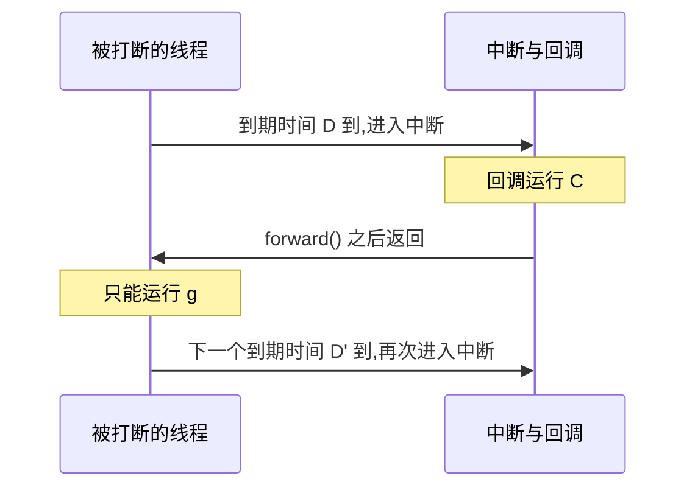

# 回调耗时与被打断线程的 CPU 份额

周期定时器的回调比周期还慢时,被它打断的线程还能分到多少 CPU。高精度定时器的第二步(对回调慢于周期的守卫,`.agents/tasks/high-res-timers/DESIGN.md`)要先量的就是这个量。

## 符号

- $P$:定时器的周期。
- $C$:回调耗时。
- $g$:回调结束后到下一次中断之前,被打断线程能运行的时间。
- $s$:被打断线程拿到的 CPU 份额。这里先忽略中断进出的开销。

## 一轮里发生什么

文字版,对象是定时器的回调和被打断的线程,事件依次是:

1. 到期时间 $D$ 到,进入中断,回调运行 $C$。
2. 回调最后调用 `forward()`,把下一次到期时间 $D'$ 推到"调用时的 now"之后的第一个整周期。
3. 回调结束后中断返回,线程只能运行到 $D'$,也就是 $g$。
4. $D'$ 到,再次进入中断。

## 公式

`forward()` 把下一次到期时间推到回调结束之后的第一个整周期:

$$D' = D + \left(\left\lfloor \frac{C}{P} \right\rfloor + 1\right) P$$

回调在 $D + C$ 结束,所以留给线程的时间是:

$$g = D' - (D + C) = P - (C \bmod P), \qquad 0 < g \le P$$

线程的份额,和它的上界:

$$s = \frac{g}{C + g} \le \frac{P}{C + P}$$

下界为零:$g$ 小于"装设备前读一次时钟"的开销时,装设备的那一刻截止时间已经过去,会被压成设备的最短间隔(LAPIC 是 15 ns),这时 $s$ 接近 0。

## $P = 10\,\mu s$ 时的几个点

| $C$ (µs) | $C \bmod P$ (µs) | $g$ (µs) | $s$ |
|---|---|---|---|
| 5 | 5 | 5 | 50 % |
| 25 | 5 | 5 | 16.7 % |
| 30 | 0 | 10 | 25 % |
| 35 | 5 | 5 | 12.5 % |
| 39 | 9 | 1 | 2.5 % |

## "中断间隔不小于处理时长"

要求 $g \ge \lambda C$,系数 $\lambda$ 越大,线程至少能拿到的份额越多:

$$g \ge \lambda C \;\Longrightarrow\; s \ge \frac{\lambda}{1 + \lambda}$$

| $\lambda$ | 线程至少拿到 | 窗口内到期的计时器最多晚 |
|---|---|---|
| 1 | 50 % | $1 \cdot C$ |
| 2 | 67 % | $2 \cdot C$ |
| 3 | 75 % | $3 \cdot C$ |

这条规则只在"下一个截止时间比 $\lambda C$ 还近"时才起作用。回调很短的计时器(比如 tick)不受影响。

## 在 QEMU TCG 上的实测

`timershare.test`(`kernel/commands/timer_share_test.cpp`)把上面的公式拿去对照。$P = 10\,\mu s$,一颗 CPU 上固定一个线程,先独占跑一份固定工作,再挂上回调耗时为 $C$ 的周期定时器跑同样的工作,两次耗时之比就是份额 $s$。每个点重复 5 次,取中位数。四次一次性模式的运行:

| 要求的 $C$ | 回调实际耗时 | 线程份额(中位数) | 回调间隔 | 公式给出 |
|---|---|---|---|---|
| 20 µs | 61 到 66 µs | 48 % 到 54 % | 360 到 398 µs | 1 % 到 10 % |
| 45 µs | 90 到 94 µs | 50 % 到 51 % | 384 到 418 µs | 1 % 到 10 % |
| 100 µs | 149 到 151 µs | 45 % 到 52 % | 481 到 511 µs | 1 % 到 10 % |

实测比公式高得多,而且几乎不随 $C$ 变化。把一轮拆开:

$$\text{间隔} \approx \underbrace{C'}_{\text{回调}} + \underbrace{O}_{\approx 110\,\mu s} + \underbrace{g_{\text{实}}}_{\approx 200\,\mu s}$$

- $C'$ 是回调实际耗时,比要求的 $C$ 多约 40 µs,多出来的是回调末尾 `forward()` 里读一次时钟源(一次约 8 µs)和排队的开销。
- $O$ 是回调之外的中断开销,由间隔、回调和份额反推得到(不是单独计时的),三个 $C$ 下都约 110 µs。
- $g_{\text{实}}$ 是线程真正能跑的时间,约 200 µs,与 $C$ 无关。

公式假定"下一次中断在 $g \le P$ 之内到来",而 QEMU 里设备被装上之后约 200 µs 才真正送达,所以线程总有约 200 µs 可跑。这个平台上中断速率被模拟和软件开销封顶在每秒两千多次,"中断背靠背"的情形造不出来,所以守卫在这里既没有要防的东西,也没法验证。真机上(中断几微秒就送达、时钟读取只要一条 `rdtsc`)公式描述的情形是否出现,要在那里重跑 `timershare.test` 才知道。
