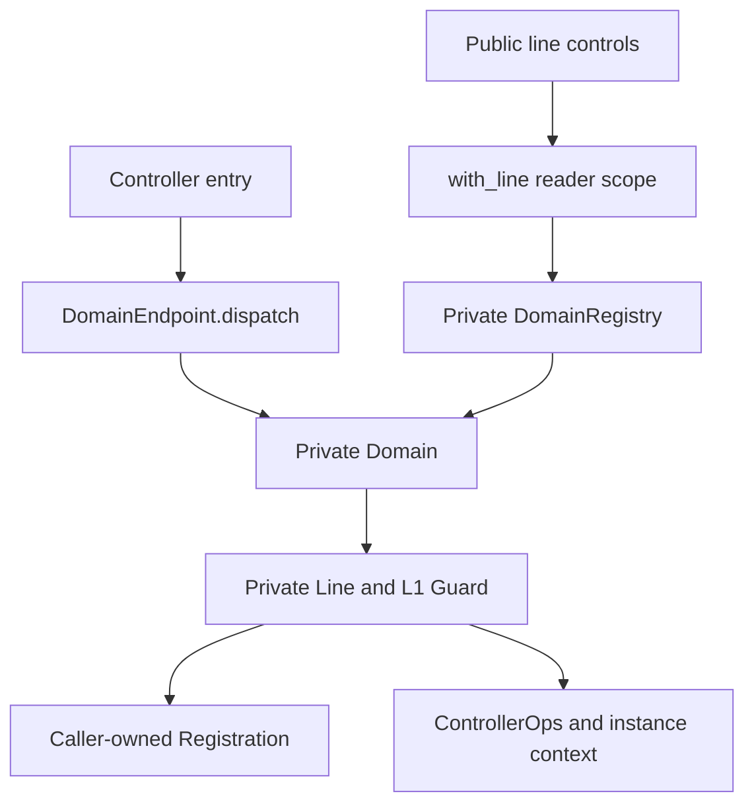

# irq-redesign: owned domains, guarded lines and explicit controller contracts

**Date**: 2026-11-03
**Status**: Accepted

## Problem

The IRQ module exposed a descriptor table and borrowed domain pointers, repeated lookup and lifetime code in two control facades, inferred controller handshake from electrical mode, and used identical primitive aliases for hardware sources and kernel identities. Permanent dispatch escaped the normal Guard and analysis contract. Deferred completion could use an old observation of owner debt to reopen newer work. CPU trap bookkeeping also lived in the line-control facade and lost the outer frame on nested exit.

## Goals and non-goals

Meet the user's six requirements: meaningful roles and names; real safety guards; independent state/lifetime reasoning; explicit extension contracts; useful C++ abstraction instead of mechanical repetition; and comparison of viable alternatives. Preserve syscall encoding and existing interrupt-object behavior. The user selected object model B, later retained the HIrqNum/VIrqNum spelling, and suspended learning exercises.

This cut does not implement other hardware controllers, MSI, dynamic vector allocation, affinity, kernel IRQ threads, pending replay, or performance optimization. It does not migrate address types or merge independent shared-checkout work. Existing platform ISA override arbitration and global lockdep class infrastructure remain separately recorded repairs. The verified product is x86.

## Design

### Objects and boundary

| Object | Owned invariant | Exposure |
|---|---|---|
| Registration | Immutable callbacks, context and RegistrationOptions; stable intrusive binding identity | Public, caller-owned until detach and the caller's own completion calls drain |
| ControllerOps / ControllerSource | Immutable handshake/masking declaration and per-instance source/id/context routing | Public adapter contract; operations/context outlive the registered domain |
| DomainEndpoint | Publication access for one controller's sources; dispatch owns its reader scope | Public, noncopyable; no Domain or Line pointer getter |
| Line | Mutable occupancy, Held/Dying, cached electrical trigger and callback lifetime under L1 | Private implementation |
| Domain | Transactional forward/reverse mapping and Vec<Box<Line>> storage; line-removal policy | Private, noncopyable and nonmovable |
| DomainRegistry | Domain ids, monotonic kernel-id allocation, unique domain ownership and reader-safe publication/retirement | Private |
| Entry interface | Receiving-CPU frame nesting, scheduler disable transitions and one-time root handler publication | Separate entry.hpp/entry.cpp |

There is one ordinary public control API. with_line(source, id, operation) creates the IRQ RCU scope, resolves Line and invokes the operation before the scope closes. Its structural C++ constraint accepts an operation on Line; Status/Result propagation shares the actual lifetime/error invariant. Domain no longer mirrors ordinary attach/mask/configure/query methods. Detach, revocation and deferred completion keep their distinct contracts explicit. Unused labels, initial Line policy flags, an allocation-only factory, root-only mapping forwarding and empty initialization scaffolds are removed.

### Identities and policy

HIrqNum and VIrqNum are different scoped u32 enum types with separate Invalid values, no implicit cross-conversion, no implicit integer conversion and no arithmetic operators. The user explicitly retained these spellings. irq_for_source(domain, source) always names the domain; source_for_irq(id) recovers its controller-local source. Numeric indexing, hardware vector encoding, diagnostics and syscall conversion are explicit. The syscall wire format remains u32. Directed IO-APIC EOI takes a third type, IrqVec.

RegistrationOptions is immutable. Null handlers, unknown bits, Permanent with Shared/Oneshot, Shared with Oneshot and missing deferred readiness are rejected before occupancy or hardware changes. Permanent is a lifetime policy and takes the same Guard as all dispatches. Only Line may invoke registration handle, revocation and readiness callbacks; notify_locked requires L1. A physical interrupt object uses Oneshot and reports WakeThread, retaining its existing wait/ack, coalescing, timestamps and port protocol.

### Lifetime and retirement

Domain builds all maps and boxed lines into local Storage, then moves complete storage into place. Failure releases local ownership without manual destroy/reset or partial publication. The directory owns Box<Entry>; an immutable published Entry owns Box<Domain> and borrows its endpoint. Reader pointers are valid only inside IRQ RCU scopes. Public endpoint dispatch covers acquisition, lookup, callback execution and controller completion in one scope.

Removal transitions a writer slot Live -> Removing, checks and marks every line with rollback if any refuses, revokes registrations, retracts endpoint and directory publication, waits for the IRQ RCU grace period, then transfers ownership out and marks the slot Free under the directory Guard. Destruction runs outside the lock. The slot owns its Entry until that transfer, so another writer cannot inspect a freed id. Kernel IRQ identities are never reused. Root is permanent; other domains can be withdrawn independently. Endpoint users stop delivery before removal and retain controller context through successful return. Directory destruction requires quiescent users; it does not wait or dereference borrowed endpoints.

### Locking and deferred completion

The directory lock covers only writer slot state and publication bookkeeping, not allocation, line callbacks, grace-period waits or destruction. L1 is per Line and covers every mutable semantic state access and every callback, including Permanent. Statistics read outside L1 are atomic. All dispatch/revocation callbacks run with interrupts and preemption disabled through actual Guard instances. No IRQ analysis suppression or alternative permanent-dispatch protocol remains.

The relevant order is L1 -> controller register lock LI, or L1 -> interrupt-object L2 -> port/wait internals. An owner drops L2 before calling line control. No handler controls its own or another line; there is no order between two line locks. Compiler TA_GUARDED/TA_REQUIRES enforce the line-state boundary. The global lockdep implementation still lacks named classes; this rewrite uses its real Guard and does not claim runtime class-order validation that the infrastructure cannot provide.

Held belongs to Line; outstanding delivered work belongs to the owner. Clearing owner debt under L2 is an observation, not authority to clear Held later. Completion takes L1, verifies the same registration is still attached, then calls ready under the owner's L2 and only clears Held/unmasks if current work is complete. The physical object's readiness is true in Idle/Waiting and false in Triggered/NeedAck/Destroyed.

1. Old ack clears debt and releases L2.
2. A new dispatch takes L1 -> L2 and establishes new debt and Held.
3. Old completion obtains L1, rechecks readiness under L2 and leaves Held intact.
4. If new dispatch instead follows the recheck, it waits for L1 and establishes its new hold after the old completion.

Detach drains IRQ callbacks. Owners must also drain their own completion callers before reusing registration storage or freeing context. The protocol does not promise safe destruction while an unrelated caller still uses the object.

### Controller handshake

Electrical Edge/Level and receiving-CPU handshake are independent. Line caches TriggerMode under L1 for holding policy. ControllerOps explicitly declares Eoi or AckEoi; missing or unused hooks and unknown declarations fail binding. Eoi notifies then ends; AckEoi acknowledges a known source, notifies, then ends. Claim reads identifying a source belong in the controller entry. AckEoi requires in-service state to survive ACK until EOI; mask-before-ACK and claim-token protocols need an explicit future protocol and tests.

One scope guard sends EOI after the last line-state update, including unclaimed or held sources. Synthetic dispatch sends neither ACK nor EOI. Endpoint Some means the source was found and completed, even if its handlers returned None; endpoint None leaves unmatched completion to the root adapter. Deferred registration additionally requires Masking::Synchronous, meaning mask has stopped delivery before returning, and usable mask/unmask hooks. Bare pointer presence is insufficient. IO-APIC declares Eoi with synchronous masking. Fake adapters test both handshakes independently over both trigger modes and separate instance contexts.

### Trap nesting

enter_trap requires interrupts off, saves and returns the previous CPU frame and raises eager/preemption disable counts. Architecture keeps that token on its kernel stack. leave_trap restores the previous frame, restores counts without scheduling inside bookkeeping and returns whether architecture should preempt. Inner exit cannot consume an outer preemption request. Scheduling and user-signal delivery occur only after this scope closes. NMI, double fault and machine check retain their separate path. Actual controller startup remains the platform InitLevel::Irq hook; empty generic/architecture init calls are removed.

### Reference comparisons

Linux handle_fasteoi_irq and irq_finalize_oneshot identify line masking/completion roles, but its callback-outside-lock and kernel-thread pending machinery are not imported. Linux handle_edge_irq has acknowledgment/replay behavior that an electrical Edge label alone cannot promise. Zircon InterruptTableEntry::invoke_if_present supplies a useful callback-lifetime comparison; ours deliberately keeps Permanent under the same Guard. These references cross-check responsibilities, while ownership, readiness revalidation, structural control resolution and explicit protocol validation follow this project's actual states and callers. Reference names stay in design/change documents, not code comments.

## Alternatives considered

| Decision | Alternatives and cost | Selected reason |
|---|---|---|
| Module shape | Keep public descriptor/table facade; add a public manager; consolidate private ownership | Consolidation deletes caller lifetime knowledge and duplicate controls without another manager layer |
| Ownership | Manual new/delete pairs; refcounted domain handles; unique ownership plus existing IRQ RCU | Box ownership and one reader protocol match the actual lifetime, with destruction outside the writer lock |
| Ordinary controls | Repeated wrappers; macros; virtual resolver; structural template | with_line shares scope and errors with compile-time checking, without runtime hierarchy or macro-generated control flow |
| Deferred completion | Generation-bearing event tokens; controller-specific exclusion; owner-state revalidation; L2 -> L1 calls | Revalidation uses existing debt, covers synthetic dispatch and preserves L1 -> L2; tokens add coalescing/port protocol state, reverse locking deadlocks |
| Controller flow | Derive handshake from trigger; adapter-supplied arbitrary flow; full pending/replay machine; validated protocol | Protocol declaration separates independent facts while Line retains common lifetime/holding policy |
| Identity | Primitive aliases plus disjoint ranges; wrappers with conversions/operators; scoped enums | Scoped types prevent mixing without an arithmetic or compatibility API; numeric operations remain explicit |
| Nested frame | Clear one pointer; add depth; allocate a context; save previous frame on stack | Only saving the previous pointer reconstructs the outer frame; the existing stack owns both lifetimes |

## Decisions

| Decision | Options | Recommendation | User's prediction | Decided |
|---|---|---|---|---|
| D1. Objects and ownership | Preserve genirq scaffolding; explicit owned Line/Registration/Domain/ControllerOps model | Explicit model B | None | User selected B, 2026-11-03 |
| D2. Deferred completion | Tokens, controller exclusion, revalidation or reverse locking | Owner-state revalidation | Waived: teaching exercises suspended | Implemented and counterfactually verified, 3972cbb9 |
| D3. Controller protocol | Trigger-derived flow, arbitrary adapter flow or validated protocol | Validated Eoi/AckEoi plus synchronous-mask capability | Waived | Implemented and tested, a4b6b080 |
| D4. Identity spelling | HardwareIrq/IrqId; HIrqNum/VIrqNum | Preserve strong types under the user's chosen spelling | None | User selected HIrqNum/VIrqNum, b109dca0 |
| D5. Entry lifetime | Mixed control facade and pointer clearing; separate stack-ordered entry | Separate entry with previous-frame restoration | Waived | Implemented and counterfactually verified, 561afe94 |

## Testing and verification

Every source increment ran repository changed-line formatting, actual LLVM 23 clang-tidy, both x86 boot images, host tests and affected kernel suites before its isolated commit. GN used scripts/format_gn.py without reordering lists. Final out/irq-final passes dbg 46/5/0, rel 44/8/0 with 7/7 required checks, and 161 host tests. Nine suites pass: irq 82, irqcontroller 49, irqrevoke 37, irqregistry 85, irqdomain 87, irqrcu 34, interrupt 67, interruptline 83 and pinlines 28.

Coverage includes invalid registration without side effects, typed-interface rejection, two controllers sharing hardware source zero with separate contexts, handled/unclaimed/unmatched completion, both handshakes over Edge/Level, deferred holding/readiness, detach/revocation barriers, concurrent readers/removers/writers, and nested frame/count restoration. Removing only readiness fails both new ack interleaving assertions; clearing instead of restoring the nested frame fails its new assertion. Exact fixed sources were restored and rebuilt before final positive verification. Stress is bounded evidence backed by the ownership/lock-order arguments, not proof of all executions. Performance and non-x86 hardware were not measured or verified.

## Open questions

None within this implementation scope. Independent address migration, ISA override arbitration, named lockdep classes and future controller protocols remain separately scoped work rather than hidden support claims.
