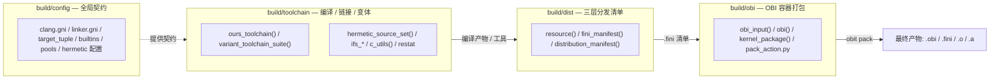
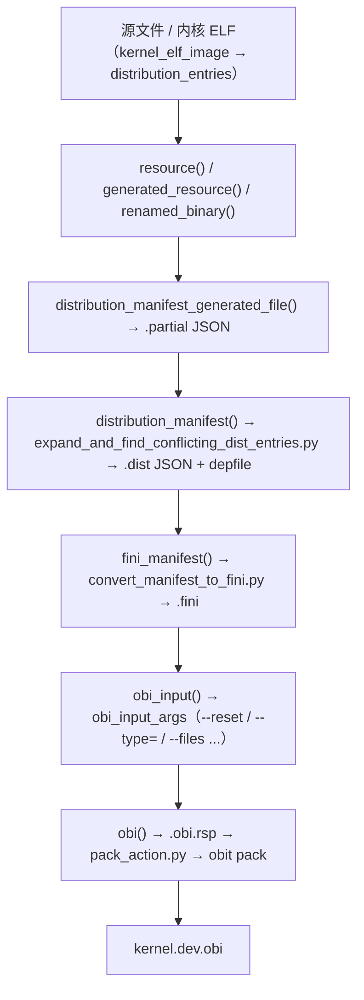
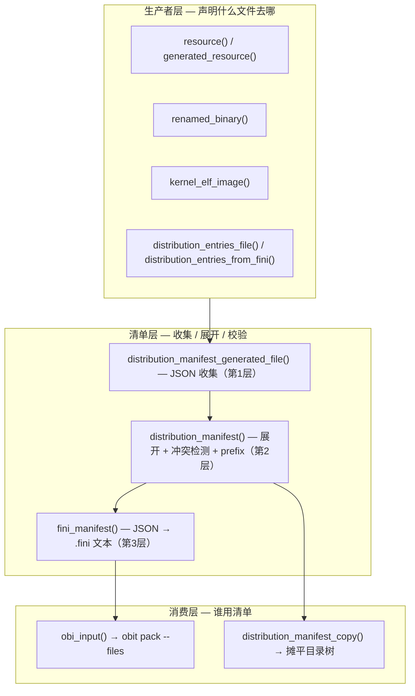
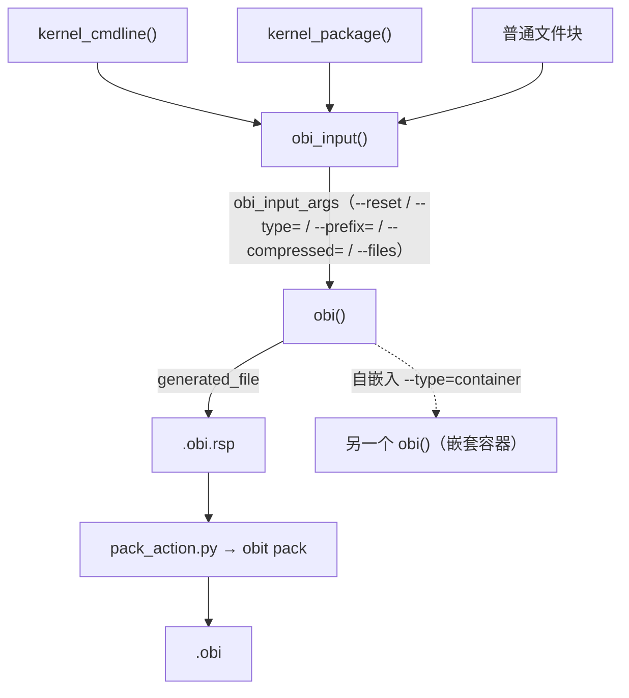
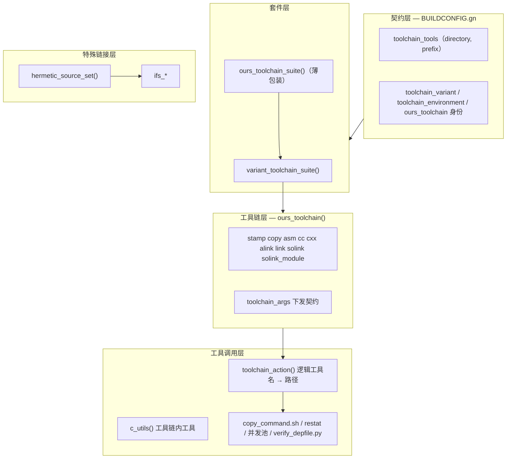
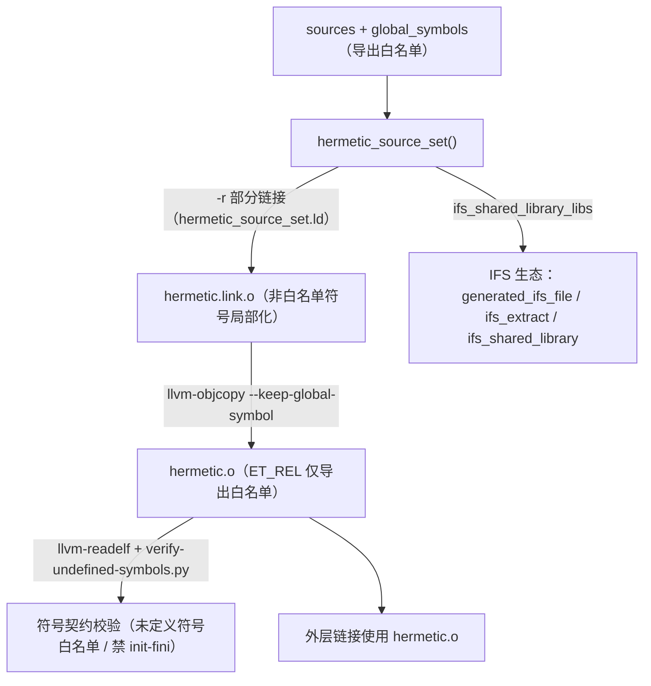
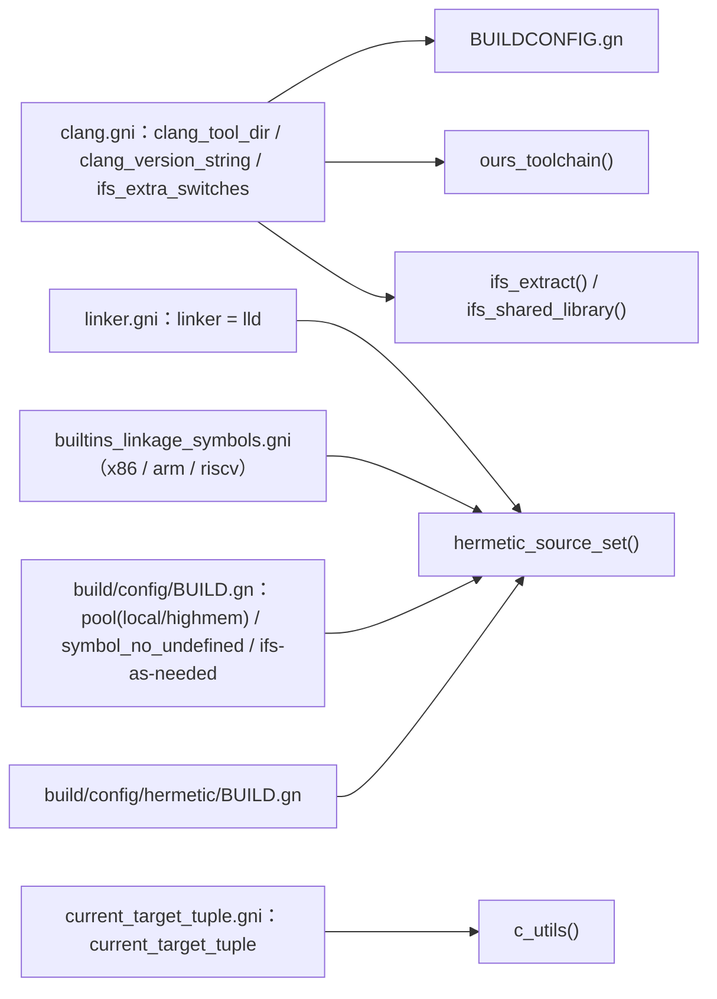
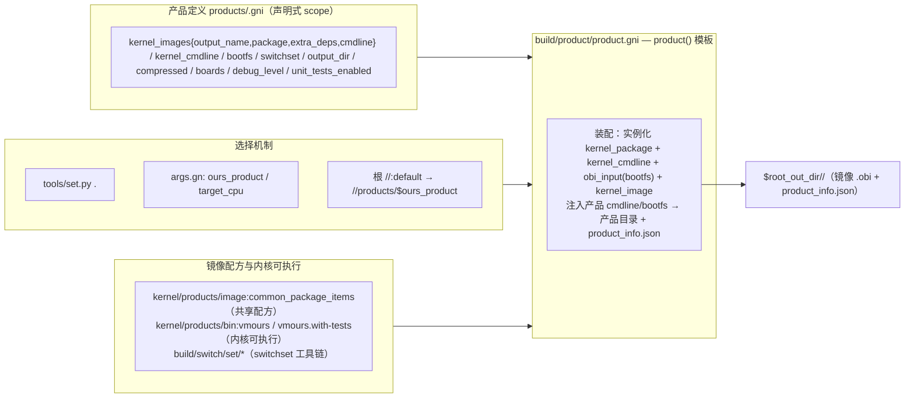

# Ours 构建系统 API 参考（build/dist + build/toolchain + build/obi）

> 本文档从**实际代码**提取（不依赖仓库旧文档），覆盖 build/dist、build/toolchain、build/obi、
> build/config 中的全部 GN 模板与 Python 脚本。每条 API 说明：**做什么 / 参数 / 结果**。
> 结构、内容、职责先用图讲清（§0），再逐块展开。
>
> 来源：Fuchsia build/dist、build/toolchain、build/zbi 的迁移适配（见 `.agents/tasks/build-migration/`；
> 各文件的 PROVENANCE 注释记录与 Fuchsia 原件的差异）。

---

## 0. 总览：结构、内容、职责

### 0.1 四块布局与职责边界



### 0.2 职责矩阵（管什么 / 明确不做）

| 块 | 职责（管什么） | 明确不做 |
| --- | --- | --- |
| build/config | 定义全局契约：clang 约定、linker、current_target_tuple、每架构内建符号、并发池、hermetic 配置 | 不定义任何编译/打包动作 |
| build/toolchain | 定义工具链与工具（stamp/copy/asm/cc/cxx/alink/link/solink）、变体套件、工具调用封装（toolchain_action/c_utils）、restat/并发、hermetic 与 IFS | 不知道"什么文件进镜像" |
| build/dist | 声明与收集"什么文件以什么路径进容器"：三层清单（生产者→收集→展开校验→.fini） | 不负责编译，不打包容器 |
| build/obi | 把 .fini + 参数驱动 obit 打包成 OBI 容器（.obi）；声明输入块（cmdline/kernel-storage/嵌套容器） | 不负责编译，不了解清单条目来源细节 |
| kernel/lib/obi (obit) | **C++ 侧**：OBI 容器读写/校验/打包（BootFS、lz4、cmdline、嵌套容器、bootable） | 受"不改 C++"约束，本次未动 |

### 0.3 端到端数据流（源文件 → .obi）



---
## 1. build/dist —— 三层分发清单体系

### 1.0 结构图与职责



### 1.1 `distribution_manifest_generated_file()`

**做什么**：三层体系第 1 层。一个 generated_file()：沿依赖树收集
`distribution_entries` 与 `distribution_entries_files` 元数据（遇到
`distribution_entries_barrier` 停止），序列化为 JSON（.partial）。

**参数**：

| 参数 | 类型 | 必填/默认 | 说明 |
| --- | --- | --- | --- |
| `deps` | list(label) | 可选 | 收集元数据的依赖树 |
| `outputs` | list(path) | 可选，默认 `$target_gen_dir/$target_name.partial` | 单一输出文件（JSON） |
| `testonly` / `visibility` | — | 可选 | GN 常规语义 |

**结果**：一个 JSON 文件（预展开清单，条目可能含 `file` 引用待第 2 层展开）。

### 1.2 `distribution_manifest()`

**做什么**：三层体系第 2 层。把第 1 层 JSON 交给
`expand_and_find_conflicting_dist_entries.py`：递归展开 `distribution_entries_files`、
合并同源条目、**检测目的路径冲突**（冲突即构建失败）、统一应用 `--prefix`、
生成 depfile（记录展开过程打开的所有文件，保证增量正确）。

**参数**：

| 参数 | 类型 | 必填/默认 | 说明 |
| --- | --- | --- | --- |
| `deps` | list(label) | 可选 | 要生成清单的依赖树 |
| `data_deps` | list(label) | 可选 | 同样进入清单但不参与收集的依赖 |
| `outputs` | list(path) | 可选，默认 `$target_gen_dir/$target_name.dist` | 单一输出（展开后的 JSON 清单） |
| `prefix` | string | 可选，默认 "" | 统一加到每个 destination 之前的路径前缀 |
| `metadata` | scope | 可选 | 附加到 action 的 metadata（barrier 等） |
| `testonly` / `visibility` | — | 可选 | GN 常规语义 |

**结果**：
- `<output>.dist`：展开、去重、冲突检测后的 JSON 清单；
- `<output>.depfile`：记录全部输入文件；
- action 上发布 `distribution_entries_barrier = []`（防止被外层清单重复收集）。

### 1.3 `fini_manifest()`

**做什么**：三层体系第 3 层（用户常用入口）。包住 distribution_manifest()，
再用 `convert_manifest_to_fini.py` 把 JSON 转成 FINI 文本（每行 `destination=source`，
按 destination 排序）。**这是 `obi_input()` 内部使用的模板**（见 §2.2），
产出被 `obit pack --files` 直接消费。

**参数**：

| 参数 | 类型 | 必填/默认 | 说明 |
| --- | --- | --- | --- |
| `deps` / `data_deps` | list(label) | 可选，默认 [] | 要生成清单的依赖树 |
| `outputs` | list(path) | 可选，默认 `$target_gen_dir/$target_name.fini` | 单一输出（.fini） |
| `prefix` | string | 可选，默认 "" | 加到每个 destination 前的路径前缀（经 convert 脚本统一处理） |
| `metadata` | scope | 可选 | 透传到内层（`obi_input` 用它发布 `obi_input_args`） |
| `testonly` / `visibility` | — | 可选 | GN 常规语义 |

**结果**：`.fini` 文本文件（`dest=src` 行，`#` 注释被 obit 忽略）。
内部两个子目标：`<name>_dist`（清单层）与主 action。

### 1.4 `resource()`（定义于 //build/obi/resource.gni）

**做什么**：文件声明原语。把源文件映射为容器内的运行时路径，发出结构化
`distribution_entries` 条目（替代迁移前扁平的 `resource_sources` 字符串）。
不产生构建动作（纯 group + metadata）。**禁止装入 `bin/`、`test/`**（除非
`allow_binary_output_dir`），ELF 重命名安装须用 renamed_binary()。

**参数**：

| 参数 | 类型 | 必填/默认 | 说明 |
| --- | --- | --- | --- |
| `sources` | list(file) | 必填 | 源文件（可为构建产物，由 deps 保证先生成） |
| `outputs` | list(path) | 必填 | 相对目标路径，支持 source 展开占位符（如 `{{source_file_part}}`） |
| `deps` | list(label) | 可选 | 产出 `sources` 的目标（不贡献自身内容进容器） |
| `data_deps` | list(label) | 可选 | 追加进容器的依赖（穿透 barrier 被收集） |
| `allow_binary_output_dir` | boolean | 可选，默认 false | 放行 `bin/`/`test/` 目的地 |
| `metadata` / `testonly` / `visibility` | — | 可选 | GN 常规语义 |

**结果**：metadata `distribution_entries`（每条 `{source, destination, label}`）
+ `distribution_entries_barrier`（含 `data_deps` 放行）。
### 1.5 `generated_resource()`

**做什么**：resource() 的 generated_file 变体——文件内容由 generated_file()
（固定内容或 metadata 收集）生成，再作为一条 distribution entry 发布。适合
cmdline 等生成文件进容器。

**参数**：`outputs`（必填，同 resource()）+ generated_file() 的全部参数
（`contents`、`data_keys`、`deps`、`output_conversion` 等），`metadata` 可选。

**结果**：一个生成文件（`$target_gen_dir/<name>.txt|.json`）+ 对应
`distribution_entries`/barrier。

### 1.6 `renamed_binary()`

**做什么**：把某个二进制的源文件以**不同名字**装入容器（如内核镜像改名
vmours）。发出 `renamed_source` 条目，由展开脚本解析为对已有条目的重命名；
默认**不保留原名**（`keep_original` 可留）。与 resource() 混用同一 source
会被冲突检测报错。

**参数**：

| 参数 | 类型 | 必填/默认 | 说明 |
| --- | --- | --- | --- |
| `source` | path | 必填 | 源二进制路径（通常是 `$root_out_dir/<name>`） |
| `dest` | path | 必填 | 容器内目的地（常以 `bin/` 开头） |
| `source_deps` | list(label) | 必填 | 生成源文件的目标（保证构建顺序与运行时依赖） |
| `keep_original` | boolean | 可选，默认 false | 是否保留原名条目 |
| `deps` / `data_deps` / `testonly` / `visibility` | — | 可选 | GN 常规语义 |

**结果**：metadata `distribution_entries` 含 `renamed_source` 条目；
展开后容器内只有 `dest`（除非 keep_original）。

### 1.7 `distribution_manifest_copy()`

**做什么**：把一份展开后的清单"摊平"成**目录树**（`distribution-manifest-copy.py`），
供 BootFS 组装/引导介质使用；写 depfile 记录全部输入。

**参数**：`outputs`（必填，单一目录）、`sources`（可选，清单 JSON 路径；
缺省用 `get_target_outputs(deps[0])`）、`deps`（必填，产出清单的目标）、
`metadata`/testonly/visibility。

**结果**：`<output>/<destination>` 目录树 + `<output>.d` depfile。

### 1.8 `distribution_entries_file()` / `distribution_entries_from_fini()`

**做什么**：把**已有清单文件**作为条目源注入收集（`distribution_entries_files`）：
- `distribution_entries_file`：直接引用一份 .dist JSON；
- `distribution_entries_from_fini`：把 .fini 文本经 `convert_fini_to_manifest.py`
  转回 JSON 再注入。

**参数**：`file`（必填，路径）＋ deps/testonly/visibility。

**结果**：metadata `distribution_entries_files`（`{file, label}`）。

### 1.9 Python 模块与脚本

#### `build/python/modules/distribution_manifest/distribution_manifest.py`
纯函数库（无 CLI），被其余脚本 import：

| 函数 | 做什么 | 入参 | 返回 |
| --- | --- | --- | --- |
| `expand_manifest_items_inner` | 递归展开条目（含 `file` 引用、`renamed_source`/`copy_from`/`elf_runtime_dir` 分类） | items, opened_files, default_label | (entries, extras) |
| `expand_partial_manifest_items` | 处理 extras：解析重命名/copy/ELF 运行目录，检测未知重命名与多源冲突 | 同上 | ParseResult(entries, errors, elf_runtime_map) |
| `expand_manifest_items` | 展开且出错即抛异常 | 同上 | list(Entry) |
| `_entries_have_same_source` | 判断两条目源是否相同（同路径或同内容） | entry1, entry2, opened_files | bool |
| `expand_manifest` | 展开 + **去重/冲突检测**（同目的地不同源 → 错误信息） | items, opened_files | (sorted entries, error_msg) |
| `distribution_entries_to_string` | Entry 列表 → JSON 字符串 | entries | str |
| `convert_fini_manifest_to_distribution_entries` | FINI 文本行 → Entry 列表 | lines, label | list(Entry) |

#### `expand_and_find_conflicting_dist_entries.py`（CLI，distribution_manifest() 调用）

| 参数 | 说明 |
| --- | --- |
| `--input` / `--output` | 预展开 JSON 入/出 |
| `--depfile` | 写出依赖文件 |
| `--hermetic-inputs-file` | 只输出输入清单（本地未用，GN 无该包装） |
| `--prefix` | 统一加目的地前缀 |

**结果**：展开+冲突检测后的 JSON；冲突时非零退出并打印冲突源。

#### `convert_manifest_to_fini.py`：`--input` JSON → `--output` FINI（`dest=src` 排序行）。
#### `convert_fini_to_manifest.py`：`--input` FINI → `--output` JSON，`--label` 注入标签。
#### `distribution-manifest-copy.py`：`--manifest`/`--output`/`--depfile`，目录摊平。
#### `distribution_manifest_unittests.py`：直接 `python3` 运行，14 用例（展开/重命名/冲突）。

---
## 2. build/obi —— OBI 容器打包

### 2.0 结构图与职责



### 2.1 `obi()`

**做什么**：顶层 OBI 容器。从 deps 收集 `obi_input_args` 元数据生成
`.obi.rsp`（一行一个参数），经 `pack_action.py` 调 `obit pack @rsp --output` 产出 .obi。
**自嵌入**：pack action 发布 `--type=container <path>` 元数据，使本容器可直接作为
另一 obi() 的 dep（嵌套容器）。

**参数**：

| 参数 | 类型 | 必填/默认 | 说明 |
| --- | --- | --- | --- |
| `deps` | list(label) | 必填 | obi_input / kernel_package / kernel_cmdline，或其他 obi() |
| `output_name` | string | 可选，默认 target_name | 输出 .obi 基名 |
| `output_dir` | dir | 可选，默认 target_out_dir | 输出目录 |
| `bootable` | string | 可选，默认 "" | 可启动架构（传给 `--bootable=`）；""=非启动镜像 |
| `compressed` | bool/string | 可选 | `true`→lz4（obit 唯一实现算法）；`false`→不压缩；字符串→`--compressed=<v>` |
| `assert_no_deps` | — | 可选 | 转发给 pack action（`gn help assert_no_deps`） |
| `metadata` / `testonly` / `visibility` | — | 可选 | GN 常规语义 |

**结果**：`<output_dir>/<output_name>.obi`（OBI 容器）。pack action 发布
`obi_input_args`（`--type=container` 自引用）+`obi_input_args_barrier`。

**已知缺口**（obit 无能力，C++ 约束内不补）：无 .json 内容清单、无 depfile。

### 2.2 `obi_input()`

**做什么**：声明一个 OBI 输入块。内部创建 `fini_manifest()`（§1.3）从 deps 收集
文件条目，然后发布 `obi_input_args` 驱动 obit：`--reset` 重置状态后按
`type`/prefix/compressed 追加参数，最后 `--files <fini>`。

**参数**：

| 参数 | 类型 | 必填/默认 | 说明 |
| --- | --- | --- | --- |
| `deps` | list(label) | 可选 | **distribution_entries 生产者**（resource/kernel_elf_image 等；把 obi() 放这里会得到空 fini） |
| `type` | string | 可选，默认 "" | `"cmdline"`→`--type=cmdline`+`--entry=`；`"kernel-storage"`→`--files-type=kernel-storage`；""→普通 `--files` |
| `prefix` | string | 可选 | BootFS 内路径前缀（`--prefix=`） |
| `compressed` | string | 可选 | 本块压缩（`--compressed=`） |
| `entries` | list(string) | 可选 | 仅 type=cmdline：`--entry=` 列表 |
| `container` | label | 可选 | 预构建 OBI 容器 → `--type=container <path>` |
| `sources` | list(file) | 可选 | 直接传给 obit 的裸文件 |
| `args` | list(string) | 可选 | 追加的原始参数 |
| `metadata` / `testonly` / `visibility` | — | 可选 | GN 常规语义 |

**结果**：`$target_gen_dir/<name>.fini`（内部 fini_manifest 产物）+ metadata
`obi_input_args` + `obi_input_args_barrier`（=`deps`）。

### 2.3 `kernel_cmdline()`

**做什么**：内核 cmdline 便捷包装——`obi_input(type="cmdline", entries=args)`。

**参数**：`args`（必填，`"key=value"` 列表）、deps/testonly/visibility。

**结果**：发布 `obi_input_args`（`--type=cmdline` + `--entry=`×n）。

### 2.4 `kernel_package()`（//kernel/kernel_package.gni）

**做什么**：内核存储块便捷包装——`obi_input(type="kernel-storage", prefix=target_name,
compressed="lz4")`，把内核 ELF 与支持文件收进压缩 BootFS（STORAGE_KERNEL 项）。

**参数**：`deps`（必填，内核可执行 + 支持文件）、`prefix`（可选，默认 target_name）、
testonly/visibility。

### 2.6 镜像最终 tree 格式（以 dev 为例，实测）

由 product()（//build/product/product.gni，在 //products/bringup/BUILD.gn 实例化）
→ kernel_package / kernel_cmdline / kernel_image → obi() → pack_action.py → obit
pack 组装。dev 镜像的输入：kernel_package（type=kernel-storage, prefix=ours,
lz4）+ 产品 cmdline（bringup 为空）+ physboot（产品定义 extra_deps 引入）。
实测 item 树（obit list）：

```
kernel.dev.obi  (OBI 容器, bootable=x86)
├── item[0]  name="kernel"    type=StorageKernel(KSTR)  format=BootFS  compression=lz4
│   └── BootFS（解压后）:
│       └── ours/vmours              ← 剥离后的内核 ELF
└── item[1]  name="physboot"  type=StorageKernel(KSTR)  format=BootFS  compression=lz4
```

完整变体（含产品 cmdline 与 code-patches 时）：

```
kernel.dev.obi
├── item[0]  name="kernel"  type=StorageKernel  format=BootFS  compression=lz4
│   └── BootFS:
│       ├── ours/vmours/image.elf         ← 内核 ELF（有 patches 时）
│       └── ours/vmours/code-patches.bin  ← code-patches 载荷
├── item[1]  name="physboot"  type=StorageKernel  format=BootFS  compression=lz4
└── item[2]  name="cmdline"  type=Config(CONF)  format=Raw
    └── 产品定义 kernel_cmdline 的 "--entry" 内容以空格拼接
        （如 "aslr.disabled=1 log.level=2"，见 //tests/product-smoke）
```

> 路径约定与 Zircon 一致（kernel/phys/kernel_elf_image.gni）：有 code-patches 时内核 ELF
> 与 patches 位于 `<install_name>/` 子树（image.elf + code-patches.bin）；无 patches 时
> 内核 ELF 为包内裸文件 `<install_name>`。当前默认 `ours_kernel_has_code_patches=false`，
> 故实际 BootFS 为 `ours/vmours` 单文件。

要点：
- 类型/魔数见 //kernel/lib/obi/include/obi/package-format.hpp（KSTR/BTSF/CONF…）；
- item 排序：PackageBuilder 稳定排序把 Executable 项放最前（bootloader 要求首项为入口）；
- BootFS 内路径 = fini 的 destination + obit 的 --prefix（此处 "ours/"）；
- dev 镜像刻意不含 physload（physload 由引导介质组装，见 kernel/arch/x86/phys/legacy-boot.hpp 的 LegacyBoot 注释）；physboot 模块则在 .obi 里。

### 2.5 `pack_action.py`（GN trampoline）

**做什么**：把 `--obit <path>` 之后的所有参数前缀 `pack` 子命令后交给 obit：
`obit pack @rsp --output OUT [--bootable=] [--compressed=]`。

**参数**：`--obit`（obit 路径）、`@rsp`、`--output`、`--bootable=`、`--compressed=`（透传）。

**结果**：0（成功）或 obit 退出码。

---
## 3. build/toolchain —— 工具链通用件

### 3.0 结构图与职责



### 3.1 `default_tools.gni`

**做什么**：统一定义每个 toolchain 都需要的 stamp/copy 工具命令。
`stamp_command`/`stamp_description`（touch）、`copy_command`/`copy_description`
（走 copy_command.sh）。`ours_toolchain()` 与 `basic_toolchain()` 都 import 它。

**结果**：4 个全局变量（命令/描述）。

### 3.2 `copy_command.sh` / `copy.py`

**做什么**：copy 工具实现。硬链接优先（快且保 mtime）；拒绝目录复制（防 Ninja
依赖跟踪失效）；修复相对父路径符号链接；macOS 用 Python 复制保纳秒 mtime。

**参数**：SOURCE DESTINATION（位置参数）。

### 3.3 `basic_toolchain()`

**做什么**：只含 stamp/copy 的 action-only 工具链（无编译器工具）。

**参数**：`expected_label`（可选，断言工具链标签）、`toolchain_args`（可选）、
`toolchain_deps`（可选）。

**结果**：GN toolchain；toolchain_args 里 `toolchain_variant.is_basic=true`、
`in_default_toolchain=false`。

### 3.4 `ours_toolchain()` / `ours_toolchain_suite()`

**做什么**：Ours 内核工具链（Clang/LLVM，ELF 目标）。完整工具面：
stamp/copy/asm/cc/cxx/alink/link/solink/solink_module。`ours_toolchain_suite`
是 `variant_toolchain_suite` 的薄包装（toolchain_template=ours_toolchain，
默认 with_shared=false）。

**ours_toolchain() 参数**：

| 参数 | 类型 | 必填/默认 | 说明 |
| --- | --- | --- | --- |
| `cpu` | string | 必填 | "x86"/"arm"/"riscv" |
| `os` | string | 必填 | 目标 OS（ours_os） |
| `environment` | string | 必填 | "kernel"/"kernel.phys"/"host" 等运行时环境 |
| `tool_dir` | string | 可选，默认 "" | 编译器目录（空=按 PATH） |
| `strip` | boolean | 可选，默认 false | 剥离调试信息到 .debug 文件 |
| `strip_tool` / `strip_args` | string | 可选 | 覆盖 strip 工具/参数（默认 llvm-strip --strip-all） |
| `cc` / `cxx` / `ar` / `ld` | string | 可选 | 覆盖工具二进制 |
| `elf_linker` | string | 可选 | 物理镜像用 GNU 链接器（经 elf_link.py 包装） |
| `tags` | list(string) | 可选 | 工具链标签（"kernel" 等） |
| `exclude_variant_tags` | list(string) | 可选 | 不支持的变体标签 |
| `configs` / `prefix_configs` / `remove_common_configs` | list(label) | 可选 | 配置层控制 |
| `variant_name` / `variant_suffix` | string | 可选 | 命名变体身份（suite 设置） |
| `host` | boolean | 可选 | host 工具链标志（不携带内核身份） |
| `toolchain_args` | scope | 可选 | 额外工具链参数 |
| `toolchain_deps` | list(label) | 可选 | toolchain 目标自身的依赖 |

**结果**：GN toolchain；toolchain_args 设置 current_cpu/current_os/
in_default_toolchain=false、runtime_environment、toolchain_tools（directory/prefix）、
toolchain_variant 作用域、ours_toolchain 身份作用域。

### 3.5 `variant_toolchain_suite()`

**做什么**：变体工具链套件（Fuchsia 算法，本地全局变量驱动）。实例化基础工具链
（target_name）与每个被 select_variant 选中的变体（target_name-<variant>），
可选 `-shared` 伴生。校验未知标签/未知变体名，合并 kernel-excluded/kernel-only。

**参数**：

| 参数 | 类型 | 必填/默认 | 说明 |
| --- | --- | --- | --- |
| `toolchain_template` | string | 必填 | 实例化工具链的模板名（如 "ours_toolchain"） |
| `toolchain_tags` / `tags` | list(string) | 可选 | 套件级工具链标签（tags 为本地惯用） |
| `exclude_variant_tags` | list(string) | 可选 | 不实例化的变体标签 |
| `enable_variants` | list(string) | 可选 | 无视 select_variant 强制启用的变体名 |
| `with_shared` | boolean | 可选，默认 false | 每个变体额外实例化 -shared 伴生 |
| `configs` / `toolchain_args` 等 | — | 可选 | 透传给工具链模板 |

**结果**：一组 GN toolchain 目标（基础 + 选中变体）；变体携带 configs/tags/
variant_name/variant_suffix/exclude_variant_tags。

### 3.6 `variant()`

**做什么**：定义变体条目（ours_known_variants 用）：一个 config + 四个依赖
注入组（deps/source_deps/link_deps/executable_deps），供 sanitizer runtime、
LTO 插件等注入。

**参数**：config 类（configs/cflags/cflags_c/cflags_cc/asmflags/ldflags/defines/
include_dirs/inputs）+ `deps`/`source_deps`/`link_deps`/`executable_deps`（可选）。

**结果**：`config("<name>")` + `group("<name>_deps")` 等 4 个组。

### 3.7 `toolchain_action()`

**做什么**：单 action 目标，把逻辑工具名（如 "objcopy"）经
`toolchain_tools.directory+prefix` 契约解析为实际路径（llvm-objcopy），
作为脚本首个参数传入，其余参数原样透传。

**参数**：`tool`（必填）、`script`（必填）、`sources`（必填）、`outputs`（必填）、
`args`（可选）、inputs/deps/data_deps/depfile/metadata/testonly/visibility（可选）。

**结果**：action 目标，命令为 `<resolved tool> <args...>`。
### 3.8 `toolchain_environment.gni` / `toolchain_tags.gni` / `variant_tags.gni`

**做什么**：全局变量定义。
- `toolchain_environment`：当前工具链的运行时环境（ours_toolchain.environment /
  "host" / "user"）；`toolchain_base_environment`：去掉点后缀（kernel.phys→kernel）。
- `all_toolchain_tags`：全部工具链标签（kernel/efi/standalone/custom-abi/…）。
- `all_variant_tags`：全部变体标签（instrumented/asan/ubsan/lto/…）。

### 3.9 `concurrent_jobs.gni` / `default_concurrent_jobs.gni` / `get_concurrent_jobs.py`

**做什么**：内存感知并发池（**本地执行，无 RBE**）。gen 时按机器内存/CPU 计算
`default_concurrent_jobs = {local, highmem}`；`concurrent_jobs` 提供
`local`/`link_highmem` 配置（pool 标签）。pool 定义在 //build/config/BUILD.gn
（仅 default toolchain）。

**参数**（get_concurrent_jobs.py）：`--memory-per-job name=SIZE`（可重复）、
`--reserve-memory=SIZE`。**结果**：JSON `{"local":N,"highmem":M}`。

### 3.10 `restat.gni` / `restat_cacher.py`

**做什么**：write-if-change 包装。`restat_command_launcher.local` 是可选
launcher 列表（默认关闭，`restat_cc=false`）；restat_cacher.py 备份现有输出、
运行命令、内容未变则恢复旧 mtime（Ninja restat 剪枝）。

**restat_cacher.py 参数**：`--outputs OUT...`、`--disable`、`COMMAND...`。
**结果**：命令退出码；未变输出保留旧 mtime。

### 3.11 `verify_depfile.py`

**做什么**：校验 depfile 只含允许路径（相对构建目录、无绝对系统路径），
保证 action 密闭性。**参数**：`--label`、`--depfile`、`--ignore-prefix`（可重复）、
`--ignore-rspfile`（可重复）、`--sources-file`、位置参数 expected_sources。
**结果**：非法路径时非零退出。

### 3.12 `c_utils.gni`（toolchain_utils_action / link_output_rspfile）+ `toolchain_utils_action.py`

**做什么**：用工具链内工具（llvm-objcopy/llvm-readelf/llvm-ifs/cc）执行 action。
`toolchain_utils_action`：解析工具路径（Clang-only，`prefix=llvm-`、cc 带
`--target=$current_target_tuple`），可选 `script=true` 走 rsp 感知驱动。
`link_output_rspfile`：收集链接目标输出路径到 rsp。

**toolchain_utils_action 参数**：`utils`（必填，如 "objcopy"/"llvm-readelf"/"cc"）、
`script`（可选，路径或 true）、`args`（必填）、action 常规参数。
**结果**：action；script=true 时 depfile 记录 rsp 内容（工具链可执行文件本身也进 inputs）。

---

## 4. build/toolchain —— hermetic 链接与 IFS ABI

### 4.0 结构图与职责



### 4.1 `hermetic_source_set()`

**做什么**：source_set() 变体，其目标经过**密闭部分链接**（职责见 §4.0 图）：
-r 链接 + objcopy 符号局部化 + 符号契约校验。产出 ET_REL 对象经 source_set
包装参与外层链接。

**参数**：

| 参数 | 类型 | 必填/默认 | 说明 |
| --- | --- | --- | --- |
| `global_symbols` | list(string) | 必填 | 导出符号白名单（其余全部局部化） |
| `sources` | list(file) | 可选 | 源文件（同 source_set） |
| `undefined_symbols` | list/true/false | 可选 | 允许未定义的符号；默认 []（custom-abi 下 false） |
| `allow_init` / `allow_fini` | boolean | 可选，默认 false | 放行 SHT_INIT_ARRAY / SHT_FINI_ARRAY |
| `hermetic_libs` | list(string) | 可选，默认 ["c++"] | -r 链接包含的库（无 libc++ 的宿主可清空） |
| `deps` / `public` / `public_configs` / `public_deps` | — | 可选 | 同 source_set |
| `metadata` / `objfile_metadata` | scope | 可选 | 顶层/objfile 子目标的 metadata |
| `testonly` / `visibility` | — | 可选 | GN 常规语义 |

**结果**：
- 主目标（source_set 包装，链接输入为 hermetic 对象）；
- 子目标 `<name>.objfile`：hermetic 对象文件 $target_out_dir/<name>.o；
- 内部目标：_hermetic_source_set.<name>.link（-r 链接）、.undefs（符号校验）、
  .libs（IFS as-needed 输入）。

### 4.2 `verify-undefined-symbols.py`

**做什么**：检查 ET_REL 对象的符号/段契约（llvm-readelf JSON 输入）。

**参数**：`--ignore-unresolved-symbol NAME`（可重复）、`--ignore-all-unresolved-symbols`、
`--init-array`、`--fini-array`、`--read-only-segments`、`--depfile`、`--stamp`、
`--rspfile`、`--objfile`（可选）、位置参数 readelf。

**结果**：成功写 stamp；违反契约时非零退出并报明细。

### 4.3 `generated_ifs_file()`

**做什么**：从 GN 数据生成 .ifs（文本 ABI）文件（可作 ifs_shared_library 的 $abi）。

**参数**：`symbols`（必填，list of {name,type[,size,weak]} 或字符串简写）、
`soname`（可选）、`needed_libs`（可选）、testonly/visibility。

**结果**：$target_gen_dir/<name>.ifs（llvm-ifs 兼容格式）。

### 4.4 `ifs_extract()`

**做什么**：从已链接 ELF 提取 .ifs（llvm-ifs `--input-format=ELF`）。

**参数**：`deps`（必填，须达一个链接目标）、`outputs`（必填，单一 .ifs 路径）、
`args`（可选，额外 llvm-ifs 参数）、testonly/visibility。

**结果**：.ifs 文件（经 toolchain_utils_action + link_output_rspfile 定位输入）。

### 4.5 `ifs_shared_library()` / `ifs_shared_library_libs()`

**做什么**：由 .ifs 规格生成**可链接的共享库存根**（llvm-ifs 生成 ELF stub），
在链接期满足符号而不引入运行时库。`ifs_shared_library_libs` 把这些 stub 经
输入链接脚本传播进 hermetic（-r）链接。

**ifs_shared_library 参数**：`abi`（必填，.ifs 路径）、`output_name`（可选）、
deps/data_deps/public/public_configs/public_deps/testonly/visibility。

**结果**：主目标（链接用）+ `<name>.stub`（存根 ELF）+ `<name>.config`（lib_dirs）+
`<name>.as-needed`（--as-needed 语义变体）。

**ifs_shared_library_libs 参数**：`deps`（必填，须达 .as-needed 子目标）、testonly/visibility。
**结果**：输入链接脚本（libs 引用）。

**已知限制**：本机 llvm-ifs 22.1.8 在 aarch64 上 IFS→ELF 方向段错误（上游缺陷，
ELF→IFS 方向正常）；存根生成依赖该工具修复。

---
## 5. build/config —— 支撑定义

### 5.0 结构图与职责



### 5.1 `clang.gni` / `clang_prefix.gni`

**做什么**：Clang 工具链约定。
- `clang_tool_dir`（clang_prefix.gni，arg，默认 ""）：编译器目录，空=按 PATH；
- `clang_version_string`（arg，默认 ""）：工具链稳定标识（变更触发重编译）；
- `ifs_extra_switches`（默认 []）：llvm-ifs 额外开关（GCC 场景预留，本地恒空）。

### 5.2 `linker.gni`

**做什么**：定义全局 `linker`："lld"（Clang）或 ""（GCC 系统默认）。本地 Clang-only，恒为 "lld"。

### 5.3 `current_target_tuple.gni`

**做什么**：定义全局 `current_target_tuple`：ours_toolchain.target_triple（内核），
否则 ""（宿主，不传 --target）。供 c_utils 的 cc 调用使用。

### 5.4 `builtins_linkage_symbols.gni`（per arch）

**做什么**：各架构编译器隐式引用、由 builtins 库提供的符号白名单
（x86/riscv 为空；arm 为 aarch64 outline-atomics 符号表）。
hermetic_source_set 默认放行这些未定义符号。

### 5.5 `build/config/hermetic/BUILD.gn`（配置）

| 配置 | 做什么 |
| --- | --- |
| no-synthetic-sections | -r 链接关掉 build-id/.eh_frame_hdr/.interp 合成段 |
| static-libc++ | -static-libstdc++（hermetic 链接静态 C++ 库） |
| hermetic_source_set.config | -r -static + hermetic_source_set.ld（保护 unwind 段） |

### 5.6 `build/config/BUILD.gn` 新增

| 条目 | 做什么 |
| --- | --- |
| pool("local") / pool("highmem") | 并发池（仅 default toolchain 定义；depth 来自 default_concurrent_jobs） |
| config("symbol_no_undefined") | -Wl,--no-undefined |
| config("ifs-as-needed") | lib_dirs 指向 default toolchain 的 ifs-as-needed stub 目录 |

---

## 附：本文档与代码的对应

每个模板/脚本的完整注释、与 Fuchsia 原件的差异（NOTE(ours)/PROVENANCE）都在
对应源文件头注释中；本文档为结构/职责/参数/行为的摘要。冒烟测试（tests/dist-smoke、
tests/hermetic-smoke）演示了绝大多数 API 的典型用法；端到端 obi_smoke 验证了
build/obi ↔ kernel/lib/obi（obit）的契约（详见 .agents/tasks/build-migration/validation.md）。

## 6. products —— 产品层（Fuchsia 风格）

### 6.0 结构图与职责



职责划分（与 kernel/products/ 区分）：
- kernel/products/ — 内核怎么编译（configs）；kernel/products/bin — 内核可执行；
- kernel/products/image — 共享镜像配方（common_package_items）；
- products/<name>.gni — 产品定义（选哪些镜像 + 什么策略）；
- product() — 把产品定义装配成可构建目标（v2：真正实例化镜像并注入内容）；
- 选择 — set.py / ours_product 决定构建哪个产品。

### 6.1 `product()`（build/product/product.gni）

**做什么**：把产品定义（scope）装配成构建目标：对每个镜像条目实例化
kernel_package（内核存储块，prefix="ours"，内核可执行在所选 switchset 工具链
下编译）+ kernel_cmdline（产品级 + 镜像级 cmdline 注入）+ obi_input（产品级
bootfs 注入，可选）+ kernel_image（最终 .obi），并生成 product_info.json 产物
清单、发布 product_info metadata。

**参数**（即产品 scope，来自 products/<name>.gni）：

| 参数 | 类型 | 必填/默认 | 说明 |
| --- | --- | --- | --- |
| `name` | string | 可选 | 必须等于 target_name（校验） |
| `kernel_images` | list(scope{output_name, package, extra_deps?, cmdline?}) | 必填 | 产品包含的内核镜像；package = 内核可执行 label（自动加 switchset 工具链后缀） |
| `kernel_cmdline` | list(string) | 可选，默认 [] | 产品级 cmdline，注入每个镜像 |
| `bootfs` | list(label) | 可选，默认 [] | 产品级 BOOTFS 资源（resource() 目标），注入每个镜像 |
| `switchset` | string | 可选，默认 "debug_level_0" | 内核编译策略（//build/switch/set/<name>） |
| `output_dir` | string | 可选，默认 target_name | 输出子目录（$root_out_dir/<dir>/） |
| `compressed` | string | 可选，默认 "lz4" | 全局压缩策略（透传 kernel_image） |
| `boards` | list(string) | 可选，默认 [] | 兼容板卡/架构列表（声明性） |
| `debug_level` / `unit_tests_enabled` | int/bool | 可选 | 声明性策略字段（实际由 switchset 决定），写入 product_info |
| `testonly` / `visibility` | — | 可选 | GN 常规语义 |

**结果**：group("<name>") 聚合目标；每镜像 .obi 写入产品目录；
product_info.json（镜像/cmdline/bootfs/switchset/策略）；metadata product_info。

### 6.2 产品定义文件（products/<name>.gni）

声明式 scope（如 products/bringup.gni）：列出 kernel_images（选内核 + 可选
extra_deps/镜像级 cmdline）、kernel_cmdline、bootfs、switchset、输出目录、
打包/调试策略。被 products/<name>/BUILD.gn 的 product() 消费：

```
# products/bringup/BUILD.gn
import("//build/product/product.gni")
import("../bringup.gni")
product("bringup") { testonly = true; forward_variables_from(product, "*") }
```

### 6.3 选择与构建

```
# 选择产品+架构（对标 fx set product.board）
tools/set.py bringup.x86            # 或 tools/set.py x86（默认产品 bringup）
tools/set.py bringup.x86 --variant lto,ubsan-trap

# 或手动 args.gn：
gn gen out/x --args='target_cpu="x86" ours_product="bringup"'

# 构建（一次产出全部镜像 + product_info.json）
ninja -C out/x                          # //:default 动态依赖所选产品
ninja -C out/x //products/bringup:bringup
```

### 6.4 冒烟测试与后续方向

已实现（v2）：
- 产品级 bootfs / kernel_cmdline 注入：镜像由 product() 实例化，产品定义直接
  驱动组装；//tests/product-smoke 用假内核走完整流水线验证注入与
  product_info.json（无需内核 C++）。

后续方向：
- 产品 track/继承（Fuchsia bringup→minimal→core）：需要跨 .gni 的组合机制
  （如一个产品 scope 以另一个为基底再叠加字段）。

---
