# Fuchsia 内核 VM：类层次与关系

> 基于 `/home/developer/fuchsia/zircon/kernel/vm/` 源码分析。

---

## 1. 四层架构总览

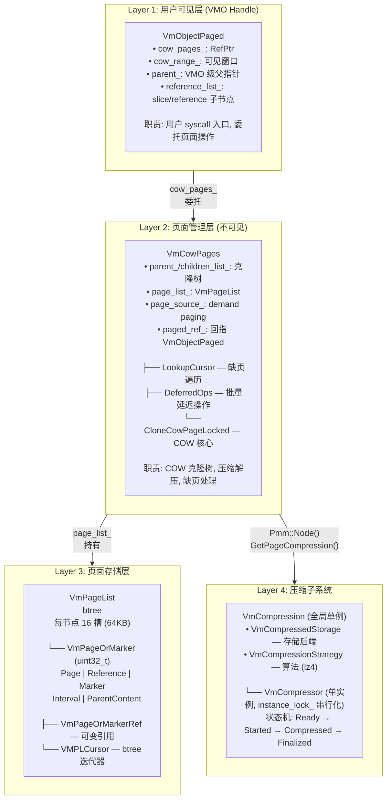

---

## 2. VmObjectPaged ↔ VmCowPages：委托关系

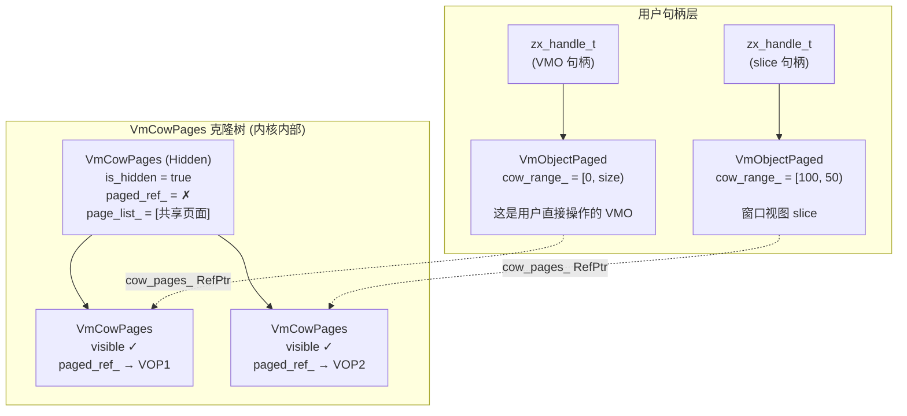

**关键关系**:
- `VmObjectPaged.cow_pages_` → 指向它挂载的 `VmCowPages` 节点（RefPtr，共享所有权）
- `VmCowPages.paged_ref_` → 回指它"属于"的 `VmObjectPaged`（raw pointer，无所有权）
- Hidden 节点 `paged_ref_ == null`：不对应任何用户可见 VMO
- 多个 `VmObjectPaged` 可以共享同一棵 `VmCowPages` 树（通过 slice/reference + `cow_range_`）

---

## 3. VmCowPages 克隆树结构

### 3.1 节点属性对比

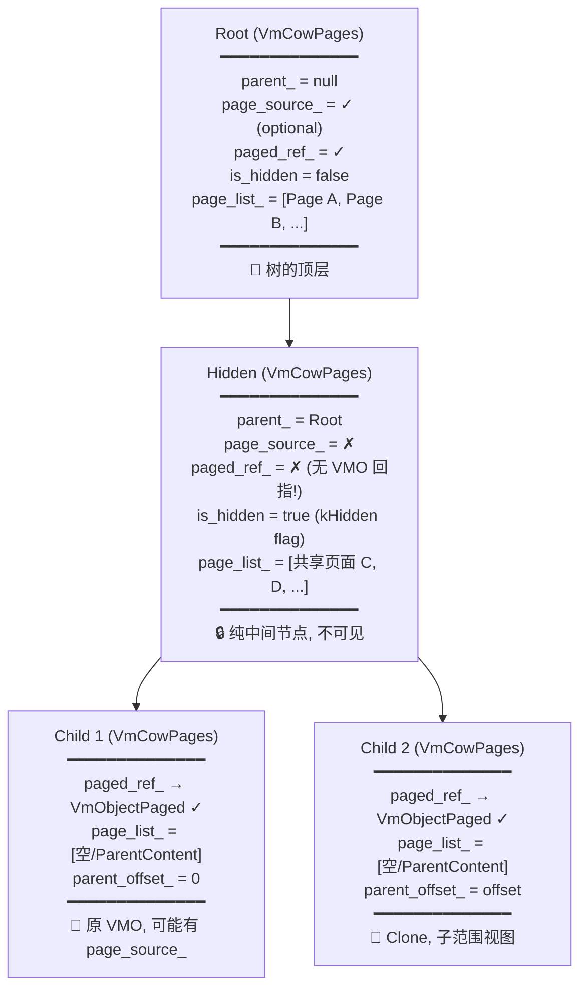

### 3.2 坐标转换

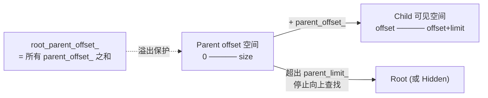

> 查找 child offset X → 在 parent 中查 `X + parent_offset_`。`parent_limit_` 指示向上查找的边界，`root_parent_offset_` 是累积偏移，用于防止 64-bit 溢出。

---

## 4. LookupCursor：缺页遍历生命周期

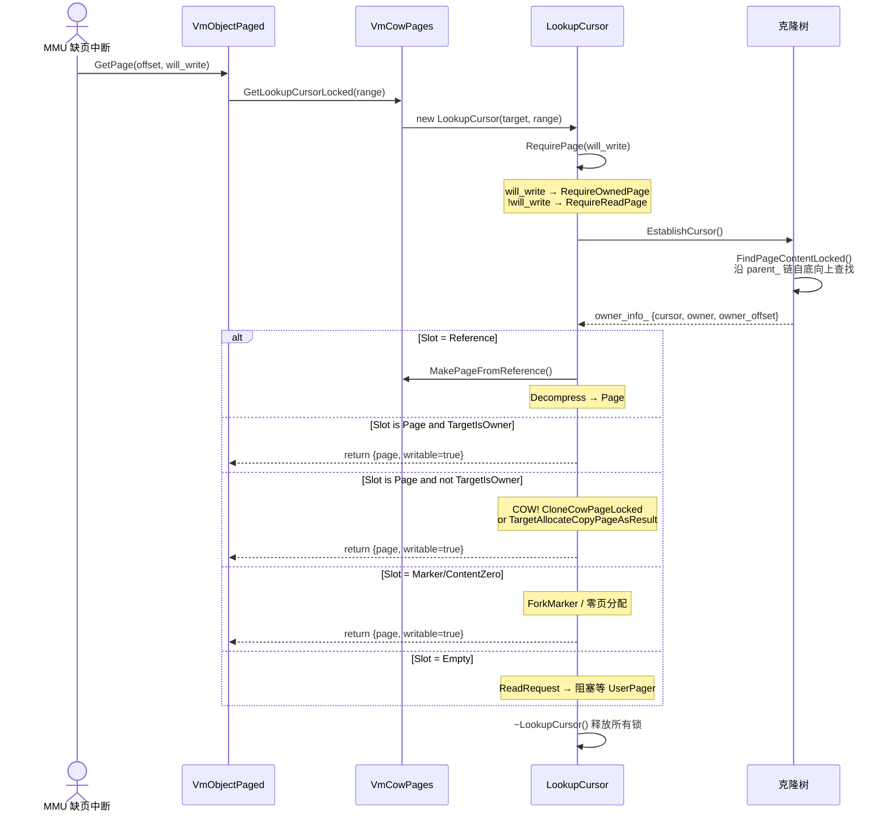

---

## 5. VmPageOrMarker：槽位五态

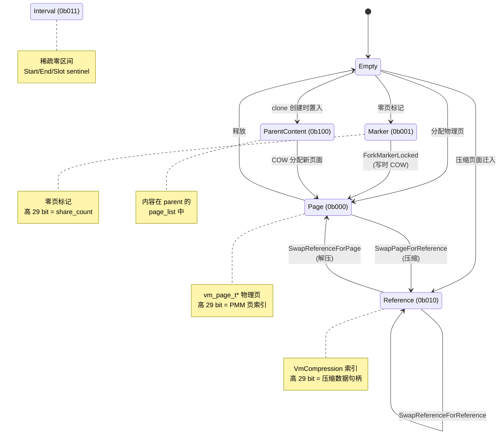

### 5.1 VmPageList 内部结构

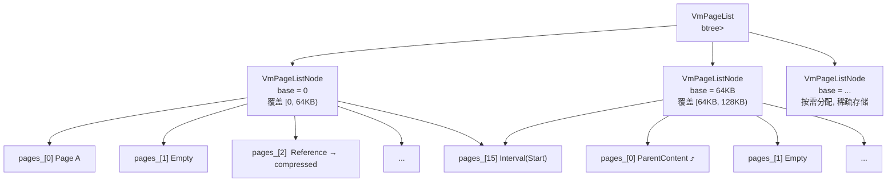

> `kPageFanOut = 16`，每个节点覆盖 16 页 = 64KB。`VMPLCursor` 封装 btree 迭代器，提供连续遍历能力。

---

## 6. 压缩子系统

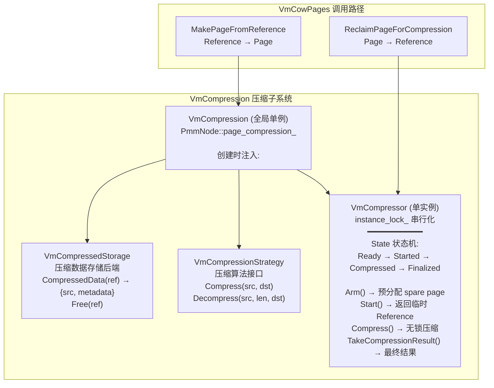

---

## 7. 完整关系总图

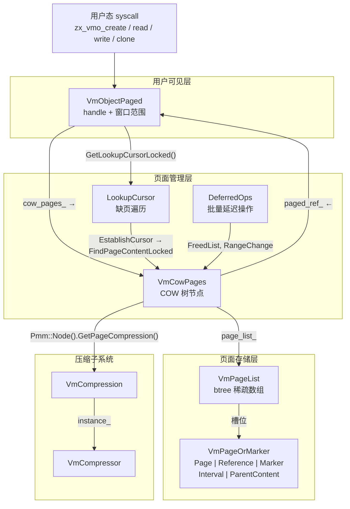

---

## 8. 关键成员变量速查表

### VmObjectPaged

| 成员 | 类型 | 说明 |
|------|------|------|
| `cow_pages_` | `fbl::RefPtr<VmCowPages>` | 指向页面管理节点 |
| `cow_range_` | `VmCowRange` | 此 VMO 在 cow_pages_ 中的可见窗口 |
| `parent_` | `VmObjectPaged*` | slice/reference 的父 VMO 指针 |
| `reference_list_` | `ReferenceList` | 所有 slice/reference 子节点链表 |

### VmCowPages

| 成员 | 类型 | 说明 |
|------|------|------|
| `options_` | `VmCowPagesOptions` | kHidden, kPageSourceRoot, kUserPagerBackedRoot |
| `parent_` | `fbl::RefPtr<VmCowPages>` | 克隆树父节点 (null = 树的根) |
| `children_list_` | `TaggedDoublyLinkedList` | 克隆树所有子节点 |
| `page_list_` | `VmPageList` | 本节点拥有的页面 |
| `page_source_` | `fbl::RefPtr<PageSource>` | 可选，demand paging 数据源 |
| `paged_ref_` | `VmObjectPaged*` | 回指用户可见 VMO (hidden 为 null) |
| `parent_offset_` | `uint64_t` | 本节点在 parent 中的起始偏移 |
| `parent_limit_` | `uint64_t` | 超出此偏移停止向上查找 |
| `root_parent_offset_` | `uint64_t` | 投影到根节点的累积偏移 |
| `size_` | `uint64_t` | 本节点的页面大小 |

---

## 9. COW 克隆与写缺页完整流程

### 9.1 Clone 创建 (CreateCloneLocked)

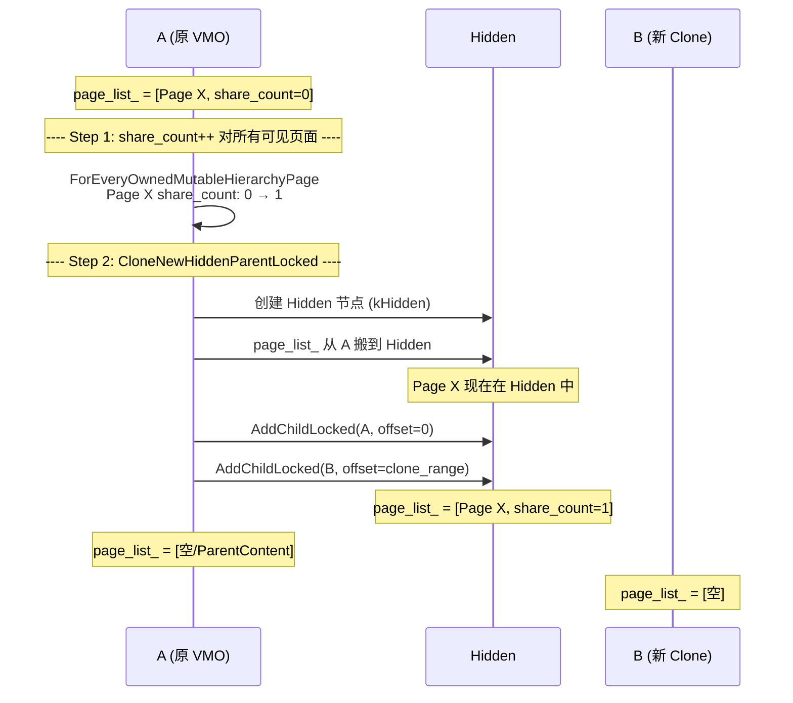

> **关键**：share_count 在创建 clone 树结构**之前**就递增了。rollback 机制保证失败时回滚。

### 9.2 share_count 的含义

```
share_count = 还有几个子节点（兄弟姐妹）能通过 Hidden 看见这个页面

  share_count == 0  →  只有一个子节点还能看到，或没有共享
  share_count == 1  →  还有一个兄弟能看到（刚 clone 完的典型值）
  share_count == N  →  还有 N 个兄弟能看到
```

### 9.3 写缺页 COW：Fork vs Migrate

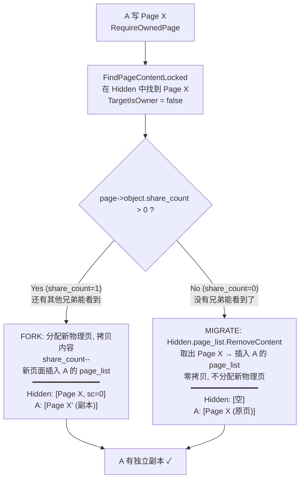

### 9.4 两种场景演示

```
初始: Hidden [Page X, share_count=1], A [空], B [空]

━━━━━━━━━━━━━━━━━━━━━━━━━━━━━━━━━━━━━━━━━━━
场景 1: A 先写, B 后写
━━━━━━━━━━━━━━━━━━━━━━━━━━━━━━━━━━━━━━━━━━━

A 写 → share_count=1>0 → FORK
       Hidden [Page X, sc=0], A [Page X'], B [空]

B 写 → share_count=0 → MIGRATE
       Hidden [空], A [Page X'], B [Page X]

━━━━━━━━━━━━━━━━━━━━━━━━━━━━━━━━━━━━━━━━━━━
场景 2: B 先写, A 后写
━━━━━━━━━━━━━━━━━━━━━━━━━━━━━━━━━━━━━━━━━━━

B 写 → share_count=1>0 → FORK
       Hidden [Page X, sc=0], A [空], B [Page X']

A 写 → share_count=0 → MIGRATE
       Hidden [空], A [Page X], B [Page X']
```

> **结论**：不管谁先写，第一个写的做 Fork（分配新页、memcpy），最后一个写的做 Migrate（直接搬原页，零开销）。share_count 精准保证了这一点。

### 9.5 PageSource 的角色

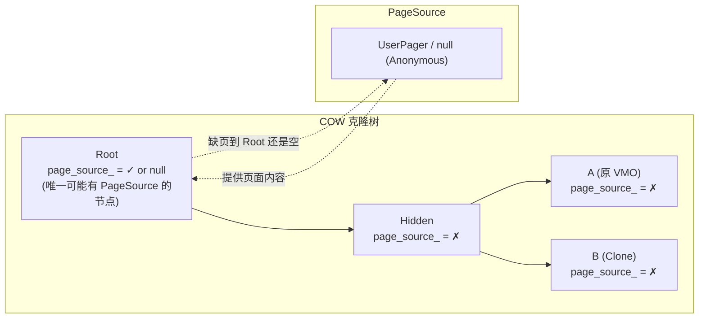

- **只有 Root 持有 `page_source_`**（可空，null 表示 Anonymous 零页）
- Clone 创建时不复制 PageSource——B 只能通过 Hidden → Root 间接用到它
- 缺页走到 Root 还是空 → 问 PageSource 要数据（可能阻塞等 UserPager）

### 9.6 为什么需要 Hidden 节点？

最直接的做法是让 B 直接挂到 A 下面：

```
简单方案:                     Fuchsia 方案:

  A [Page X]                   Hidden [Page X]
    └── B [空]                   ├── A [空]
                                 └── B [空]
```

简单方案的问题是 **A 自己要写 Page X 时**：

> A 既是"共享页面的持有者"又是"可以修改的参与者"。
> A 写 Page X → 页面在 A 自己的 page_list 里 → B 也在看 → 不能直接改
> → A 需要"对自己 COW"——把自己的页面复制一份替换自己？
> → 新页面放哪？怎么让 B 不受影响？

Fuchsia 的做法是把这两个角色拆开：

```
  Hidden [Page X]     ← 只负责持有共享页面，只读，永不变
    ├── A [空]        ← 只负责按需修改
    └── B [空]        ← 跟 A 完全对等
```

A 写和 B 写走**完全相同的 COW 路径**（CloneCowPageLocked），没有特殊情况。A 不需要对自己 COW，因为共享页面根本不在 A 的 page_list 里。

### 9.7 Hidden 何时消失？

触发条件（[vm_cow_pages.h:1012](zircon/kernel/vm/include/vm/vm_cow_pages.h#L1012)）：

```cpp
bool should_dead_transition_locked() const {
    return !paged_ref_ && children_list_len_ == 0 && life_cycle_ == LifeCycle::Alive;
}
```

Hidden 的 `paged_ref_` 永远为 null，所以就是等 **所有孩子都走了**（`children_list_len_ == 0`）。

```
场景 A: 还剩 2 孩子，走 1 个（合并成功）
  Hidden [Page X]            Sibling close
    ├── Child                   → RemoveChildLocked: children_list_len_==2
    └── Sibling(close)          → DropChildLocked(Sibling)
                                → MergeContentWithChildLocked:
                                  把 Hidden 的页面塞进剩下的 Child
                                  塞成功 → DropChildLocked(Child)
                                  children_list_len_ = 0 → Hidden 消失 ✅

场景 B: 还剩 2 孩子，走 1 个（合并失败）
  同上, 但 Child 的相同 offset 已经有自己的页面 → 塞不进去
  Hidden 留着, 剩 1 个孩子

场景 C: 只剩 1 孩子（合并失败留下），走掉
  Hidden [空/剩页]            Child close
    └── Child(close)             → DropChildLocked
                                 children_list_len_ = 0 → Hidden 消失 ✅
```

**合并失败**的唯一原因：剩下的 Child 在同一 offset 已经有自己的页面了（之前 COW Fork 过）。

---

## 10. 关键函数索引

| 函数 | 类 | 位置 | 功能 |
|------|------|------|------|
| `Create` | `VmObjectPaged` | [vm_object_paged.h:61](zircon/kernel/vm/include/vm/vm_object_paged.h#L61) | 创建普通 VMO |
| `CreateExternal` | `VmObjectPaged` | [vm_object_paged.h:82](zircon/kernel/vm/include/vm/vm_object_paged.h#L82) | 创建 pager-backed VMO |
| `GetPage` | `VmObjectPaged` | [vm_object_paged.cc:1995](zircon/kernel/vm/vm_object_paged.cc#L1995) | 缺页入口，创建 LookupCursor |
| `Create` | `VmCowPages` | [vm_cow_pages.h:162](zircon/kernel/vm/include/vm/vm_cow_pages.h#L162) | 创建 VmCowPages 节点 |
| `CreateCloneLocked` | `VmCowPages` | [vm_cow_pages.cc:1831](zircon/kernel/vm/vm_cow_pages.cc#L1831) | 创建 clone |
| `CloneNewHiddenParentLocked` | `VmCowPages` | [vm_cow_pages.cc:1582](zircon/kernel/vm/vm_cow_pages.cc#L1582) | 创建 hidden 父节点，页面迁移 |
| `FindPageContentLocked` | `VmCowPages` | [vm_cow_pages.cc:2958](zircon/kernel/vm/vm_cow_pages.cc#L2958) | 沿克隆链向上查找页面 |
| `RequireOwnedPage` | `LookupCursor` | [vm_cow_pages.cc:3747](zircon/kernel/vm/vm_cow_pages.cc#L3747) | 写缺页处理 |
| `RequireReadPage` | `LookupCursor` | [vm_cow_pages.cc:3888](zircon/kernel/vm/vm_cow_pages.cc#L3888) | 读缺页处理 |
| `MakePageFromReference` | `VmCowPages` | [vm_cow_pages.cc:951](zircon/kernel/vm/vm_cow_pages.cc#L951) | 解压 Reference → Page |
| `CloneCowPageLocked` | `VmCowPages` | [vm_cow_pages.cc:2671](zircon/kernel/vm/vm_cow_pages.cc#L2671) | Hidden 节点 COW (迁移/复制) |
| `TargetAllocateCopyPageAsResult` | `LookupCursor` | [vm_cow_pages.cc:3444](zircon/kernel/vm/vm_cow_pages.cc#L3444) | 直接 COW 复制 |
| `ReclaimPageForCompression` | `VmCowPages` | [vm_cow_pages.cc:7387](zircon/kernel/vm/vm_cow_pages.cc#L7387) | 压缩 Page → Reference |
