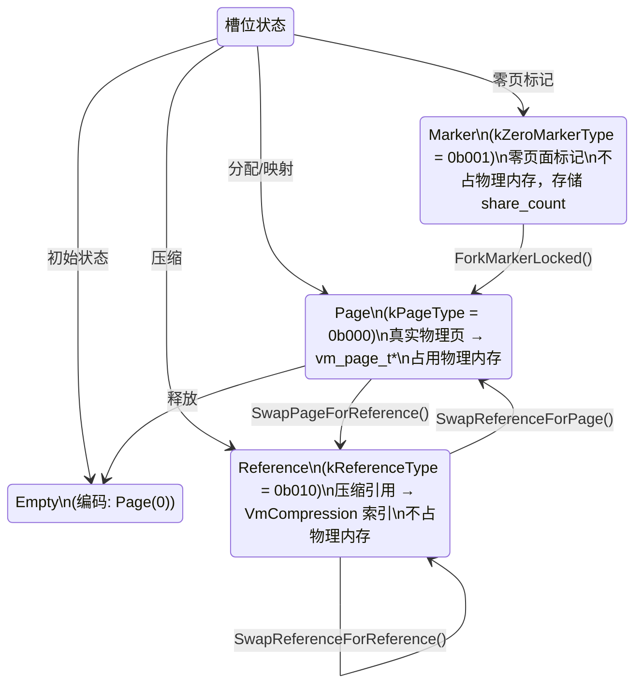
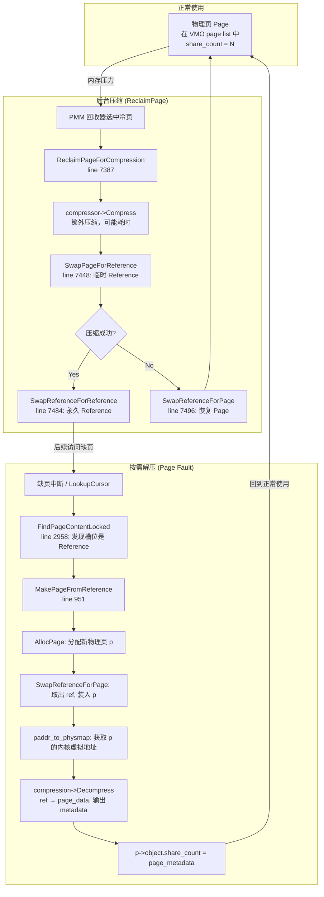
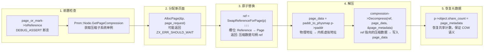
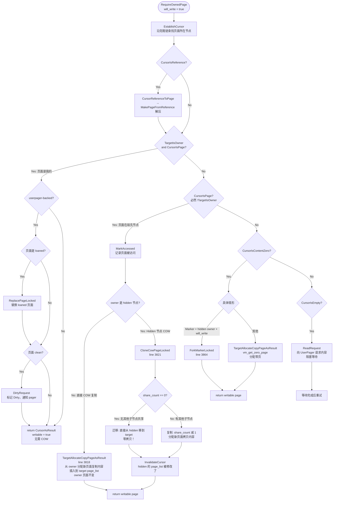
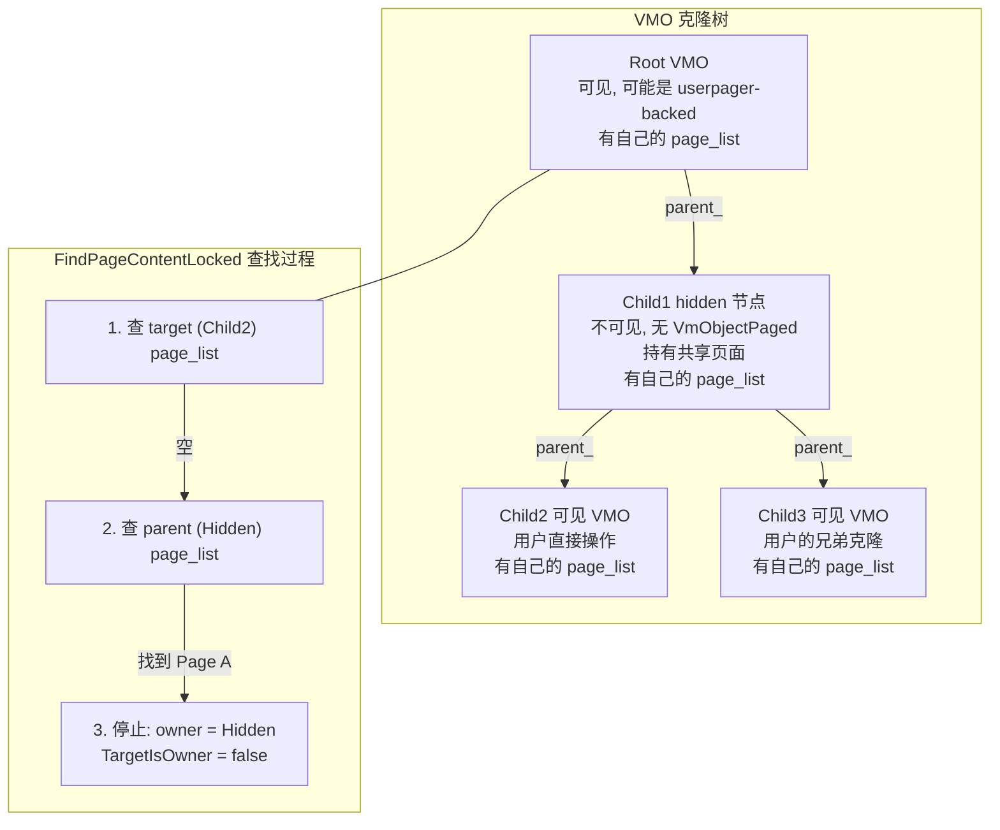
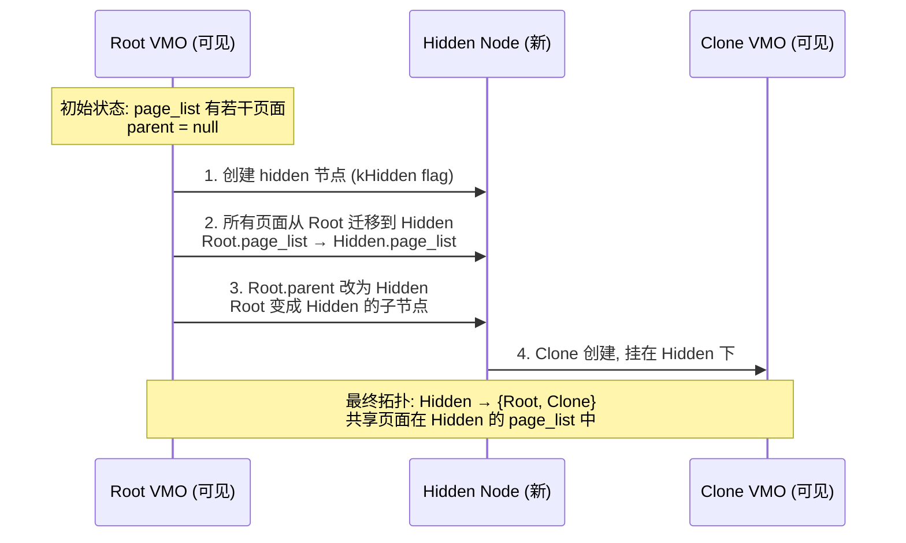
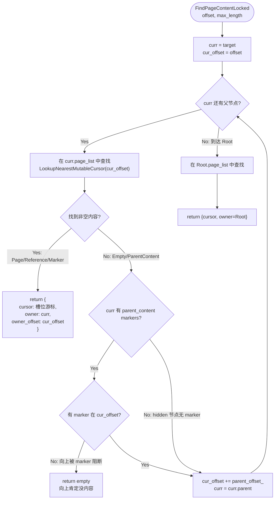
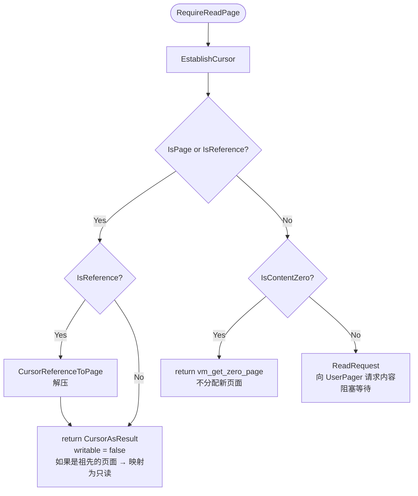
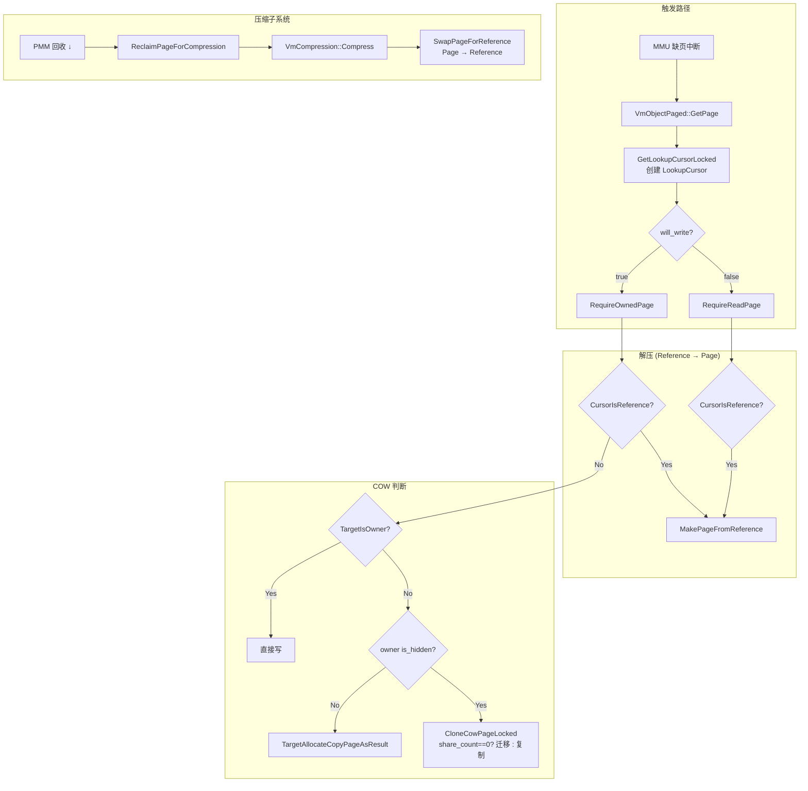

# Fuchsia 内核 VM：COW 页面管理与压缩流程图

> 基于 `zircon/kernel/vm/vm_cow_pages.cc` 源码分析。
>
> 文件索引：
> - [vm_cow_pages.cc](/home/developer/fuchsia/zircon/kernel/vm/vm_cow_pages.cc) — COW 页面管理实现
> - [vm_cow_pages.h](/home/developer/fuchsia/zircon/kernel/vm/include/vm/vm_cow_pages.h) — `LookupCursor`、`VmCowPagesOptions` 等定义
> - [vm_page_list.h](/home/developer/fuchsia/zircon/kernel/vm/include/vm/vm_page_list.h) — `VmPageOrMarker` 三态表示
> - [compression.h](/home/developer/fuchsia/zircon/kernel/vm/include/vm/compression.h) — `VmCompression` 压缩子系统接口
> - [physmap.h](/home/developer/fuchsia/zircon/kernel/vm/include/vm/physmap.h) — `paddr_to_physmap()` 物理地址到内核虚拟地址映射

---

## 1. VmPageOrMarker：一个槽位的三种状态

VMO page list 中每个槽位是 `VmPageOrMarker`（内部编码为一个 `uint32_t`，低 3 bit 为类型标记）。



### 1.1 三种状态对比

| 状态 | 编码 | 存储内容 | 占用物理内存 | 典型场景 |
|------|------|----------|:--:|----------|
| **Page** | `0b000` | `vm_page_t*` 指针（PMM 页索引） | ✅ | 正常分配、COW 复制后 |
| **Reference** | `0b010` | 压缩数据句柄（`VmCompression` 内部索引） | ❌ | 内存压力下被压缩的冷页 |
| **Marker** | `0b001` | 共享计数（高 29 bit） | ❌ | 已提交但内容全零的页 |

---

## 2. 页面压缩与解压的完整生命周期



### 2.1 MakePageFromReference 详细流程（你选中的代码）



---

## 3. 写缺页（Write Fault）完整决策流程

入口：`VmCowPages::LookupCursor::RequireOwnedPage`（[line 3747](zircon/kernel/vm/vm_cow_pages.cc#L3747)）



---

## 4. TargetIsOwner() 与克隆层级

### 4.1 核心概念



### 4.2 `TargetIsOwner()` 判定逻辑

```
TargetIsOwner() := (owner_info_.owner == null)

  owner == null  →  页面在 target 自己的 page_list  →  直接写, 无 COW
  owner != null  →  页面在祖先的 page_list          →  COW
```

### 4.3 Hidden 节点的创建（CloneNewHiddenParentLocked）



---

## 5. FindPageContentLocked：沿克隆树向上查找



---

## 6. 两种 COW 路径对比

### 6.1 路径 A：直接复制（owner 为非 hidden，如 Root）

```
  Before:                    After (write fault):
  ┌─────────────┐            ┌─────────────┐
  │ Root (owner)│            │ Root        │
  │ page_list:  │            │ page_list:  │
  │  [Page A]   │            │  [Page A]   │  ← 不变！share_count 不变
  └──────┬──────┘            └──────┬──────┘
         │                          │
  ┌──────┴──────┐            ┌──────┴──────┐
  │ Child (target)│           │ Child        │
  │ page_list:   │            │ page_list:   │
  │  [空]        │            │  [Page A']   │  ← 新分配的复制页
  └─────────────┘            └─────────────┘
```

### 6.2 路径 B：Hidden 节点 COW（CloneCowPageLocked）

```
  Before: share_count > 0           After (write fault on Child2):

  ┌──────────────┐                  ┌──────────────┐
  │ Hidden       │                  │ Hidden       │
  │ page_list:   │                  │ page_list:   │
  │  [Page A]    │                  │  [Page A]    │  ← 还在
  │ share_count=2│                  │ share_count=1│  ← 减 1
  └──┬────────┬──┘                  └──┬────────┬──┘
     │        │                        │        │
  ┌──┴──┐  ┌──┴──┐                 ┌──┴──┐  ┌──┴──┐
  │Child1│  │Child2│                │Child1│  │Child2│
  │ [空] │  │ [空] │                │ [空] │  │[Pg A']│ ← Child2 新副本
  └─────┘  └─────┘                 └─────┘  └─────┘


  Before: share_count == 0           After (write fault on Child1):

  ┌──────────────┐                  ┌──────────────┐
  │ Hidden       │                  │ Hidden       │
  │ page_list:   │                  │ page_list:   │
  │  [Page A]    │                  │  [空]        │  ← Page A 被移走
  │ share_count=0│                  └──────────────┘
  └──┬────────┬──┘                        │
     │        │                     ┌──────┴──────┐
  ┌──┴──┐  ┌──┴──┐                 │ Child1      │
  │Child1│  │Child2│                │ page_list:  │
  │ [空] │  │ [空] │                │  [Page A]   │  ← 直接迁移，零拷贝！
  └─────┘  └─────┘                 └─────────────┘
```

---

## 7. 读缺页（Read Fault）决策流程

相对简单——读操作不需要 COW，直接返回已有页面（只读）。



---

## 8. 完整流程总览



---

## 9. 关键函数索引

| 函数 | 位置 | 功能 |
|------|------|------|
| `VmCowPages::MakePageFromReference` | [vm_cow_pages.cc:951](zircon/kernel/vm/vm_cow_pages.cc#L951) | 将压缩 Reference 解压为物理 Page |
| `VmCowPages::ReplaceReferenceWithPageLocked` | [vm_cow_pages.cc:977](zircon/kernel/vm/vm_cow_pages.cc#L977) | 解压 + 加入 page queues |
| `VmCowPages::ReclaimPageForCompression` | [vm_cow_pages.cc:7387](zircon/kernel/vm/vm_cow_pages.cc#L7387) | 压缩一个页面 Page → Reference |
| `VmCowPages::FindPageContentLocked` | [vm_cow_pages.cc:2958](zircon/kernel/vm/vm_cow_pages.cc#L2958) | 沿克隆树向上查找页面内容 |
| `LookupCursor::RequireOwnedPage` | [vm_cow_pages.cc:3747](zircon/kernel/vm/vm_cow_pages.cc#L3747) | 写缺页核心处理 |
| `LookupCursor::RequireReadPage` | [vm_cow_pages.cc:3888](zircon/kernel/vm/vm_cow_pages.cc#L3888) | 读缺页核心处理 |
| `VmCowPages::CloneCowPageLocked` | [vm_cow_pages.cc:2671](zircon/kernel/vm/vm_cow_pages.cc#L2671) | Hidden 节点 COW 分叉（迁移/复制） |
| `LookupCursor::TargetAllocateCopyPageAsResult` | [vm_cow_pages.cc:3444](zircon/kernel/vm/vm_cow_pages.cc#L3444) | 直接 COW 复制（非 hidden owner） |
| `VmCowPages::CloneNewHiddenParentLocked` | [vm_cow_pages.cc:1582](zircon/kernel/vm/vm_cow_pages.cc#L1582) | 创建 hidden 节点，页面从源迁移到 hidden |
| `VmCowPages::ForkMarkerLocked` | [vm_cow_pages.cc:2755](zircon/kernel/vm/vm_cow_pages.cc#L2755) | Hidden 节点中 Marker 的 COW 分叉 |
| `LookupCursor::CursorReferenceToPage` | [vm_cow_pages.cc:3558](zircon/kernel/vm/vm_cow_pages.cc#L3558) | 游标层解压封装 |
| `VmPageOrMarker::SwapReferenceForPage` | [vm_page_list.h:127](zircon/kernel/vm/include/vm/vm_page_list.h#L127) | 原子替换：槽位 Reference → Page |
| `VmPageOrMarker::SwapPageForReference` | [vm_page_list.h:137](zircon/kernel/vm/include/vm/vm_page_list.h#L137) | 原子替换：槽位 Page → Reference |
| `VmCompression::Decompress` | [compression.cc:139](zircon/kernel/vm/compression.cc#L139) | 压缩子系统解压入口 |
| `paddr_to_physmap` | [physmap.h](zircon/kernel/vm/include/vm/physmap.h) | 物理地址 → 内核虚拟地址映射 |
