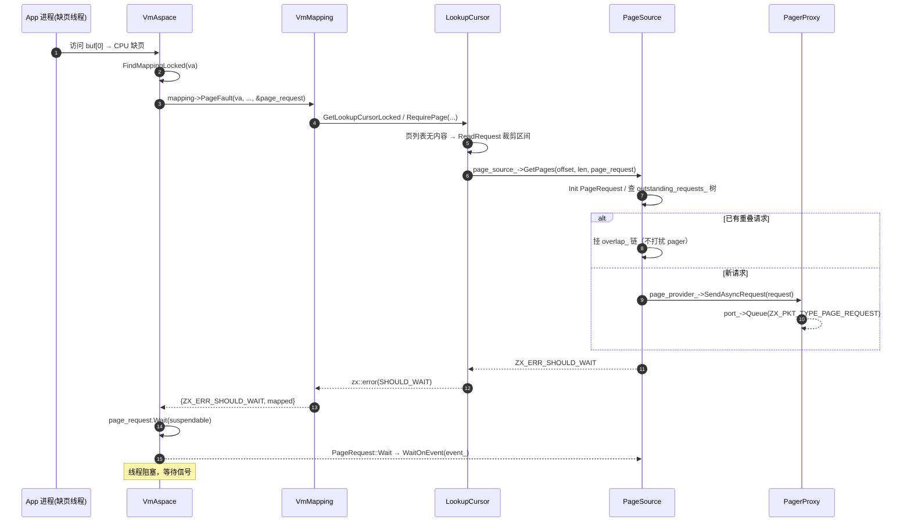

# Fuchsia 内核 VM：PageSource / PageProvider / PageRequest 缺页请求体系

> 基于 `/home/developer/fuchsia/zircon/kernel/vm/` 源码分析。本文梳理"pager 支持的 VMO 缺页时，内核如何跨进程请求页面、等待、供页、唤醒"的完整链路。
>
> 文件索引：
> - [page_source.h](/home/developer/fuchsia/zircon/kernel/vm/include/vm/page_source.h) — `PageSource`、`PageProvider`、`PageRequest`、`PageRequestInterface`、`MultiPageRequest` 定义
> - [page_source.cc](/home/developer/fuchsia/zircon/kernel/vm/page_source.cc) — 请求跟踪、重叠合并、完成唤醒实现
> - [pager_dispatcher.cc](/home/developer/fuchsia/zircon/kernel/object/pager_dispatcher.cc) — `PagerDispatcher::CreateSource`（pager VMO 创建入口）
> - [pager_proxy.cc](/home/developer/fuchsia/zircon/kernel/object/pager_proxy.cc) — `PagerProxy`（PageProvider 的 pager 实现，port 发包）
> - [vm_cow_pages.cc](/home/developer/fuchsia/zircon/kernel/vm/vm_cow_pages.cc) — `LookupCursor::RequirePage/RequireReadPage/RequireOwnedPage/ReadRequest`，`GetPages` 调用点
> - [vm_mapping.cc](/home/developer/fuchsia/zircon/kernel/vm/vm_mapping.cc) — `VmMapping::PageFault`，缺页时调用 `cursor->RequirePage`
> - [vm_aspace.cc](/home/developer/fuchsia/zircon/kernel/vm/vm_aspace.cc) — `VmAspace::PageFault`，入口与等待循环
> - [vm_object_paged.cc](/home/developer/fuchsia/zircon/kernel/vm/vm_object_paged.cc) — `CreateContiguous`（PhysicalPageProvider 装配）、`CreateExternal`

---

## 1. 设计动机：为什么 Fuchsia 需要这套协议

### 1.1 与 Linux 的根本差异

| | Linux（宏内核） | Fuchsia（微内核风格） |
|---|---|---|
| 页面内容来源 | 内核内的文件系统 + 块设备驱动 | **用户态进程**（pager，如 fxfs） |
| 缺页时的行为 | 同步执行 `readpage()`，线程在内核里睡 I/O | 发 IPC 消息后返回 `ZX_ERR_SHOULD_WAIT`，睡在 event 上 |
| 请求合并 | 页锁 + 页的 wait queue | `outstanding_requests_` WAVL 树 + `overlap_` 链表 |
| 完成信号 | `unlock_page()` 唤醒等待者 | `event_.Signal()`（从 syscall 路径调入） |
| 出错 | I/O error 直接返回 fault handler | `OnPagesFailed` 存 `complete_status_`，唤醒带回 |

**核心结论**：Linux 把"谁提供页面"内建在宏内核里，页面状态本身就是隐式的请求状态，所以不需要协议；Fuchsia 把"谁提供页面"外包到进程外，内核不认识磁盘，只能发明一套**跨进程的"点菜-等待-送菜-喊人"协议**。本文所有代码复杂度，都是这条边界本身的造价。

### 1.2 设计先例

这套设计是 **Mach external pager** 概念的直接后代（BSD UVM、macOS vnode pager 同源）。Linux 中最接近的类比是 **userfaultfd**（把缺页发给用户态处理），但那是可选设施；Fuchsia 的 pager 是文件系统的**默认路径**——`zx_pager_create_vmo` 是存储栈的地基。

---

## 2. 核心角色

```
VmAspace（地址空间）
 └─ VmMapping（虚拟地址 ←→ VMO 映射）
      └─ VmCowPages（页面仓库）
           └─ PageSource ──────── 请求调度中枢（记账 + 合并 + 唤醒）
                ├─ PageProvider ─── 真正干活的抽象接口
                │    ├─ PagerProxy（用户态 pager 实现，port 发包）
                │    └─ PhysicalPageProvider（contiguous VMO 回收物理页）
                └─ PageRequest ──── 调用方栈上分配的"等待令牌"
```

| 角色 | 一句话职责 | 关键方法 |
|---|---|---|
| `PageRequest` | 调用方（缺页线程）栈上的**等待凭证**，贯穿整个请求生命周期 | `Init` / `Wait` / `CancelRequest` |
| `PageRequestInterface` | PageRequest → PageSource 的窄接口（让 PageRequest 只需持有 RefPtr 而不依赖 PageSource 完整类型） | `CancelRequest` / `WaitOnRequest` |
| `PageSource` | 请求注册、重叠合并、完成唤醒；**不含具体供页逻辑** | `GetPages` / `RequestDirtyTransition` / `OnPagesSupplied` / `OnPagesDirtied` / `OnPagesFailed` / `Detach` / `Close` |
| `PageProvider` | 真正异步干活的抽象接口 | `SendAsyncRequest` / `ClearAsyncRequest` / `SwapAsyncRequest` / `WaitOnEvent` / `OnDetach` / `OnClose` |
| `PagerProxy` | PageProvider 的 pager 实现：把请求打包成 port packet 发给用户态 pager | `SendAsyncRequest` → `port_->Queue` |
| `PhysicalPageProvider` | PageProvider 另一实现：为 contiguous VMO 从 pmm 回收特定物理页 | — |

### 2.1 PageRequest 的内部状态（理解后续流程的关键）

```cpp
// page_source.h 中 PageRequest 的字段
uint64_t offset_ = UINT64_MAX;   // 请求起点（VMO 空间）；UINT64_MAX = 未初始化
uint64_t len_ = 0;               // 请求总长度
uint64_t pending_size_ = 0;      // 还差多少页没被供给
uint64_t wake_offset_ = UINT64_MAX;  // 下次该唤醒的偏移（请求相对），用于部分供给
zx_status_t complete_status_ = ZX_OK; // 完成时带给等待者的状态（支持部分失败）
AutounsignalEvent event_;        // 等待者睡在这里
fbl::RefPtr<PageRequestInterface> src_;  // 回指 PageSource
fbl::TaggedDoublyLinkedList<PageRequest*, PageSourceTag> overlap_; // 重叠等待者链
bool provider_owned_;            // 请求是否还在 PageProvider 手里（断言用）
```

---

## 3. 缺页请求完整流程（方向一：请求）

```
用户态 App:   pixel = buf[0];           →  CPU 缺页
                │
                ▼
VmAspace::PageFault(va, flags)                          vm_aspace.cc:552
└─ PageFaultInternal(va, flags, additional_pages)       vm_aspace.cc:569
   ├─ root_vmar_->FindMappingLocked(va)  找到 VmMapping  vm_aspace.cc:604
   └─ mapping->PageFault(va, flags, ..., &page_request) vm_aspace.cc:616
      └─ VmMapping::PageFault(...)  加 VMO 锁            vm_mapping.cc:1375
         └─ PageFaultLockedObject(...)                  vm_mapping.cc:1173
            ├─ object->GetLookupCursorLocked(...)  建页列表游标 vm_mapping.cc:1284
            └─ cursor->RequirePage(write, num, ..., page_request)  vm_mapping.cc:1300
               └─ RequirePage 是 inline 分发 (vm_cow_pages.h:1826):
                  ├─ will_write ? RequireOwnedPage (vm_cow_pages.cc:3747)
                  └─         : RequireReadPage (vm_cow_pages.cc:3888)
                     └─ 决策: 有页→返回 / 零页→零页 / 空→ReadRequest (vm_cow_pages.cc:3915)
                        └─ ReadRequest: 裁剪区间后发起请求 (vm_cow_pages.cc:3606)
                           └─ page_source_->GetPages(owner_offset, len, page_request)
                                                                        vm_cow_pages.cc:3620
                              └─ PageSource::GetPages = PopulateRequest(READ)  page_source.h:240
                                 └─ PopulateRequest (page_source.cc:298)
                                    ├─ PageRequest::Init 填"点菜单"（栈上对象）
                                    ├─ 查 outstanding_requests_ 树:
                                    │   ├─ 有重叠 → 挂 overlap_ 链，不打扰 pager (page_source.cc:404)
                                    │   └─ 无重叠 → SendRequestToProviderLocked (page_source.cc:393)
                                    │       └─ page_provider_->SendAsyncRequest(req) (page_source.cc:411)
                                    │           └─ PagerProxy::SendAsyncRequest (pager_proxy.cc:58)
                                    │              └─ QueuePacketLocked → port_->Queue(packet)
                                    │                 (ZX_PKT_TYPE_PAGE_REQUEST: key+offset+len)
                                    └─ 返回 ZX_ERR_SHOULD_WAIT ← 逐层原样传回
                │
                ▼  （缺页线程开始等）
page_request.Wait(suspendable)                          vm_aspace.cc:622
└─ PageRequest::Wait                                     page_source.cc:595
   └─ src_->WaitOnRequest(this, suspendable)             page_source.cc:600
      └─ PageSource::WaitOnRequest                       page_source.cc:522
         └─ page_provider_->WaitOnEvent(&request->event_) page_source.cc:527
            （线程睡死在 event_ 上，等方向二）
```



### 3.1 关键决策：`SendRequestToProviderLocked`（page_source.cc:393）

```cpp
auto overlap = outstanding_requests_[type].upper_bound(request->offset_);
if (overlap.IsValid() && overlap->offset_ <= request->offset_) {
    // 【重叠】区间已被别的请求覆盖 → 挂到已有请求的 overlap_ 链上，
    // 不重复打扰 pager，等那个请求完成时一起被唤醒
    overlap->overlap_.push_back(request);
} else {
    // 【不重叠】自己是"主请求" → 发给 PageProvider，插入树中
    request->pending_size_ = request->len_;
    page_provider_->SendAsyncRequest(request);
    outstanding_requests_[type].insert(request);
}
```

`outstanding_requests_[type]` 是**按键 = 请求结束偏移**（`GetEnd()`）排序的 WAVL 树，每类请求（READ / DIRTY / WRITEBACK）一棵。按结束偏移排序是为了 `ResolveRequestsLocked` 里用 `upper_bound(offset)` 一次定位"结束地址 > offset 的最小请求"，O(log n) 处理重叠。

---

## 4. 供页完成流程（方向二：唤醒）

```
用户态 pager:  收 port 包 → 自己读磁盘/网络 → 调 syscall
                zx_pager_supply_pages(pager, vmo, offset, len, aux_vmo, ...)
                │
                ▼
内核:   VmCowPages::SupplyPagesLocked(...)   页插进 page_list_
        └─ page_source_->OnPagesSupplied(gap_start, gap_len)   vm_cow_pages.cc:4355
           └─ PageSource::OnPagesSupplied                      page_source.cc:94
              └─ ResolveRequestsLocked(READ, offset, len, ZX_OK)  page_source.cc:152
                 ├─ 树定位: outstanding_requests_[type].upper_bound(offset)  page_source.cc:168
                 ├─ 部分满足 → EarlyWakeRequestLocked → event_.Signal()      page_source.cc:206
                 │             （只醒"正好等这个偏移"的请求）
                 └─ 全部满足 → CompleteRequestLocked                          page_source.cc:219
                    ├─ page_provider_->ClearAsyncRequest(request)  从 pager 收回  page_source.cc:425
                    └─ event_.Signal()  自己 + 所有 overlap_ 等待者一起醒       page_source.cc:458
                │
                ▼
缺页线程:   Wait 返回 → do-while 重试缺页          vm_aspace.cc:645
            → RequirePage 这次找到页了
            → coalescer.Append / Flush → arch_aspace().Map() 写页表   vm_mapping.cc:1322
            → 返回用户态，pixel = buf[0] 正常执行
```

### 4.1 ResolveRequestsLocked 的核心逻辑（page_source.cc:152）

对每个与 `[offset, offset+len)` 相交的请求，把供给区间换算成请求相对区间 `[req_offset, req_end)`，计算 `fulfill = req_end - req_offset`：

- **`fulfill < pending_size_`**（部分满足）：`pending_size_ -= fulfill`；仅当 `req_offset == wake_offset_` 时调 `EarlyWakeRequestLocked` 提前唤醒一次（部分数据可先处理，early-wake 场景）
- **`fulfill >= pending_size_`**（全部满足）：`CompleteRequestLocked` 从 provider 收回请求，Signal 自己及所有 overlap 等待者，从树中删除

> 注意：跟踪的只有"已满足长度"而非精确偏移（page_source.h:258-264 的注释），因此调用方必须保证 `OnPagesSupplied` 只对**新供给**的区间调用，否则会重复记账。

---

## 5. RequirePage 什么时候会调用 PageSource::GetPages？

决策树（`RequireReadPage`，vm_cow_pages.cc:3888）：

```cpp
if (CursorIsPage() || CursorIsReference()) {
    return zx::ok(CursorAsResult());   // ① 页已经在（或 COW 引用）→ 直接用，不问 pager
}
if (CursorIsContentZero()) {
    return zx::ok(RequireResult{vm_get_zero_page(), false});  // ② 内容是全零 → 用零页，不问 pager
}
// ③ 走到这里：page_list_ 里这个偏移什么都没有 → 内容必须从外部来
return zx::error(ReadRequest(max_request_pages, page_request->GetReadRequest()));
```

**结论：只有 VMO 确认"自己不知道这页是什么"时才调 GetPages**——页在、是 COW 引用、是全零页，都不会走到 pager。写路径 `RequireOwnedPage`（vm_cow_pages.cc:3747）末尾有同样的兜底。

两个细节：

1. **批处理与裁剪**（`ReadRequest`，vm_cow_pages.cc:3606）：尽量一次要 `max_request_pages` 页，但用 `ForEveryPageInRange` 找到范围内第一页已存在的位置，把 `request_size` 截断到那里——**已经有的页绝不重复请求**。
2. **请求打向 COW 链的 owner**：是 `owner_info_.owner`（真正带 page_source 的根节点）。pager VMO 有 clone 时，子节点缺页命中父节点的 marker/reference（COW 语义）走 fork 路径，只有一路查到根还是空才发请求。

---

## 6. VMO 与 Pager 的关系

### 6.1 创建：绑定发生在 `zx_pager_create_vmo`

用户态 pager 进程执行：

```
zx_pager_create(pager, ...)          → 内核建 PagerDispatcher（pager 对象）
zx_pager_create_vmo(pager, port, key, size, &vmo)
```

内核侧（`PagerDispatcher::CreateSource`，pager_dispatcher.cc:41）：

```cpp
// 1. 建 PagerProxy（PageProvider 实现），携带用户给的 port 和 key
auto proxy = fbl::MakeRefCountedChecked<PagerProxy>(&ac, this, port, key, options);
// 2. 用 proxy 做 provider，建 PageSource
auto src = fbl::MakeRefCountedChecked<PageSource>(&ac, proxy);
// 3. 两者互指（注释明说这是 RefPtr cycle，靠关句柄打断）
proxy->SetPageSourceUnchecked(src);
```

然后 `VmObjectPaged::CreateExternal(src, ...)`（vm_object_paged.cc:500）→ `VmCowPages` 持有 `page_source_`。

### 6.2 对象图与双向依赖

```
用户态 pager 进程
  ├── pager 句柄 ──────────────► PagerDispatcher (pager 对象)
  ├── VMO 句柄
  └── zx_port_wait(port) ◄─────────── 在这里收请求包

内核:
  PagerDispatcher
    └── proxies_（链表，一个 pager 可服务多个 VMO）
         └── PagerProxy (PageProvider 实现)
              ├── 持有 port_ + key_
              └── PageSource ◄──── VmCowPages::page_source_（VMO 内核对象持有）
```

- **① VMO → pager（请求）**：VMO 缺页 → `PageSource` → `PagerProxy::SendAsyncRequest` → 往 port 排队 `ZX_PKT_TYPE_PAGE_REQUEST` 包（`key` + `ZX_PAGER_VMO_READ` + offset/length，pager_proxy.cc:107-119）。用户态 pager 在 `zx_port_wait` 上收到。
- **② pager → VMO（供页/报错）**：`zx_pager_supply_pages` → 页插进该 VMO 的 `page_list_` → `OnPagesSupplied` → 唤醒。`zx_pager_op_range(ZX_PAGER_OP_FAIL)` → `OnPagesFailed` 让缺页报错。

### 6.3 生命周期纠缠

- **引用环**：PagerProxy ↔ PageSource 互相持有 RefPtr，靠用户关闭 pager 句柄 → `ReleaseProxy` → `OnDispatcherClose` 打断。
- **VMO 销毁**：`VmCowPages` 析构 → `page_source_->Close()`（vm_cow_pages.cc:1129）→ `Detach`（page_source.cc:46）→ 所有未完成请求被错误唤醒；同时 proxy 给用户态 pager 发 `ZX_PAGER_VMO_COMPLETE` 包（pager_proxy.cc:173）通知"这个 VMO 没了"。
- **pager 进程死亡**：pager 死了 → 端口关闭/句柄清空 → PageSource 侧所有未完成请求被 `Detach` 或错误唤醒，缺页返回 `ZX_ERR_IO` 等错误——**VMO 不会把内核带走**（崩溃隔离）。
- **一个 pager 多个 VMO**：`proxies_` 链表，每调一次 `zx_pager_create_vmo` 多一个 PagerProxy；用户态 pager 用 `key`（创建时指定）区分请求属于哪个 VMO。

---

## 7. 业务例子：相册 App 看一张 32MB 照片

**角色**：App 进程、fxfs 进程（用户态文件系统 = pager）、内核。

| 阶段 | 动作 |
|---|---|
| 打开 | App `open("/data/photos/holiday.jpg")` → fxfs 收到 IPC → `zx_pager_create_vmo` 建 pager-backed VMO → 返回 VMO 句柄 → App `mmap`。**此时一页数据都没读** |
| 访问 | App 执行 `pixel = buf[0]` → 缺页 → 内核链路 → `GetPages` → port 包（offset=0, len=4096）→ App 线程睡在 event_ 上 |
| 供页 | fxfs 在 `zx_port_wait` 收包 → 自己读磁盘 → `zx_pager_supply_pages` → 内核插页 → `OnPagesSupplied` → `event_.Signal()` |
| 重试 | App 线程醒来，do-while 重试缺页 → 找到页 → 写页表 → `pixel = buf[0]` 正常执行 |
| 批量 | 一次缺页连后几页一起要（`max_request_pages` 批处理），fxfs 一次读一个 chunk，不是每页一次 IPC |

这就是**按需调页（demand paging）**——32MB 照片只看了缩略图区域时，磁盘上只读了几个 chunk。

**对比 Linux**：同样场景下，缺页后内核自己调 `ext4_readpage` 同步读盘，文件系统 + 页缓存 + 块设备驱动全在内核里。**pager 就是 Linux 的"文件系统 + 页缓存 + 块设备驱动"整套东西，只是搬到了用户态进程里。**

**pager 的价值**：数据来源完全外包——本地磁盘、网络、解压中的 zip、实时数据流都可以，内核只提供"请求-等待-供页"通用协议。

---

## 8. 错误、取消与重叠管理

```
① pager 报错:  zx_pager_op_range(ZX_PAGER_OP_FAIL) → OnPagesFailed (page_source.cc:223)
                → ResolveRequestsLocked(..., error_status) → complete_status_ 记录
                → Wait 带着错误码返回，缺页重试后以 EIO 等错误失败

② VMO 销毁:    VmCowPages 析构 → page_source_->Close() (vm_cow_pages.cc:1129)
                → Detach (page_source.cc:46) → 所有等待者被错误唤醒
                → PagerProxy 发 ZX_PAGER_VMO_COMPLETE 包通知用户态 pager (pager_proxy.cc:173)

③ 主动取消:    PageRequest::CancelRequest (page_source.cc:552 析构兜底)
                → PageSource::CancelRequestLocked (page_source.cc:476)
                   - 自己是 overlap 节点 → 摘链
                   - 自己是主节点且有 overlap → "扶正"链上第一个，SwapAsyncRequest
                   - 无 overlap → 删树节点 + ClearAsyncRequest
```

错误码规则：`IsValidExternalFailureCode`（pager 可通过 `ZX_PAGER_OP_FAIL` 指定）⊂ `IsValidInternalFailureCode`（内核内部可用，多含 `ZX_ERR_NO_MEMORY`）。

### 8.1 为什么 PageRequest 要调用方分配？

缺页路径上**不能分配内存**——内核分配内存可能又触发页回收、又触发缺页，形成死锁。Linux 用 `GFP_ATOMIC`/mempool 对付；Fuchsia 让调用方在栈上自带存储（反正调用方会阻塞到请求完成，栈对象不会失效）。这也是 `PageRequest` 必须由调用链一路传参的原因（vm_mapping.cc:1300 的 `page_request` 参数），以及 PageSource 存裸指针时所有防悬空逻辑的由来。

---

## 9. 记忆锚点

- **方向一**（请求）解决"怎么把请求送出去"，**方向二**（供页）解决"怎么把人喊醒"；两方向唯一的交汇点是 `PageRequest::event_`——方向一末尾睡在上面，方向二末尾 Signal 它。
- **缺页不是 pager 造成的**——缺页只是"页面不在内存"的事实；pager 决定的是"页面缺失时谁去把它弄回来"。
- 内部其他 PageProvider 实现（如 `PhysicalPageProvider`，用于 contiguous VMO 的物理页回收）复用同一套 `PageSource` 协议，这也是 PageSource 不绑定 pager 的原因（`PageSourceProperties::is_user_pager` 区分）。
