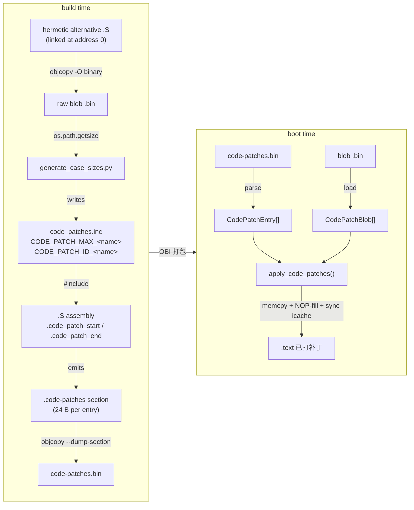
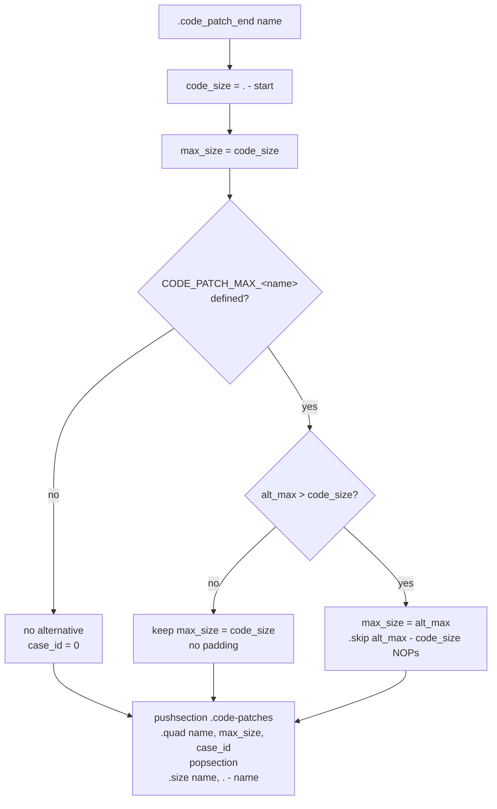
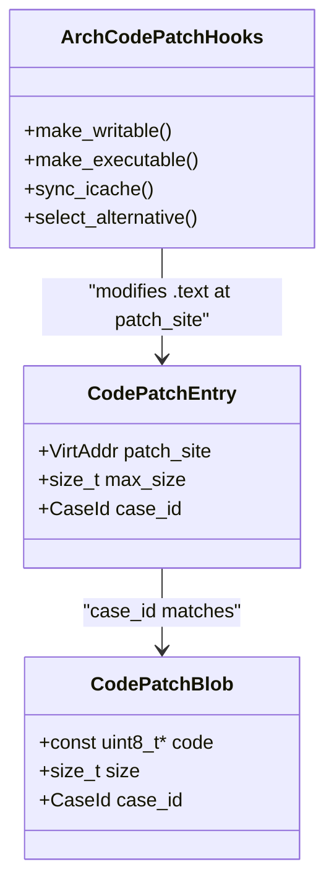
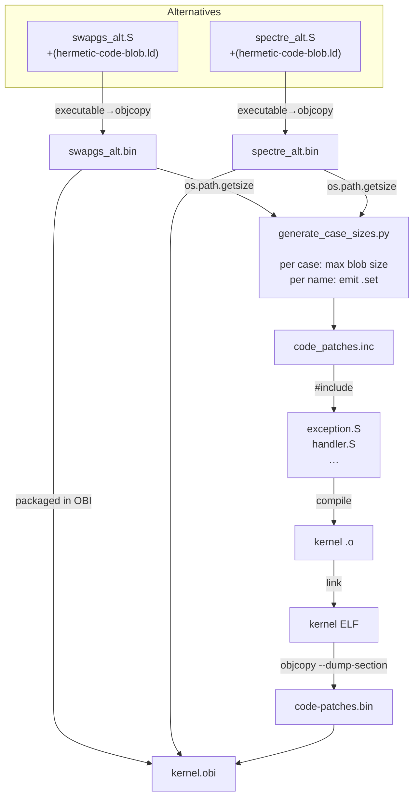

# libcode-patching

Boot-time kernel code patching.  Replace instructions at designated sites
before any patchable code executes — used for CPU erratum mitigations,
feature toggles, and security hardening that must be decided before the
kernel proper starts.

## When to use code patching

- **CPU erratum workarounds** — apply a mitigation only on affected steppings.
- **Feature dispatch** — choose a fast path when a hardware feature is present.
- **Late-bound configuration** — override a default policy at boot without indirection.

Do **not** use code patching for runtime state that changes after boot.  Use a
function pointer or `if` branch for dynamically varying behaviour.

---

## Overall flow



---

## Quick start

### 1. Mark a patch site in assembly

```asm
#include <arch/asm.hpp>
#include <lib/code_patching/asm.hpp>
#include "code_patches.inc"                 // generated — see step 3

.function my_handler, global
    .code_patch_start lfence_patch           // label + record start
    lfence
    .code_patch_end lfence_patch             // compute size, emit metadata
    ret
.end_function
```

`.code_patch_end` looks up `CODE_PATCH_MAX_lfence_patch` and
`CODE_PATCH_ID_lfence_patch` from `code_patches.inc`.  If neither
symbol is defined the site has no alternative and `case_id` defaults to
0 (runtime skips it).

### 2. Write a hermetic alternative

```asm
// swapgs_alt.S — linked as a standalone position-independent blob
#include <arch/asm.hpp>

.function swapgs_alt, global
    lfence
    ret
.end_function
```

Build it with `code_patching_hermetic_alternative`:

```gn
import("//kernel/lib/code_patching/code_patching.gni")

code_patching_hermetic_alternative("swapgs_alt") {
    sources  = [ "swapgs_alt.S" ]
    case_id  = "SWAPGS_BUG"          // groups alternatives sharing a case
    testonly = true
}
```

### 3. Generate the data header

```gn
code_patching_case_sizes("kernel_case_sizes") {
    deps = [
        ":swapgs_alt",
        ":spectre_alt",
    ]
}
```

`code_patching_case_sizes` collects all alternatives via GN metadata,
groups them by `case_id`, computes the maximum blob size per case, and
produces:

```asm
// code_patches.inc — auto-generated, do not edit
.set CODE_PATCH_MAX_swapgs_alt,    5
.set CODE_PATCH_ID_swapgs_alt,     1
.set CODE_PATCH_MAX_spectre_alt,  32
.set CODE_PATCH_ID_spectre_alt,    2
```

Add it to your kernel source set so assembly can `#include` it:

```gn
source_set("x86-kernel") {
    sources = [ "exception.S", ... ]
    deps    = [ ":kernel_case_sizes" ]   // adds $target_gen_dir to include_dirs
}
```

### 4. (Optional) Replace an entire function with a stub

When the alternative must replace a whole function, use a hermetic stub:

```gn
code_patching_hermetic_stub("swapgs_stub") {
    deps           = [ ":swapgs_alt" ]
    case_id_header = "code_patches.inc"
}
```

The generated stub reserves space for the largest alternative:

```asm
.function swapgs_stub, global
    .code_patching.blob swapgs_stub     // .skip NOP padding from CODE_PATCH_MAX_<name>
.end_function
```

### 5. Apply patches at boot

```cpp
#include <lib/code_patching/code_patching.hpp>

void early_boot_patch() {
    // These come from the OBI kernel package (code-patches.bin + alternatives).
    const auto *entries   = /* parsed code-patches metadata */;
    size_t      n_entries = /* blob_size / sizeof(CodePatchEntry) */;
    const auto *blobs     = /* loaded hermetic alternatives */;
    size_t      n_blobs   = /* … */;

    ArchCodePatchHooks hooks = {
        .make_writable      = x86_make_writable,
        .make_executable    = x86_make_executable,
        .sync_icache        = x86_sync_icache,
        .select_alternative = x86_select_alternative,
    };

    size_t n = code_patching::apply_code_patches(
        entries, n_entries, blobs, n_blobs, hooks);
    dprintf(INFO, "applied %zu code patches\n", n);
}
```

Call `apply_code_patches` **before** any patchable function executes —
typically at the end of phys kernel initialisation, right before
jumping to the kernel proper.

---

## How `.code_patch_end` decides



---

## Data structures



`CodePatchEntry` is a 24-byte record that mirrors the three `.quad`
directives the assembly macros emit.  `CodePatchBlob` is a raw
instruction stream — just a pointer and a length, no headers.

---

## Ninja dependency graph



Ninja guarantees topological order: alternatives build first, then
`generate_case_sizes.py` runs (it reads blob file sizes), then kernel
assembly compiles (it `#include`s the generated `code_patches.inc`), then
the kernel links, then `code-patches.bin` is extracted.

---

## Reference

### Assembly macros

| Macro | Parameters | Purpose |
| --- | --- | --- |
| `.code_patch_start` | `name` | Define a patchable label; record `.` |
| `.code_patch_end` | `name` | Compute code size, look up `CODE_PATCH_MAX_<name>` / `CODE_PATCH_ID_<name>`, pad with NOPs if needed, emit `.code-patches` metadata |
| `.code_patching.blob` | `name` | Hermetic stub only: emit metadata + `.skip` NOP padding from `CODE_PATCH_MAX_<name>` |

### Generated data symbols (per patch site)

| Symbol | Meaning |
| --- | --- |
| `CODE_PATCH_MAX_<name>` | Maximum bytes an alternative may occupy at this site |
| `CODE_PATCH_ID_<name>` | Numeric case identifier (absent → 0 = "no alternative") |

### GN templates

| Template | Purpose |
| --- | --- |
| `code_patches` | Extract `.code-patches` section from a linked ELF |
| `code_patching_hermetic_alternative` | Compile + link a position-independent blob |
| `code_patching_hermetic_stub` | Generate a stub function sized for alternatives |
| `code_patching_case_sizes` | Collect alternatives, generate `code_patches.inc` |

### Runtime API

| Function / type | Purpose |
| --- | --- |
| `CodePatchEntry` | 24-byte metadata: `{patch_site, max_size, case_id}` |
| `CodePatchBlob` | Raw alternative: `{code*, size, case_id}` |
| `ArchCodePatchHooks` | Arch callbacks: `make_writable`, `make_executable`, `sync_icache`, `select_alternative` |
| `apply_code_patches()` | Apply all patches; returns count |

### Size decision matrix

|  | no alternative | alt ≤ code | alt > code |
| --- | --- | --- | --- |
| `max_size` | `code_size` | `code_size` | `alt_max` |
| `.skip` NOPs? | no | no | yes (`alt - code`) |
| `case_id` | 0 | `CODE_PATCH_ID` | `CODE_PATCH_ID` |
| runtime | skipped | replace + NOP tail | replace + NOP tail |

### Architecture hooks (x86)

```cpp
static void x86_make_writable(VirtAddr, size_t) {
    write_cr0(read_cr0() & ~CR0_WP);        // disable write-protect
}
static void x86_make_executable(VirtAddr, size_t) {
    write_cr0(read_cr0() | CR0_WP);         // re-enable
}
static void x86_sync_icache(VirtAddr, size_t) {
    // x86 dcache / icache are coherent — nothing to do
}
static const CodePatchBlob *x86_select_alternative(
    CaseId id, const CodePatchBlob *blobs, size_t n) {
    switch (id) {
    case 1:  // SWAPGS_BUG
        if (!cpu_has_swapgs_bug()) return nullptr;
        break;
    default:
        return nullptr;
    }
    for (size_t i = 0; i < n; ++i)
        if (blobs[i].case_id == id) return &blobs[i];
    return nullptr;
}
```

AArch64 only differs in `sync_icache`: `__builtin___clear_cache(start, end)`.

---

## Testing

```sh
kernel/lib/code_patching/tests/run_tests.sh
```

Requires `gcc` and `binutils`.  Assembles a `.S` file exercising every
macro combination and verifies the `.code-patches` section size, ELF symbol
sizes, and metadata hex dump.
